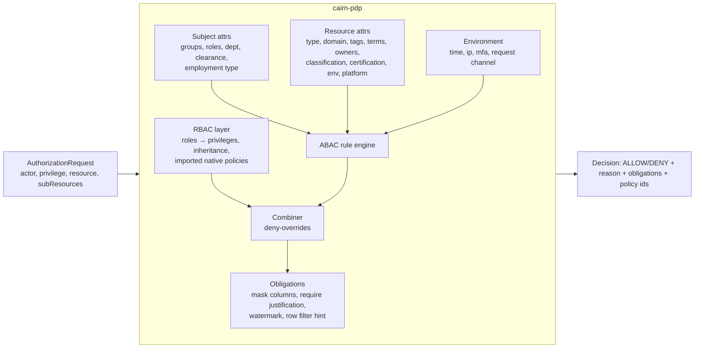
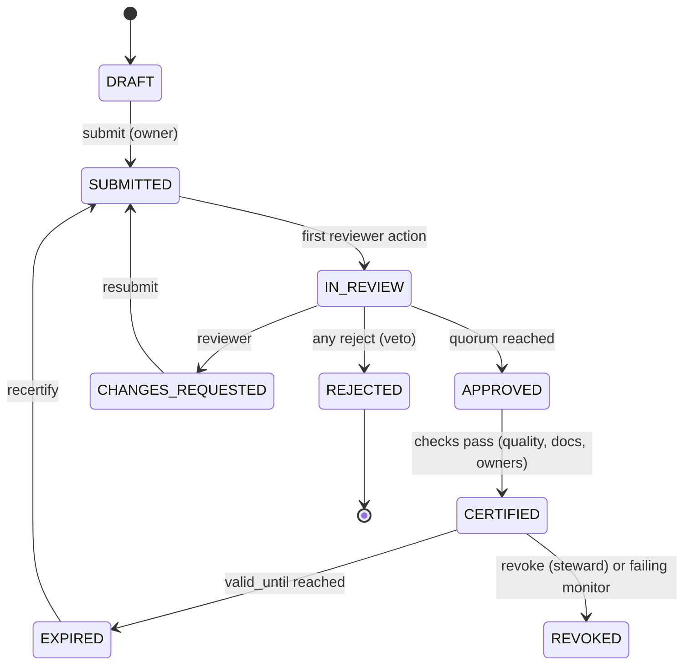

# Cairn — Architecture

> Status: v0.2 (architecture + reference implementation in this repository)

Cairn is a self-hosted active-metadata platform. **Cairn Core** is its metadata system of record: a
typed metadata graph with a versioned store, search and graph indexes, a change-log stream, GraphQL
and REST APIs, and the catalog web UI. Around it, the Cairn control plane adds four modules: native
data quality, governance (ABAC + RBAC, PII, certification), in-VPC remote ingestion agents, and AI
context and discovery. The consumer workspace, marketplace, personas and purposes, context agents,
notifications and embeds are specified in [UX_ACTIVE_METADATA_SPEC.md](UX_ACTIVE_METADATA_SPEC.md).

Every control-plane component talks to Cairn Core through its public contracts: typed aspects,
the REST/OpenAPI/GraphQL APIs, the metadata change-log topics, the authorizer plugin interface and
the ingestion sink interface. Maintainer notes on Cairn Core internals live in `core/`.

---

## Part 1 — Cairn control plane

### 1.0 System context

```mermaid
flowchart TB
  subgraph Core["Cairn Core (unmodified images)"]
    FE[cairn-web + React UI]
    Cairn Core[cairn-core]
    MAE[mae/mce consumers]
    ACT[cairn-executor]
    SQL[(MySQL/Postgres)]
    ES[(Elasticsearch/OpenSearch)]
    KAFKA[(Kafka)]
    PLUG[[CairnAuthorizer plugin .jar]]
    Cairn Core --- PLUG
  end

  subgraph Cairn["Cairn control plane (this repo)"]
    API[cairn-api<br/>FastAPI: /quality /governance /agents /ai]
    QS[cairn-quality-scheduler]
    PDP[cairn-pdp<br/>ABAC+RBAC decision point]
    GW[cairn-agent-gateway]
    MCP[cairn-mcp-server]
    WRK[cairn-actions<br/>PII propagation, vector indexer]
    PG[(cairn Postgres + pgvector)]
  end

  subgraph VPC["Customer private VPC(s)"]
    AG1[cairn-remote-agent pool=finance]
    AG2[cairn-remote-agent pool=eu-prod]
    SRC[(Snowflake / Postgres / Kafka / S3 …)]
    VAULT[(Vault / AWS SM)]
    AG1 --> SRC
    AG1 --> VAULT
  end

  LLM[(LLM: Claude API or in-VPC Ollama)]

  FE -- enterprise UI modules --> API
  PLUG -- /v1/authorize (mTLS, cached) --> PDP
  API --> PG
  QS --> PG
  QS -- assertions, run events, incidents --> Cairn Core
  QS -- metric SQL (read-only) --> SRC
  PDP -- policies, attributes --> Cairn Core
  WRK -- consume MCL --> KAFKA
  WRK --> Cairn Core
  AG1 -- outbound HTTPS only<br/>signed + encrypted --> GW
  AG2 -- outbound HTTPS only --> GW
  GW -- claimed execution requests / MCPs --> Cairn Core
  MCP --> Cairn Core
  MCP --> PDP
  MCP --> LLM
  API --> LLM
```

All Cairn services ship as **one Python package** (`cairn`) and one image with several
entry points (`cairn api`, `cairn pdp`, `cairn gateway`, `cairn scheduler`, `cairn mcp`, `cairn actions`,
`cairn agent run`). The authorizer plugin is the only JVM artifact.

**Source map (this directory):**

| Module | Code |
|---|---|
| Common | `src/cairn/common/` (config, Cairn Core client, MCP builders, DB, hash-chained audit, identity) |
| A: Quality | `src/cairn/quality/` (`detectors.py`, `collectors.py`, `engine.py`, `scheduler.py`, `emitter.py`, `api.py`) |
| B: Governance | `src/cairn/governance/` (`abac.py`, `rbac.py`, `pdp.py`, `attributes.py`, `pii.py`, `propagation_action.py`, `certification.py`, `api.py`) + `plugins/java/cairn-authorizer/` |
| C: Remote agents | `src/cairn/agent/` (`crypto.py`, `gateway.py`, `dispatcher.py`, `api.py`, `client.py`, `worker.py`, `sink.py`, `secrets.py`) |
| D: AI | `src/cairn/ai/` (`llm.py`, `embeddings.py`, `catalog.py`, `semantic.py`, `nlq.py`, `docgen.py`, `guardrails.py`, `mcp_server.py`, `indexer_action.py`, `api.py`) |
| UI | `ui/` (`@cairn/web-react-modules`: quality dashboard, monitor editor, access simulator, policy editor, certification inbox, agent fleet, Ask Cairn Core) |
| Deploy | `docker-compose.cairn.yml`, `docker/`, `deploy/`, `helm/cairn/`, `helm/cairn-remote-agent/` |

### 1.1 Cross-cutting design

| Concern | Decision |
|---|---|
| Identity | Cairn APIs accept Cairn Core personal access tokens (PATs). A token is validated once against Cairn Core `me` and cached for 60 s. Service-to-service calls use a Cairn service token, and mTLS is optional. |
| Authorization of Cairn APIs | Every Cairn endpoint calls the PDP itself, so the AI, quality and governance APIs obey the same ABAC policies as Cairn Core. |
| State | Cairn Postgres (`cairn` schema): monitors, metric history, workflow state, agents, tasks, audit log, embeddings (pgvector). SQLite is supported for tests and dev. |
| Writes to Cairn Core | Always MCPs through Cairn Core (`/aspects?action=ingestProposal`), never directly to SQL, Kafka or ES. This keeps Cairn Core validators, MCL, and indexing in the loop. |
| Audit | An append-only, **hash-chained** audit log (`sha256(prev_hash ‖ canonical_json(event))`) for decisions, approvals, agent enrolment, and LLM-generated writes. A verifier CLI detects tampering. |
| Observability | Structured JSON logs, a Prometheus `/metrics` endpoint per service, and an OpenTelemetry trace header passed through to Cairn Core. |
| Configuration | `CAIRN_*` environment variables (pydantic settings) plus YAML policy/monitor bundles, which can be managed via GitOps. |

### 1.2 Module A — Native Data Quality & Anomaly Detection

**Goal:** continuous freshness, volume, schema, and distribution monitoring with learned baselines,
running natively without Great Expectations or dbt, with results surfaced in the native Cairn Core
Quality tab and Incidents.

```mermaid
flowchart LR
  subgraph Scheduler["cairn-quality-scheduler (leader-elected)"]
    CRON[cron/interval planner] --> Q[due monitors]
  end
  Q --> COL{Collector}
  COL -- "information_schema / SQL<br/>(read-only role)" --> WH[(Warehouse)]
  COL -- "operation, datasetProfile<br/>timeseries aspects" --> Cairn Core
  COL --> MP[(metric_points)]
  MP --> DET[Detector<br/>freshness · volume · distribution · schema]
  DET --> EV[(evaluations)]
  DET -- assertionInfo + assertionRunEvent --> Cairn Core
  DET -- incidentInfo raise/resolve --> Cairn Core
  DET -- notification webhooks --> NOTIF[Slack/Teams/PagerDuty]
```

**Monitor types and detectors**

| Monitor | Signal | Detector | Notes |
|---|---|---|---|
| Freshness | Latest `operation.lastUpdatedTimestamp` from Cairn Core, or `MAX(<ts_col>)` / `information_schema.last_altered` | Learns the inter-arrival distribution of updates and flags when `now - last_update > max(p95 × k, sla)`. A fixed SLA is also supported. | Works with zero warehouse access when ingestion emits `operation` aspects |
| Volume | `COUNT(*)` / `datasetProfile.rowCount` / `information_schema.row_count` | Seasonal robust z-score: baseline = median and MAD of the same hour-of-week bucket, with a fallback to the global trailing window. Also checks absolute and percent row-count deltas. | Seasonality is learned after `min_history` points |
| Field metric | null %, distinct %, min/max/mean/stddev, string length | EWMA control band (λ = 0.3, L = 3σ) | One series per (field, metric) |
| Distribution | Histogram of a categorical or bucketed numeric field | Population Stability Index (PSI) against the reference window, plus a two-sample KS statistic for numerics | PSI > 0.2 warns, PSI > 0.3 fails, both configurable |
| Schema | `schemaMetadata` from Cairn Core | Diff of field set and types against the accepted baseline | Breaking vs non-breaking classification |
| Custom SQL | User SQL returning one number | Static threshold or any detector above | Runs only with a read-only connection role |

**Key properties**

* **Learned and static modes coexist.** Every monitor can carry a hard threshold *and* an anomaly
  sensitivity (`low|medium|high` → z = 4/3/2.5). Learned detectors stay in `TRAINING` until
  `min_history` points exist, so they never page during cold start.
* **Feedback loop.** Users can mark an anomaly as "expected". The point is then excluded from future
  baselines. Behind a feature flag, the sensitivity can also be auto-tuned.
* **Idempotent emission.** The assertion URN is `urn:li:assertion:cairn-<sha1(monitor_id)>`. Run events
  carry `runId = <monitor_id>:<scheduled_ts>`, so retries do not duplicate results.
* **Incident lifecycle.** After N consecutive failures (default 1), Cairn raises an incident linked to the
  assertion, typed from the monitor (`FRESHNESS`, `VOLUME`, `FIELD`, `SQL`, `DATA_SCHEMA`). When the monitor recovers it resolves the
  incident automatically, and it never reopens an incident a human has closed.
* **Scale-out.** The scheduler takes a Postgres advisory lock (`pg_try_advisory_lock`) for leader
  election and hands evaluations to a worker pool. Monitor IDs are hash-partitioned so several
  workers can share the load.

### 1.3 Module B — Enterprise Governance (ABAC + RBAC + PII + Certification)

#### 1.3.1 Policy Decision Point



* **Policy language.** Policies are YAML/JSON documents (`config/policies/*.yaml`) with `effect`,
  `priority`, `actions` (Cairn Core privileges, wildcards allowed), a `target` pre-filter, and a
  `condition` tree (`all`/`any`/`not`) whose leaves compare attributes with operators `eq`, `neq`,
  `in`, `not_in`, `contains`, `contains_any`, `contains_all`, `starts_with`, `matches` (RE2-safe
  subset), `gte`, `lte`, `exists`, `time_between`, `cidr`. Attribute references use JSON-pointer-like
  paths, for example `subject.attributes.clearance` or `resource.tags`. Values can point at the
  subject (`{"ref": "subject.attributes.department"}`), which enables "same department" rules.
* **Combining algorithm.** Explicit DENY beats ALLOW. Higher `priority` breaks ties for reporting.
  With no applicable rule the result is DENY in authoritative mode, and in additive mode the request
  falls through to the native authorizer.
* **RBAC.** Roles have privilege sets and `inherits` edges. Cairn Core's built-in Admin, Editor and Reader
  roles are imported, along with any active `dataHubPolicy`, which is translated into an equivalent ABAC
  rule (`actors`, then `resources.filter` criteria, then conditions). This keeps the native policy UI
  working.
* **Explainability.** `POST /v1/authorize?explain=true` returns every rule evaluated with its match
  trace. The UI "Access Simulator" uses it.
* **Performance.** Decisions are cached by `(actor, privilege, resource, attr_version)` for 30 s.
  An MCL for an entity bumps its `attr_version`, which invalidates the cache entry. The Java
  plugin keeps its own TTL cache (5 s, dependency-free) and a circuit breaker.

#### 1.3.2 PII classification and propagation

* **Classifier.** Column-name heuristics plus value-sample regexes (email, phone, SSN, credit card
  with Luhn check, IBAN, IP, and more) produce a confidence score. Above `auto_apply_threshold` it
  attaches the glossary term `urn:li:glossaryTerm:Classification.PII.<Kind>` (and optionally a
  tag). Between `suggest_threshold` and that threshold it creates a **proposal** for a human to review.
* **Propagation.** A `cairn-executor` plugin consumes MCLs for `schemaMetadata`,
  `editableSchemaMetadata`, `glossaryTerms`, and `upstreamLineage`. When a column carries a PII term,
  the planner walks **column-level lineage** (`fineGrainedLineages`) downstream up to `max_hops`.
  Transformation types listed in `blocking_transforms` (for example `HASH`, `AGGREGATE`) stop the walk.
  The term is attached with `attribution.source = urn:li:dataHubAction:cairn-pii-propagation` and a
  `sourceDetail.origin = <upstream field urn>` so it can be traced and reverted. Removing the origin
  term removes every propagated copy whose attribution points to it.
* **Loop safety.** Propagated writes carry `systemMetadata.properties.cairn_propagated=true` and are
  ignored as triggers. The planner also de-duplicates by (target field, term).

#### 1.3.3 Certification and approval workflows



* **Workflow templates** define the required reviewer groups, quorum (`n_of_m`), separation of duties
  (a requester never approves their own request), an SLA with escalation, and **entry checks**: owner
  assigned, description present, a minimum share of documented columns, no open DQ incidents, and
  passing DQ monitors.
* On `CERTIFIED`, Cairn writes the structured property `io.cairn.certification.status=CERTIFIED`
  (+ `certifiedBy`, `validUntil`) and the tag `urn:li:tag:Certified`. Both are searchable and can be
  filtered in the native UI.
* A failing critical DQ monitor can **auto-revoke** a certification (configurable), which closes the
  loop between Module A and Module B.
* AI-generated documentation (Module D) goes through the same workflow engine as a proposal of type
  `DOCUMENTATION`.

### 1.4 Module C — In-VPC Remote Ingestion Agents

**Goal:** run ingestion inside isolated networks with **outbound-only** connectivity. Source
credentials never leave the VPC, and metadata travels back **signed and end-to-end encrypted**.

```mermaid
sequenceDiagram
  autonumber
  participant Admin
  participant GW as cairn-agent-gateway (central)
  participant AG as cairn-remote-agent (in VPC)
  participant SM as VPC secret store
  participant SRC as Source system
  participant Cairn Core
  Admin->>GW: create pool "finance" → one-time enrolment token (TTL 1h)
  AG->>AG: generate Ed25519 (signing) + X25519 (encryption) keypairs
  AG->>GW: POST /agents/enroll {token, pubkeys, hostname, version}
  GW-->>AG: agent_id, gateway X25519 pubkey, pool policy
  loop every 15s
    AG->>GW: POST /agents/{id}/heartbeat (signed)
  end
  Note over GW,Cairn Core: UI/scheduler creates ExecutionRequest(executorId="finance")
  GW->>Cairn Core: claim request (dispatcher watches executorId pools)
  AG->>GW: POST /agents/{id}/tasks/poll (signed long-poll)
  GW-->>AG: task {recipe with ${secret refs}, run_id} (encrypted to agent key)
  AG->>SM: resolve ${SNOWFLAKE_PASSWORD} locally
  AG->>SRC: extract metadata
  loop per batch (≤ 1 MiB or 500 MCPs)
    AG->>GW: POST /agents/{id}/runs/{run}/batches (zstd/gzip → AES-256-GCM, signed, seq#)
    GW->>GW: verify sig, nonce, seq; decrypt; schema-validate MCPs
    GW->>Cairn Core: ingestProposal (batch)
  end
  AG->>GW: complete run {report}
  GW->>Cairn Core: dataHubExecutionRequestResult
```

**Security model**

| Threat | Control |
|---|---|
| Inbound attack surface in the VPC | Agent opens **no listening ports**. It only makes outbound HTTPS calls to one gateway hostname, which works well with egress allowlists and AWS PrivateLink/VPC endpoints. |
| Credential exfiltration | Recipes reference secrets as `${NAME}`, resolved only on the agent (env/file/Vault/AWS SM). The gateway **rejects** any task with inline credentials (secret-shaped keys must be `${}` refs). |
| MITM or a compromised TLS terminator | Application-layer E2E encryption: ephemeral X25519 ECDH → HKDF-SHA256 → AES-256-GCM, with AAD = `agent_id ‖ run_id ‖ seq`. A proxy that terminates TLS sees ciphertext only. |
| Replay / reordering | Each request carries an Ed25519 signature over `method ‖ path ‖ ts ‖ nonce ‖ sha256(body)`. Skew must be ≤ 300 s, the nonce cache has a TTL, and batch sequence numbers must increase monotonically. |
| Rogue agent writing arbitrary metadata | Pool policy restricts the **allowed platforms/URN prefixes and aspects**. The gateway validates every MCP against it before forwarding. Agents never hold a Cairn Core token. |
| Stolen agent key | Keys can be revoked per agent. Rotation re-enrols with the old key's signature. Heartbeat anomalies (new IP or ASN) raise an alert. |
| Data residency | Only metadata travels. Profiling/sampling can be disabled per pool. A pool can be pinned to a regional gateway. |

**Operational features:** pool-level concurrency limits, task leases with heartbeat extension (a crashed
agent's lease expires and the task is retried up to `max_attempts`), cancellation via the native
`dataHubExecutionRequestSignal` aspect, live log streaming (encrypted, chunked), version reporting
for fleet upgrades, and a Helm chart (`helm/cairn-remote-agent`) with a restricted PodSecurity context
and a read-only root filesystem.

### 1.5 Module D — AI-Driven Context & Agentic Discovery

```mermaid
flowchart LR
  subgraph Clients
    IDE[Claude Code / Claude Desktop / IDEs]
    CHAT[Cairn UI 'Ask Cairn Core' panel]
    BOT[Slack bot]
  end
  IDE -- MCP (stdio / streamable HTTP) --> MCPS[cairn-mcp-server]
  CHAT --> API[/ai endpoints/]
  BOT --> API
  MCPS --> TOOLS
  API --> TOOLS
  subgraph TOOLS[Tool & retrieval layer]
    NLQ[NL → search plan<br/>LLM structured output]
    SEM[Semantic search<br/>native SemanticSearchService or pgvector]
    LIN[Lineage / impact analysis]
    DQ[Quality status]
    ACC[Access check / explain]
    DOC[Doc generator → review workflow]
  end
  TOOLS --> GUARD[Guardrails<br/>PDP filter · PII redaction · audit]
  GUARD --> Cairn Core
  GUARD --> PDP[cairn-pdp]
  DOC --> LLM[(Claude API or in-VPC model)]
  NLQ --> LLM
  IDX[cairn vector indexer<br/>MCL-driven] --> PGV[(pgvector)]
  SEM --> PGV
```

* **MCP server.** Built on the official `mcp` Python SDK (`MCPServer`). It supports `stdio` and
  `streamable-http` transports and exposes these tools: `search_assets`, `semantic_search`,
  `ask_metadata` (NL → plan → execute → grounded answer), `get_asset`, `get_lineage`,
  `impact_analysis`, `get_quality_status`, `check_access`, `list_sensitive_fields`,
  `generate_documentation` (proposal only), and `list_pending_reviews`.
  Every tool call runs **as the calling user**, authenticated by PAT on HTTP or by a configured token
  on stdio, and its results are filtered by the PDP.
* **NL → structured query.** The LLM receives the user question and the catalog's facet vocabulary
  (platforms, domains, tags, terms). It returns a strictly-typed `SearchPlan` (query text, entity
  types, filters, lineage direction, sort) through **structured outputs** (`output_config.format`
  JSON schema). The plan is validated and executed against Cairn Core search, never as free-form SQL.
  A deterministic heuristic parser serves as the fallback when no LLM is configured.
* **Semantic vector search.** Entity documents (name, description, column names and descriptions,
  tags, terms, domain, owners) are rendered to text and embedded by a pluggable `EmbeddingProvider`:
  in-VPC Ollama, the local deterministic hashing model for air-gapped tests, or native Cairn Core
  semantic search. Vectors go to pgvector (HNSW, cosine). The indexer keeps them fresh from MCL
  and skips re-embedding unchanged text using a content hash.
* **Documentation generation.** The generator builds grounded context from schema, sample profiles,
  upstream lineage and its docs, popular queries, and existing glossary terms. It asks the LLM for a
  strictly-typed `DocumentationDraft` (table description, per-column descriptions, suggested
  terms, confidence, and "unknowns"). Drafts are **never written directly**. Each becomes a
  `DOCUMENTATION` proposal in the governance workflow. When approved, Cairn writes
  `editableDatasetProperties` / `editableSchemaMetadata` with attribution
  (`actor = urn:li:corpuser:cairn-ai`, `approvedBy = <reviewer>`).
* **Guardrails.** (1) Retrieval is authorization-aware: any entity the caller cannot `VIEW_ENTITY_PAGE`
  is dropped before it reaches the LLM. (2) Sample values from fields classified as PII are redacted
  before prompt assembly. (3) Every LLM call is audited (model, token counts, entities in context;
  prompts are kept only if `CAIRN_AI_AUDIT_PROMPTS=true`). (4) The LLM never receives credentials or
  raw query results.
* **LLM providers.** `anthropic` (default `claude-opus-5-5`, with adaptive thinking and server-side
  refusal fallback), or `ollama` for fully in-VPC inference. Provider and model are configurable per
  task (`CAIRN_AI_MODEL_DOCGEN`, `CAIRN_AI_MODEL_NLQ`).

### 1.6 Data model additions

Cairn keeps its operational state in its own Postgres and **projects** user-visible results into native
Cairn Core aspects, so nothing breaks if Cairn is removed:

| Cairn concept | Native Cairn Core representation |
|---|---|
| Monitor | `assertion` entity: `assertionInfo` (type FRESHNESS/VOLUME/FIELD/SQL/DATA_SCHEMA, `source.type=NATIVE`), `assertionRunEvent` timeseries |
| Anomaly incident | `incident` entity with `incidentInfo` (type from monitor, `source.type=ASSERTION_FAILURE`) |
| Certification | Structured property `io.cairn.certification.status` + tag `Certified` |
| PII classification | Glossary terms under `Classification.PII.*` with `attribution` metadata |
| Remote agent run | `dataHubExecutionRequest` (native) with `executorId=<pool>` |
| AI documentation | `editableDatasetProperties.description`, `editableSchemaMetadata` with attribution |

### 1.7 API surface (Cairn control plane)

| Method & path | Purpose |
|---|---|
| `GET/POST /quality/monitors`, `GET/PUT/DELETE /quality/monitors/{id}` | Monitor CRUD |
| `POST /quality/monitors/{id}/run` | Run now |
| `GET /quality/monitors/{id}/evaluations?limit=` | History (metric, expected band, status) |
| `POST /quality/evaluations/{id}/feedback` | Mark anomaly expected or real |
| `GET /quality/datasets/{urn}/health` | Roll-up health per dataset |
| `POST /governance/v1/authorize` (`?explain=true`) | PDP decision (also used by the Java plugin) |
| `GET/PUT /governance/policies`, `POST /governance/policies/validate` | ABAC policy bundle management |
| `POST /governance/simulate` | Access simulator |
| `POST /governance/pii/classify` | Classify a schema (+ samples) |
| `POST /governance/pii/propagation/plan` | Dry-run the propagation plan for a dataset |
| `POST /governance/workflows`, `GET /governance/workflows?state=` | Certification and doc proposals |
| `POST /governance/workflows/{id}/{submit,approve,reject,request-changes,revoke}` | Workflow transitions |
| `GET /governance/audit/verify` | Verify the audit hash chain |
| `POST /agents/pools`, `POST /agents/pools/{pool}/enrollment-tokens` | Fleet admin |
| `POST /agents/enroll`, `/agents/{id}/heartbeat`, `/agents/{id}/tasks/poll`, `/agents/{id}/runs/{run}/{batches,logs,complete}` | Agent protocol (signed) |
| `GET /agents`, `GET /agents/runs` | Fleet and run status |
| `POST /ai/ask`, `POST /ai/search/semantic`, `POST /ai/docs/generate`, `POST /ai/index/rebuild` | AI features |

### 1.8 Deployment topology

* **Local:** `docker compose -f docker-compose.cairn.yml up` brings up Cairn Core
  (core API, web, setup and executor services), Cairn Postgres+pgvector, `cairn-api`, `cairn-scheduler`, `cairn-actions`, `cairn-mcp`,
  `cairn-agent-gateway`, a demo `cairn-remote-agent`, and optionally Ollama (profile `ai-local`).
* **Kubernetes:** `helm/cairn` is an umbrella chart that deploys Cairn Core (core API, web, setup
  jobs) and the Cairn control plane, with the authorizer plugin and the workspace configuration baked
  into the Cairn Core images. `helm/cairn-remote-agent` is installed separately inside each private
  VPC cluster.

### 1.9 Failure modes

| Failure | Behaviour |
|---|---|
| PDP down | Java plugin: circuit opens and the plugin fails closed, except for privileges explicitly listed in `failOpenPrivileges` (empty by default) |
| Cairn Core down | Quality results are buffered in `metric_points`/`evaluations` with `emitted=false` and re-emitted on recovery |
| Gateway down | Agents back off exponentially (capped at 60 s). In-flight batches are spooled to a bounded local disk queue. |
| LLM down / refusal | NLQ falls back to the heuristic parser. Doc generation marks the job `FAILED` with a reason, and nothing is written. |
| Kafka lag | Propagation and indexing are eventually consistent. Consumer lag is exported as a metric. |
