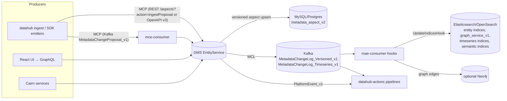
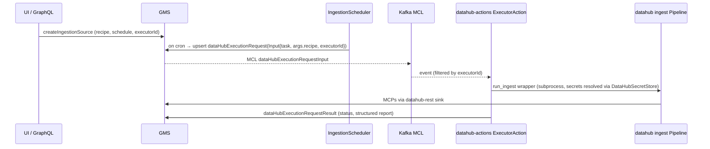
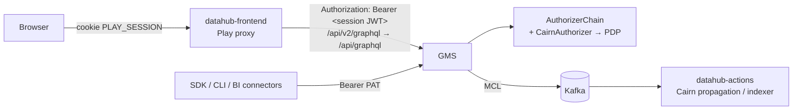

# Cairn Core — upstream maintainer notes

> Internal. Cairn Core is built from the open-source DataHub project (Apache 2.0, see
> `THIRD_PARTY_NOTICES.md`). This file maps Cairn concepts to the upstream code base for whoever
> maintains `core/` and upgrades the upstream release. It is not product documentation.

Pinned upstream release: **v1.8.0** (`core/UPSTREAM_VERSION`). Checked at HEAD: the Dockerfile's `UPSTREAM_VERSION=v1.8.0`
and `UPSTREAM_JAR_VERSION=1.8.0` agree with it, and `deploy/build-images.sh` passes both from `core/UPSTREAM_VERSION`.
The upstream images are `acryldata/datahub-gms`, `datahub-frontend-react`, `datahub-upgrade` and `datahub-actions`
(`-slim`).

---

## Cairn's patches to the pinned release

Cairn changes the upstream release at build time, in `core/`, and does not keep a fork of the engine's source.
The patches below are the complete list at HEAD, taken from `core/Dockerfile`, `core/web/`, `core/tools/` and
`core/rootfs/`.

| # | Patch | Where | What it changes |
|---|---|---|---|
| P1 | Relabelled engine archives | `core/tools/relabel.py`; Dockerfile stages `relabel-core`, `relabel-setup`, `relabel-web` | Rewrites prose strings in the GMS war, the setup jar and the frontend jar. The root account URN becomes `urn:li:corpuser:admin`; seed data (bootstrap MCPs, root policies) and default source names are relabelled. Class, method, header and config names are untouched |
| P2 | Core image | Dockerfile stage `core` | Replaces the upstream war with P1's copy (the filesystem is flattened so the image carries one copy; an overlay would add about 620 MB); adds the `cairn-env` entrypoint, the `env.d` maps, init hooks 10 and 15, and the notices file; installs the authorizer plugin under `/etc/datahub/plugins/auth/` |
| P3 | Engine defaults | Dockerfile `ENV` in stages `core`, `web`, `setup`, `executor` | Cairn's defaults: `AUTH_POLICIES_ENABLED=true`, `VIEW_AUTHORIZATION_ENABLED=true`, `DATAHUB_TELEMETRY_ENABLED=false`, `STRICT_URN_VALIDATION_ENABLED=true`, `UI_INGESTION_ENABLED=true`, `THEME_V2_DEFAULT=true`, `ELASTICSEARCH_IMPLEMENTATION=opensearch`, `REACT_APP_TITLE=Cairn`, and the Cairn logo and favicon paths |
| P4 | Setup job | Dockerfile stage `setup` | Entrypoint `SystemUpdate`. The two built-in maintenance sources (garbage collection, documents) run from pre-built venvs (`bundled`), so they work offline. Seed revisions `v8-cairn1` (garbage collection) and `v2-cairn1` (documents); a new revision re-applies the seed on existing installs |
| P5 | Web UI rebrand | `core/web/rebrand.mjs`, run by `core/web/build.sh` | Rewrites user-facing strings and translation values (never keys or GraphQL documents); points the documentation links at `/docs`; replaces the wordmark, marks, favicon, manifest and title; relabels the "Cairn Project" documentation labels; disables the product-updates panel, the welcome modal and the source-setup education modal. Each pattern must still match, so an upstream rename fails the build |
| P6 | Web UI packaging | `core/web/package.py`, `core/tools/overlay_jar.py`, Dockerfile stage `web` | Packages the UI as `web-ui-assets.jar` and overlays it onto the server's assets jar, dropping stale engine-named images; sets `links.wiki.appHelp = "/docs"` in `application.conf`; empties `user.props` so there are no sample accounts (init hook 20 writes the admin login from `CAIRN_ADMIN_PASSWORD`); ships `deploy/mfe/mfe.config.yaml` |
| P7 | Executor | Dockerfile stage `executor` | `cairn-env` and the schema-registry hook; `DATAHUB_SYSTEM_CLIENT_ID=__datahub_system` (the engine's spelling is kept) |
| P8 | Settings shim | `core/rootfs/usr/local/bin/cairn-env`, `core/rootfs/etc/cairn/env.d/*.map`, `core/rootfs/etc/cairn/init.d/` | Maps the `CAIRN_*` names (and `CAIRN_*_FILE`) onto the engine's variables; init hooks for the database URL, the schema registry and the admin login |
| P9 | Cairn's authorizer plugin | `plugins/java/cairn-authorizer` (image `cairn/authorizer`) | Not a patch to the engine: the `Authorizer` plugin the Core image loads, which calls the PDP. Built and tested by CI job `java` |

The engine's source code is not patched, and protocol identifiers keep the engine's spelling (see `core/README.md`).
The number of translation catalogues that P5 rewrites depends on the upstream source at build time, so it is not
recorded here.

**When the engine is upgraded**, re-check P1 to P8 against the new release, then the rebrand patterns (P5) and the
relabel rules (P1), which are the parts most likely to break.

---

> The analysis in Parts 1 and F below describes the upstream code as it was studied when the integration was
> designed. The repository holds no upstream source, so it was not re-checked at HEAD. The version and the patch
> list above were.

## Part 1 — DataHub Core: reverse-engineering analysis

### 1.1 Module map

| Layer | Upstream module(s) | Language | Role |
|---|---|---|---|
| Metadata model | `metadata-models/` (PDL under `src/main/pegasus/com/linkedin/**`), `metadata-models/src/main/resources/entity-registry.yml` | PDL → Java/Avro/Python/TS codegen | Schema-first definition of 72 entity types and their aspects |
| Entity registry | `entity-registry/` | Java | Loads `entity-registry.yml` + PDL annotations (`@Aspect`, `@Searchable`, `@Relationship`, `@TimeseriesField`) into `EntitySpec`/`AspectSpec` |
| GMS | `metadata-service/*` (`war`, `servlet`, `factories`, `restli-*`, `openapi-*`, `graphql-servlet-impl`, `auth-*`, `plugin`) | Java / Spring Boot | Write path (MCP ingestion), read path, Rest.li + OpenAPI v3 + GraphQL APIs, authn/authz |
| GraphQL | `datahub-graphql-core/` (`src/main/resources/*.graphql`, resolvers) | Java | The API the UI uses (`/api/graphql` on GMS, proxied as `/api/v2/graphql` by the frontend) |
| Persistence | `metadata-io/` (`entity/`, `graph/elastic`, `graph/neo4j`, `search/`, `timeseries/`) | Java | EntityService (SQL/Cassandra), search & graph indexes, timeseries indices |
| Async jobs | `metadata-jobs/{mce-consumer,mae-consumer,pe-consumer}` | Java | Kafka consumers: MCP → write, MCL → index/graph hooks, platform events |
| Hooks | `metadata-jobs/mae-consumer/.../hook/` (`UpdateIndicesHook`, `siblings`, `incident`, `assertion`, `form`, `ingestion`, `event`) | Java | `MetadataChangeLogHook` implementations that react to every committed aspect |
| Ingestion | `metadata-ingestion/` (`ingestion/api/source.py`, `ingestion/run/pipeline.py`, `ingestion/sink/*`, `executor/*`) | Python | Source → WorkUnit → Transformer → Sink pipeline; `datahub ingest` CLI; executor framework for UI-triggered runs |
| Scheduler | `ingestion-scheduler/` (`IngestionScheduler.java`) | Java | Turns `dataHubIngestionSource` cron schedules into `dataHubExecutionRequest` entities |
| Actions | `datahub-actions/` (`pipeline/`, `plugin/source/{kafka,acryl,pgqueue}`, `plugin/action/{execution,propagation,tag,term,slack,teams,…}`) | Python | Event-driven automation framework; also hosts the **executor action** that runs ingestion requests |
| Agent context | `datahub-agent-context/` (`mcp_tools/*`, `langchain_tools`, `google_adk_tools`) | Python | OSS MCP-style tool library (search, lineage, docs, assertions, incidents…) |
| Frontend | `datahub-frontend/` (Play, auth/SSO) + `datahub-web-react/` (React 17, antd 4, styled-components, Apollo 3.13) | Scala/TS | UI; consumes only GraphQL |
| Auth | `metadata-auth/auth-api` (`Authorizer`, `Authenticator` SPIs), `metadata-service/auth-impl` (`AuthorizerChain`, `DataHubAuthorizer`) | Java | Pluggable authn/authz |

### 1.2 Metadata model and how it is compiled

* **Entities are aggregates of aspects.** Each entity type declares a key aspect plus a list of aspects
  in `entity-registry.yml`. Example: `assertion` → `assertionKey`, `assertionInfo`, `assertionRunEvent`
  (timeseries), `assertionRunSummary`, `assertionActions`, `status`, `globalTags`, …
* **PDL annotations drive every downstream index.** For example:
  * `@Aspect{name, type: "timeseries"}` routes the aspect to timeseries ES indices instead of SQL.
  * `@Searchable{fieldType: KEYWORD|TEXT|URN|COUNT…}` generates ES mappings in
    `<entity>index_v2`. One instance: `ExecutionRequestInput.executorId` is `@Searchable`
    `KEYWORD`. Cairn's remote agents use this field to route work.
  * `@Relationship{name, entityTypes}` generates edges in the graph index (`graph_service_v1` in ES,
    or Neo4j). Lineage edges like `DownstreamOf`, `Consumes`, `Produces` come from here, as do
    column-level `fineGrainedLineages`.
* **Codegen.** Gradle `metadata-models` compiles PDL into Java `RecordTemplate`s and Avro schemas.
  The Avro schemas feed `metadata-events/mxe-schemas` (MCP/MCL Avro) and Python
  `datahub.metadata.schema_classes` (via `metadata-ingestion` `codegen`). The UI's TS types are
  generated from the GraphQL SDL, not from PDL.
* **Custom models without forking** are supported through `metadata-models-custom/`, a runtime-loaded
  entity-registry plugin. Cairn ships its custom aspects this way (see §2.6).

### 1.3 Write path, storage and indexing

* **SQL (`metadata_aspect_v2`)** is the system of record: one row per (urn, aspect, version), where
  version 0 holds the latest value. Optimistic locking uses `systemMetadata` / `If-Version-Match`.
* **MCL** is emitted after every commit. `UpdateIndicesHook` projects it into ES (search docs, graph
  edges, timeseries docs). For that reason Cairn treats **MCL as its change feed** and never polls SQL.
* **Search** (`metadata-io/.../search`): `SearchService`, `LineageSearchService`, and, already in OSS,
  `SemanticSearchService` with `EmbeddingProvider` implementations (Cohere, Classical/ONNX, NoOp) and
  hybrid kNN (`search/hybrid/v3`). Cairn's AI layer uses native semantic search when it is enabled and
  otherwise falls back to its own pgvector index (§2.5).
* **Graph** (`metadata-io/.../graph`): an `elastic` (default) or `neo4j` implementation behind
  `GraphService`. Lineage queries go through `LineageSearchService` (multi-hop, with filters).
* **Timeseries**: profiles (`datasetProfile`), operations (`operation`), usage, and
  `assertionRunEvent` live in per-aspect ES indices. Cairn's quality engine writes
  `assertionRunEvent` here, so assertions show up in the native UI "Quality" tab.

### 1.4 Ingestion and execution pipeline

Observations relevant to Cairn:

* `ExecutionRequestInput.executorId` already exists. The OSS `ExecutorAction` only claims requests
  whose `executorId` matches its own config (default `"default"`). **This is the seam Cairn's remote
  agents plug into.** A gateway claims requests that carry `executorId = "<pool>"` and dispatches them
  to agents in that pool.
* Secrets are normally resolved centrally (`DataHubSecretStore` → GMS-encrypted secrets). For in-VPC
  execution, Cairn resolves secrets **inside the VPC** (env, file, Vault, AWS Secrets Manager), so
  credentials never leave the customer network.
* The `Sink` plugin API (`ingestion/api/sink.py`, registry in `sink_registry.py`) lets Cairn add a
  `cairn-encrypted` sink without patching the ingestion framework.

### 1.5 Authorization internals (critical finding)

* `AuthorizerChainFactory` builds the chain from **custom authorizers first** and appends the default
  `DataHubAuthorizer` **only if** `AUTH_POLICIES_ENABLED=true`.
* `AuthorizerChain.authorize` returns **the first ALLOW** (permit-overrides) and treats exceptions as
  "skip this authorizer".
* **Consequence:** a plugin cannot *restrict* what native policies allow while both are in the chain.
  Cairn therefore supports two modes:
  * **Additive mode:** the ABAC plugin only adds grants. Native policies stay authoritative for
    denies. This is safe for gradual rollout.
  * **Authoritative mode** (recommended for regulated deployments): set `AUTH_POLICIES_ENABLED=false`
    so the Cairn `CairnAuthorizer` is the only authorizer in the chain. In Cairn this is
    `CAIRN_AUTHZ_MODE=authoritative` with `CAIRN_NATIVE_POLICIES_ENABLED=false`, which the image maps onto
    `AUTH_POLICIES_ENABLED` (the image default is `true`). The Helm overlay is `helm/cairn/values-authoritative.yaml`. The Cairn PDP imports native
    `dataHubPolicy` / `dataHubRole` entities as its RBAC layer and evaluates ABAC with
    **deny-overrides** on top. A break-glass rule always allows `urn:li:corpuser:__datahub_system`
    and configured root users. If the PDP is unreachable, the plugin **fails closed**, except for
    a configured read-only allowlist of privileges.
* Resource attributes the native resolver already computes (`EntityFieldType`: `TYPE`, `URN`, `OWNER`,
  `DOMAIN`, `TAG`, `GLOSSARY`, `CONTAINER`, `DATA_PLATFORM_INSTANCE`, `STRUCTURED_PROPERTY`,
  `GROUP_MEMBERSHIP`) are passed to the PDP by the plugin. Only the PDP has to fetch the rest
  (classification, certification state, lineage-derived PII).

### 1.6 Extension points used by Cairn

| Extension point | Upstream location | Cairn consumer |
|---|---|---|
| `Authorizer` plugin SPI + `~/.datahub/plugins/auth/config.yml` | `metadata-auth/auth-api` | `plugins/java/cairn-authorizer` → PDP |
| MCL Kafka topics | `MetadataChangeLog_Versioned_v1`, `…_Timeseries_v1` | PII propagation, vector indexer, certification invalidation |
| `datahub-actions` `Action` plugin | `datahub_actions/action/action.py` | `cairn.governance.propagation_action`, `cairn.ai.indexer_action` |
| Ingestion `Sink` plugin | `metadata-ingestion/.../sink_registry.py` | `cairn-encrypted` sink on remote agents |
| `executorId` routing | `ExecutionRequestInput.pdl` | Remote agent gateway dispatcher |
| Native assertion/incident model | `assertion/*.pdl`, `incident/*.pdl` | Quality engine emits `assertionInfo` (source `NATIVE`), `assertionRunEvent`, `incidentInfo` |
| Structured properties | `structured/*.pdl` | Certification state, data classification, clearance attributes |
| Custom entity registry | `metadata-models-custom` | `cairnMonitor` aspects (optional; Cairn also works without them) |
| OpenAPI v3 / GraphQL | `openapi-entity-servlet`, `datahub-graphql-core` | Every Cairn read/write |

---

---

## Frontend and request path (from the UX analysis)

### F.1 `datahub-web-react` today

| Aspect | Finding | Consequence for this design |
|---|---|---|
| Stack | React 17, antd 4.24, styled-components 5, Apollo Client 3.13 (GraphQL codegen), Vite 6, `@visx/*`, `reactflow` 11, in-house design system `alchemy-components` | Cairn UI uses the same React/antd/styled generation, so code can later be upstreamed or vendored |
| Shell | `AuthenticatedApp` → `ProtectedRoutes` → `SearchRoutes`; nav redesign behind `useShowNavBarRedesign`; home V2/V3 (`homeV2`, `homeV3` module templates) | DataHub keeps owning the shell, and our surfaces mount inside it |
| **Micro-frontends** | `app/mfeframework`: the host loads webpack Module-Federation remotes (`format: var`) listed in a YAML file (`MFE_CONFIG_FILE_PATH`). It calls `mount(el, {})`, adds nav entries and shares no dependencies. | **Primary integration point.** Cairn ships its consumer UI as one federated remote (`cairnConsumer/mount`) and needs no fork or rebuild of datahub-frontend |
| Embeds | `EmbedRoutes` (`/embed/<entity>/:urn`, `/embed/lookup/:url`) render entity pages without chrome, for an *authenticated session only* | Not usable inside BI tools whose viewers have no DataHub session, so Cairn adds token-scoped embeds (§5) |
| Marketplace | `app/marketplace` = Data Product browse tree + search (`getRootDataProducts`, `childDataProducts`) | It covers discovery only. Request access, subscribe, SLA cards and request status are missing, and Cairn adds them |
| Personalisation | `DataHubPersonaInfo` = *home-page persona* (technical / business user), not an access concept | Cairn "Personas" are a separate, access-oriented concept (Atlan semantics). The UI labels them "Access Personas" to avoid confusion |
| Collaboration | No bookmarks, comments/discussions, follows, view tracking or trending. Only `favoritesCount` on dashboards (ingested from BI). `NotificationSettings`/`SlackNotificationSettings` PDLs exist, but OSS ships no sender | Cairn provides collab storage, a notification hub, and Slack/Teams bots |

### F.2 GMS request path and extension points

* `datahub-frontend` forwards every UI GraphQL/REST call to `DATAHUB_GMS_HOST:DATAHUB_GMS_PORT` with the
  user's **session JWT** (HS256, claim `actorId`, signed with `DATAHUB_TOKEN_SERVICE_SIGNING_KEY`).
* GMS has **no plugin hook for response transformation**. Authorizer plugins can only allow or deny.
  Field-level masking therefore needs a component *in the response path*.
* **Decision:** add **`cairn-gms-proxy`**, a streaming reverse proxy that sits in that path (frontend →
  proxy → GMS; SDK clients can also be pointed at it). It identifies the caller locally from the JWT,
  asks the PDP for masking obligations, and rewrites only the parts of responses that carry data
  values. Everything else streams through untouched. Writes are never modified, and GMS still enforces
  authentication and authorization on every request.
* Tag/term propagation stays **event-driven on MCL**, in the GMS processing pipeline, so that writes
  from ingestion, SDKs and the UI are all caught. That is more complete than intercepting UI writes.

---

## Upgrading the pinned upstream release

Cairn Core follows upstream releases deliberately: one bump at a time, each one through this matrix
before it merges. Read the upstream release notes for breaking changes first, in particular to the
entity registry, the GraphQL schema, the `Authorizer` SPI and the setup (system-update) steps.

1. Set `core/UPSTREAM_VERSION` and rebuild every image: `deploy/build-images.sh`.
2. Run the test matrix:

| Check | Command | What it guards |
|---|---|---|
| Unit tests, lint | `pytest tests --ignore=tests/e2e`, `ruff check src tests` | Cairn's own code |
| Authorizer plugin | `plugins/java/cairn-authorizer`: `./gradlew test` (CI job `java`) | the `Authorizer` SPI and Cairn's policy bridge |
| UI | `ui`: `npx tsc --noEmit`, `npx vitest run` | the workspace UI against GraphQL types |
| White-label | `core/web/build.sh`, then `node core/tools/leak_scan.mjs <ui url>` (CI job `stack`) | no upstream names in what customers see |
| Full live suite | `tests/e2e/run.sh` on a fresh stack | every API, the remote agent, SSO, the edge |
| Upgrade from the last release | `deploy/ops/rehearse-upgrade.sh <last release tag>` | the setup job migrates existing data; no Cairn table loses rows |
| Restore | `deploy/ops/backup.sh`, then `restore.sh` on the upgraded stack | backups from the new engine restore and reindex |
| Load | `tests/load/loadtest.py` against the stack | the published limits still hold |
| Helm | `helm lint` and `helm template` with `values.yaml` and `values-ha.yaml` | chart changes the new release needs |

3. Write the release notes: the new upstream version, any setting changes, and the measured upgrade
   time from the rehearsal.
