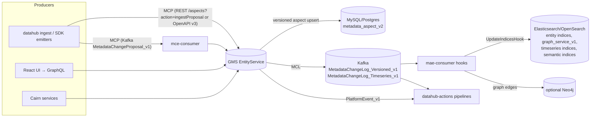
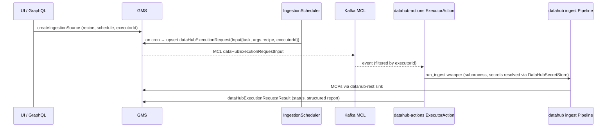
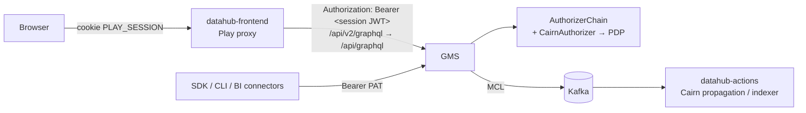

# Cairn Core — upstream maintainer notes

> Internal. Cairn Core is built from the open-source DataHub project (Apache 2.0, see
> `THIRD_PARTY_NOTICES.md`). This file maps Cairn concepts to the upstream code base for whoever
> maintains `core/` and upgrades the upstream release. It is not product documentation.

Pinned upstream release: **v1.8.0** (`core/UPSTREAM_VERSION`).

---

## Part 1 — DataHub Core: reverse-engineering analysis

### 1.1 Module map

| Layer | Upstream module(s) | Language | Role |
|---|---|---|---|
| Metadata model | `metadata-models/` (PDL under `src/main/pegasus/com/linkedin/**`), `metadata-models/src/main/resources/entity-registry.yml` | PDL → Java/Avro/Python/TS codegen | Schema-first definition of 72 entity types and their aspects |
| Entity registry | `entity-registry/` | Java | Loads `entity-registry.yml` + PDL annotations (`@Aspect`, `@Searchable`, `@Relationship`, `@TimeseriesField`) into `EntitySpec`/`AspectSpec` |
| GMS | `metadata-service/*` (`war`, `servlet`, `factories`, `restli-*`, `openapi-*`, `graphql-servlet-impl`, `auth-*`, `plugin`) | Java / Spring Boot | Write path (MCP ingestion), read path, Rest.li + OpenAPI v3 + GraphQL APIs, authn/authz |
| GraphQL | `datahub-graphql-core/` (`src/main/resources/*.graphql`, resolvers) | Java | The API the UI uses (`/api/graphql` on GMS, proxied as `/api/v2/graphql` by the frontend) |
| Persistence | `metadata-io/` (`entity/`, `graph/elastic`, `graph/neo4j`, `search/`, `timeseries/`) | Java | EntityService (SQL/Cassandra), search & graph indexes, timeseries indices |
| Async jobs | `metadata-jobs/{mce-consumer,mae-consumer,pe-consumer}` | Java | Kafka consumers: MCP → write, MCL → index/graph hooks, platform events |
| Hooks | `metadata-jobs/mae-consumer/.../hook/` (`UpdateIndicesHook`, `siblings`, `incident`, `assertion`, `form`, `ingestion`, `event`) | Java | `MetadataChangeLogHook` implementations that react to every committed aspect |
| Ingestion | `metadata-ingestion/` (`ingestion/api/source.py`, `ingestion/run/pipeline.py`, `ingestion/sink/*`, `executor/*`) | Python | Source → WorkUnit → Transformer → Sink pipeline; `datahub ingest` CLI; executor framework for UI-triggered runs |
| Scheduler | `ingestion-scheduler/` (`IngestionScheduler.java`) | Java | Turns `dataHubIngestionSource` cron schedules into `dataHubExecutionRequest` entities |
| Actions | `datahub-actions/` (`pipeline/`, `plugin/source/{kafka,acryl,pgqueue}`, `plugin/action/{execution,propagation,tag,term,slack,teams,…}`) | Python | Event-driven automation framework; also hosts the **executor action** that runs ingestion requests |
| Agent context | `datahub-agent-context/` (`mcp_tools/*`, `langchain_tools`, `google_adk_tools`) | Python | OSS MCP-style tool library (search, lineage, docs, assertions, incidents…) |
| Frontend | `datahub-frontend/` (Play, auth/SSO) + `datahub-web-react/` (React 17, antd 4, styled-components, Apollo 3.13) | Scala/TS | UI; consumes only GraphQL |
| Auth | `metadata-auth/auth-api` (`Authorizer`, `Authenticator` SPIs), `metadata-service/auth-impl` (`AuthorizerChain`, `DataHubAuthorizer`) | Java | Pluggable authn/authz |

### 1.2 Metadata model and how it is compiled

* **Entities are aggregates of aspects.** Each entity type declares a key aspect plus a list of aspects
  in `entity-registry.yml`. Example: `assertion` → `assertionKey`, `assertionInfo`, `assertionRunEvent`
  (timeseries), `assertionRunSummary`, `assertionActions`, `status`, `globalTags`, …
* **PDL annotations drive every downstream index.** For example:
  * `@Aspect{name, type: "timeseries"}` routes the aspect to timeseries ES indices instead of SQL.
  * `@Searchable{fieldType: KEYWORD|TEXT|URN|COUNT…}` generates ES mappings in
    `<entity>index_v2`. One instance: `ExecutionRequestInput.executorId` is `@Searchable`
    `KEYWORD`. Cairn's remote agents use this field to route work.
  * `@Relationship{name, entityTypes}` generates edges in the graph index (`graph_service_v1` in ES,
    or Neo4j). Lineage edges like `DownstreamOf`, `Consumes`, `Produces` come from here, as do
    column-level `fineGrainedLineages`.
* **Codegen.** Gradle `metadata-models` compiles PDL into Java `RecordTemplate`s and Avro schemas.
  The Avro schemas feed `metadata-events/mxe-schemas` (MCP/MCL Avro) and Python
  `datahub.metadata.schema_classes` (via `metadata-ingestion` `codegen`). The UI's TS types are
  generated from the GraphQL SDL, not from PDL.
* **Custom models without forking** are supported through `metadata-models-custom/`, a runtime-loaded
  entity-registry plugin. Cairn ships its custom aspects this way (see §2.6).

### 1.3 Write path, storage and indexing

* **SQL (`metadata_aspect_v2`)** is the system of record: one row per (urn, aspect, version), where
  version 0 holds the latest value. Optimistic locking uses `systemMetadata` / `If-Version-Match`.
* **MCL** is emitted after every commit. `UpdateIndicesHook` projects it into ES (search docs, graph
  edges, timeseries docs). For that reason Cairn treats **MCL as its change feed** and never polls SQL.
* **Search** (`metadata-io/.../search`): `SearchService`, `LineageSearchService`, and, already in OSS,
  `SemanticSearchService` with `EmbeddingProvider` implementations (Cohere, Classical/ONNX, NoOp) and
  hybrid kNN (`search/hybrid/v3`). Cairn's AI layer uses native semantic search when it is enabled and
  otherwise falls back to its own pgvector index (§2.5).
* **Graph** (`metadata-io/.../graph`): an `elastic` (default) or `neo4j` implementation behind
  `GraphService`. Lineage queries go through `LineageSearchService` (multi-hop, with filters).
* **Timeseries**: profiles (`datasetProfile`), operations (`operation`), usage, and
  `assertionRunEvent` live in per-aspect ES indices. Cairn's quality engine writes
  `assertionRunEvent` here, so assertions show up in the native UI "Quality" tab.

### 1.4 Ingestion and execution pipeline

Observations relevant to Cairn:

* `ExecutionRequestInput.executorId` already exists. The OSS `ExecutorAction` only claims requests
  whose `executorId` matches its own config (default `"default"`). **This is the seam Cairn's remote
  agents plug into.** A gateway claims requests that carry `executorId = "<pool>"` and dispatches them
  to agents in that pool.
* Secrets are normally resolved centrally (`DataHubSecretStore` → GMS-encrypted secrets). For in-VPC
  execution, Cairn resolves secrets **inside the VPC** (env, file, Vault, AWS Secrets Manager), so
  credentials never leave the customer network.
* The `Sink` plugin API (`ingestion/api/sink.py`, registry in `sink_registry.py`) lets Cairn add a
  `cairn-encrypted` sink without patching the ingestion framework.

### 1.5 Authorization internals (critical finding)

* `AuthorizerChainFactory` builds the chain from **custom authorizers first** and appends the default
  `DataHubAuthorizer` **only if** `AUTH_POLICIES_ENABLED=true`.
* `AuthorizerChain.authorize` returns **the first ALLOW** (permit-overrides) and treats exceptions as
  "skip this authorizer".
* **Consequence:** a plugin cannot *restrict* what native policies allow while both are in the chain.
  Cairn therefore supports two modes:
  * **Additive mode:** the ABAC plugin only adds grants. Native policies stay authoritative for
    denies. This is safe for gradual rollout.
  * **Authoritative mode** (recommended for regulated deployments): set `AUTH_POLICIES_ENABLED=false`
    so the Cairn `CairnAuthorizer` is the only authorizer in the chain. The Cairn PDP imports native
    `dataHubPolicy` / `dataHubRole` entities as its RBAC layer and evaluates ABAC with
    **deny-overrides** on top. A break-glass rule always allows `urn:li:corpuser:__datahub_system`
    and configured root users. If the PDP is unreachable, the plugin **fails closed**, except for
    a configured read-only allowlist of privileges.
* Resource attributes the native resolver already computes (`EntityFieldType`: `TYPE`, `URN`, `OWNER`,
  `DOMAIN`, `TAG`, `GLOSSARY`, `CONTAINER`, `DATA_PLATFORM_INSTANCE`, `STRUCTURED_PROPERTY`,
  `GROUP_MEMBERSHIP`) are passed to the PDP by the plugin. Only the PDP has to fetch the rest
  (classification, certification state, lineage-derived PII).

### 1.6 Extension points used by Cairn

| Extension point | Upstream location | Cairn consumer |
|---|---|---|
| `Authorizer` plugin SPI + `~/.datahub/plugins/auth/config.yml` | `metadata-auth/auth-api` | `plugins/java/cairn-authorizer` → PDP |
| MCL Kafka topics | `MetadataChangeLog_Versioned_v1`, `…_Timeseries_v1` | PII propagation, vector indexer, certification invalidation |
| `datahub-actions` `Action` plugin | `datahub_actions/action/action.py` | `cairn.governance.propagation_action`, `cairn.ai.indexer_action` |
| Ingestion `Sink` plugin | `metadata-ingestion/.../sink_registry.py` | `cairn-encrypted` sink on remote agents |
| `executorId` routing | `ExecutionRequestInput.pdl` | Remote agent gateway dispatcher |
| Native assertion/incident model | `assertion/*.pdl`, `incident/*.pdl` | Quality engine emits `assertionInfo` (source `NATIVE`), `assertionRunEvent`, `incidentInfo` |
| Structured properties | `structured/*.pdl` | Certification state, data classification, clearance attributes |
| Custom entity registry | `metadata-models-custom` | `cairnMonitor` aspects (optional; Cairn also works without them) |
| OpenAPI v3 / GraphQL | `openapi-entity-servlet`, `datahub-graphql-core` | Every Cairn read/write |

---

---

## Frontend and request path (from the UX analysis)

### F.1 `datahub-web-react` today

| Aspect | Finding | Consequence for this design |
|---|---|---|
| Stack | React 17, antd 4.24, styled-components 5, Apollo Client 3.13 (GraphQL codegen), Vite 6, `@visx/*`, `reactflow` 11, in-house design system `alchemy-components` | Cairn UI uses the same React/antd/styled generation, so code can later be upstreamed or vendored |
| Shell | `AuthenticatedApp` → `ProtectedRoutes` → `SearchRoutes`; nav redesign behind `useShowNavBarRedesign`; home V2/V3 (`homeV2`, `homeV3` module templates) | DataHub keeps owning the shell, and our surfaces mount inside it |
| **Micro-frontends** | `app/mfeframework`: the host loads webpack Module-Federation remotes (`format: var`) listed in a YAML file (`MFE_CONFIG_FILE_PATH`). It calls `mount(el, {})`, adds nav entries and shares no dependencies. | **Primary integration point.** Cairn ships its consumer UI as one federated remote (`cairnConsumer/mount`) and needs no fork or rebuild of datahub-frontend |
| Embeds | `EmbedRoutes` (`/embed/<entity>/:urn`, `/embed/lookup/:url`) render entity pages without chrome, for an *authenticated session only* | Not usable inside BI tools whose viewers have no DataHub session, so Cairn adds token-scoped embeds (§5) |
| Marketplace | `app/marketplace` = Data Product browse tree + search (`getRootDataProducts`, `childDataProducts`) | It covers discovery only. Request access, subscribe, SLA cards and request status are missing, and Cairn adds them |
| Personalisation | `DataHubPersonaInfo` = *home-page persona* (technical / business user), not an access concept | Cairn "Personas" are a separate, access-oriented concept (Atlan semantics). The UI labels them "Access Personas" to avoid confusion |
| Collaboration | No bookmarks, comments/discussions, follows, view tracking or trending. Only `favoritesCount` on dashboards (ingested from BI). `NotificationSettings`/`SlackNotificationSettings` PDLs exist, but OSS ships no sender | Cairn provides collab storage, a notification hub, and Slack/Teams bots |

### F.2 GMS request path and extension points

* `datahub-frontend` forwards every UI GraphQL/REST call to `DATAHUB_GMS_HOST:DATAHUB_GMS_PORT` with the
  user's **session JWT** (HS256, claim `actorId`, signed with `DATAHUB_TOKEN_SERVICE_SIGNING_KEY`).
* GMS has **no plugin hook for response transformation**. Authorizer plugins can only allow or deny.
  Field-level masking therefore needs a component *in the response path*.
* **Decision:** add **`cairn-gms-proxy`**, a streaming reverse proxy that sits in that path (frontend →
  proxy → GMS; SDK clients can also be pointed at it). It identifies the caller locally from the JWT,
  asks the PDP for masking obligations, and rewrites only the parts of responses that carry data
  values. Everything else streams through untouched. Writes are never modified, and GMS still enforces
  authentication and authorization on every request.
* Tag/term propagation stays **event-driven on MCL**, in the GMS processing pipeline, so that writes
  from ingestion, SDKs and the UI are all caught. That is more complete than intercepting UI writes.

