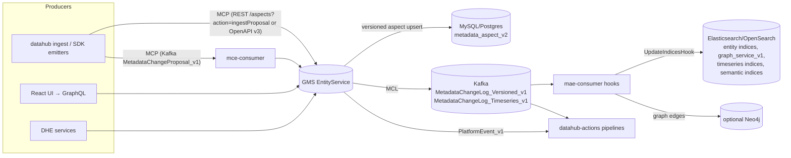
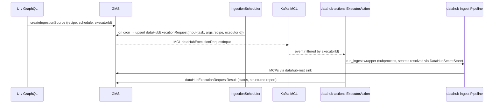
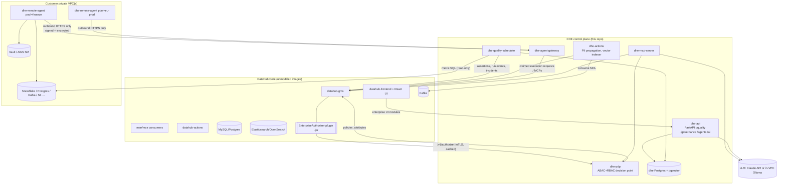
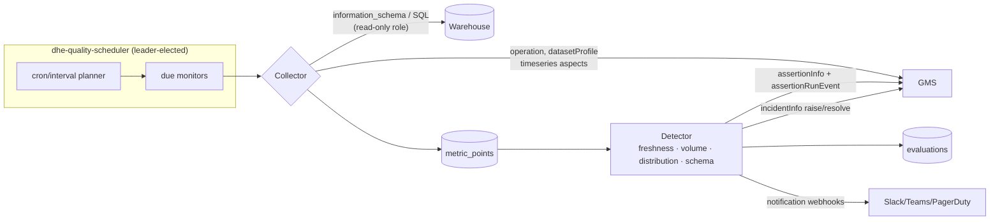
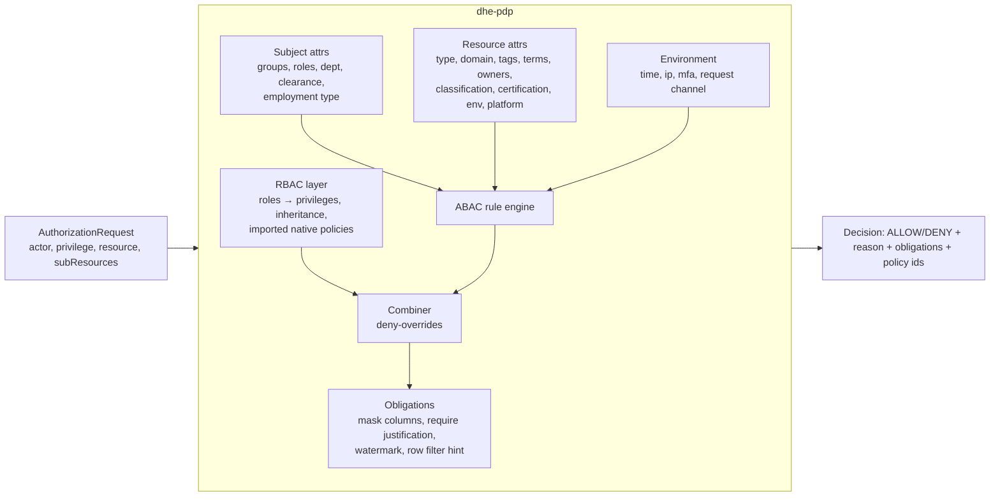
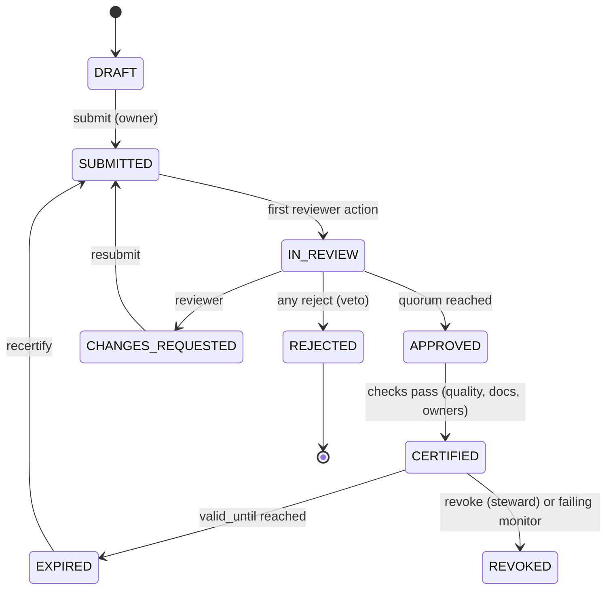
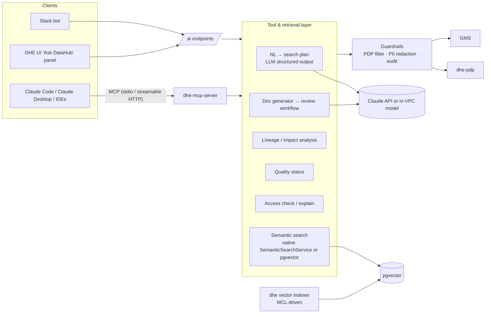

# DataHub Enterprise Extension Layer — Architecture Blueprint

> Status: v0.1 (blueprint + reference implementation in this directory)
> Upstream analysed: `datahub-project/datahub` @ `f248d163` (2026-10-23)

This document has two halves:

1. **Reverse-engineering analysis** of open-source DataHub Core: how it stores, indexes, and moves
   metadata, and the extension points it offers.
2. **The enterprise extension layer (DHE)**: four modules that add self-hosted equivalents of the
   commercial DataHub Cloud capabilities. They are built on those extension points and need **no fork**
   of DataHub Core.

The guiding constraint is **zero-fork extensibility**. Every DHE component talks to DataHub through
public contracts: PDL aspects, GMS REST/OpenAPI/GraphQL, Kafka MCL topics, the Authorizer plugin SPI,
and the `datahub-actions` / ingestion `Sink` plugin APIs. Because of this, upgrading DataHub Core stays
a version bump and never turns into a merge.

---

## Part 1 — DataHub Core: reverse-engineering analysis

### 1.1 Module map

| Layer | Upstream module(s) | Language | Role |
|---|---|---|---|
| Metadata model | `metadata-models/` (PDL under `src/main/pegasus/com/linkedin/**`), `metadata-models/src/main/resources/entity-registry.yml` | PDL → Java/Avro/Python/TS codegen | Schema-first definition of 72 entity types and their aspects |
| Entity registry | `entity-registry/` | Java | Loads `entity-registry.yml` + PDL annotations (`@Aspect`, `@Searchable`, `@Relationship`, `@TimeseriesField`) into `EntitySpec`/`AspectSpec` |
| GMS | `metadata-service/*` (`war`, `servlet`, `factories`, `restli-*`, `openapi-*`, `graphql-servlet-impl`, `auth-*`, `plugin`) | Java / Spring Boot | Write path (MCP ingestion), read path, Rest.li + OpenAPI v3 + GraphQL APIs, authn/authz |
| GraphQL | `datahub-graphql-core/` (`src/main/resources/*.graphql`, resolvers) | Java | The API the UI uses (`/api/graphql` on GMS, proxied as `/api/v2/graphql` by the frontend) |
| Persistence | `metadata-io/` (`entity/`, `graph/elastic`, `graph/neo4j`, `search/`, `timeseries/`) | Java | EntityService (SQL/Cassandra), search & graph indexes, timeseries indices |
| Async jobs | `metadata-jobs/{mce-consumer,mae-consumer,pe-consumer}` | Java | Kafka consumers: MCP → write, MCL → index/graph hooks, platform events |
| Hooks | `metadata-jobs/mae-consumer/.../hook/` (`UpdateIndicesHook`, `siblings`, `incident`, `assertion`, `form`, `ingestion`, `event`) | Java | `MetadataChangeLogHook` implementations that react to every committed aspect |
| Ingestion | `metadata-ingestion/` (`ingestion/api/source.py`, `ingestion/run/pipeline.py`, `ingestion/sink/*`, `executor/*`) | Python | Source → WorkUnit → Transformer → Sink pipeline; `datahub ingest` CLI; executor framework for UI-triggered runs |
| Scheduler | `ingestion-scheduler/` (`IngestionScheduler.java`) | Java | Turns `dataHubIngestionSource` cron schedules into `dataHubExecutionRequest` entities |
| Actions | `datahub-actions/` (`pipeline/`, `plugin/source/{kafka,acryl,pgqueue}`, `plugin/action/{execution,propagation,tag,term,slack,teams,…}`) | Python | Event-driven automation framework; also hosts the **executor action** that runs ingestion requests |
| Agent context | `datahub-agent-context/` (`mcp_tools/*`, `langchain_tools`, `google_adk_tools`) | Python | OSS MCP-style tool library (search, lineage, docs, assertions, incidents…) |
| Frontend | `datahub-frontend/` (Play, auth/SSO) + `datahub-web-react/` (React 17, antd 4, styled-components, Apollo 3.13) | Scala/TS | UI; consumes only GraphQL |
| Auth | `metadata-auth/auth-api` (`Authorizer`, `Authenticator` SPIs), `metadata-service/auth-impl` (`AuthorizerChain`, `DataHubAuthorizer`) | Java | Pluggable authn/authz |

### 1.2 Metadata model and how it is compiled

* **Entities are aggregates of aspects.** Each entity type declares a key aspect plus a list of aspects
  in `entity-registry.yml`. Example: `assertion` → `assertionKey`, `assertionInfo`, `assertionRunEvent`
  (timeseries), `assertionRunSummary`, `assertionActions`, `status`, `globalTags`, …
* **PDL annotations drive every downstream index.** For example:
  * `@Aspect{name, type: "timeseries"}` routes the aspect to timeseries ES indices instead of SQL.
  * `@Searchable{fieldType: KEYWORD|TEXT|URN|COUNT…}` generates ES mappings in
    `<entity>index_v2`. One instance: `ExecutionRequestInput.executorId` is `@Searchable`
    `KEYWORD`. DHE's remote agents use this field to route work.
  * `@Relationship{name, entityTypes}` generates edges in the graph index (`graph_service_v1` in ES,
    or Neo4j). Lineage edges like `DownstreamOf`, `Consumes`, `Produces` come from here, as do
    column-level `fineGrainedLineages`.
* **Codegen.** Gradle `metadata-models` compiles PDL into Java `RecordTemplate`s and Avro schemas.
  The Avro schemas feed `metadata-events/mxe-schemas` (MCP/MCL Avro) and Python
  `datahub.metadata.schema_classes` (via `metadata-ingestion` `codegen`). The UI's TS types are
  generated from the GraphQL SDL, not from PDL.
* **Custom models without forking** are supported through `metadata-models-custom/`, a runtime-loaded
  entity-registry plugin. DHE ships its custom aspects this way (see §2.6).

### 1.3 Write path, storage and indexing



* **SQL (`metadata_aspect_v2`)** is the system of record: one row per (urn, aspect, version), where
  version 0 holds the latest value. Optimistic locking uses `systemMetadata` / `If-Version-Match`.
* **MCL** is emitted after every commit. `UpdateIndicesHook` projects it into ES (search docs, graph
  edges, timeseries docs). For that reason DHE treats **MCL as its change feed** and never polls SQL.
* **Search** (`metadata-io/.../search`): `SearchService`, `LineageSearchService`, and, already in OSS,
  `SemanticSearchService` with `EmbeddingProvider` implementations (Cohere, Classical/ONNX, NoOp) and
  hybrid kNN (`search/hybrid/v3`). DHE's AI layer uses native semantic search when it is enabled and
  otherwise falls back to its own pgvector index (§2.5).
* **Graph** (`metadata-io/.../graph`): an `elastic` (default) or `neo4j` implementation behind
  `GraphService`. Lineage queries go through `LineageSearchService` (multi-hop, with filters).
* **Timeseries**: profiles (`datasetProfile`), operations (`operation`), usage, and
  `assertionRunEvent` live in per-aspect ES indices. DHE's quality engine writes
  `assertionRunEvent` here, so assertions show up in the native UI "Quality" tab.

### 1.4 Ingestion and execution pipeline



Observations relevant to DHE:

* `ExecutionRequestInput.executorId` already exists. The OSS `ExecutorAction` only claims requests
  whose `executorId` matches its own config (default `"default"`). **This is the seam DHE's remote
  agents plug into.** A gateway claims requests that carry `executorId = "<pool>"` and dispatches them
  to agents in that pool.
* Secrets are normally resolved centrally (`DataHubSecretStore` → GMS-encrypted secrets). For in-VPC
  execution, DHE resolves secrets **inside the VPC** (env, file, Vault, AWS Secrets Manager), so
  credentials never leave the customer network.
* The `Sink` plugin API (`ingestion/api/sink.py`, registry in `sink_registry.py`) lets DHE add a
  `dhe-encrypted` sink without patching the ingestion framework.

### 1.5 Authorization internals (critical finding)

* `AuthorizerChainFactory` builds the chain from **custom authorizers first** and appends the default
  `DataHubAuthorizer` **only if** `AUTH_POLICIES_ENABLED=true`.
* `AuthorizerChain.authorize` returns **the first ALLOW** (permit-overrides) and treats exceptions as
  "skip this authorizer".
* **Consequence:** a plugin cannot *restrict* what native policies allow while both are in the chain.
  DHE therefore supports two modes:
  * **Additive mode:** the ABAC plugin only adds grants. Native policies stay authoritative for
    denies. This is safe for gradual rollout.
  * **Authoritative mode** (recommended for regulated deployments): set `AUTH_POLICIES_ENABLED=false`
    so the DHE `EnterpriseAuthorizer` is the only authorizer in the chain. The DHE PDP imports native
    `dataHubPolicy` / `dataHubRole` entities as its RBAC layer and evaluates ABAC with
    **deny-overrides** on top. A break-glass rule always allows `urn:li:corpuser:__datahub_system`
    and configured root users. If the PDP is unreachable, the plugin **fails closed**, except for
    a configured read-only allowlist of privileges.
* Resource attributes the native resolver already computes (`EntityFieldType`: `TYPE`, `URN`, `OWNER`,
  `DOMAIN`, `TAG`, `GLOSSARY`, `CONTAINER`, `DATA_PLATFORM_INSTANCE`, `STRUCTURED_PROPERTY`,
  `GROUP_MEMBERSHIP`) are passed to the PDP by the plugin. Only the PDP has to fetch the rest
  (classification, certification state, lineage-derived PII).

### 1.6 Extension points used by DHE

| Extension point | Upstream location | DHE consumer |
|---|---|---|
| `Authorizer` plugin SPI + `~/.datahub/plugins/auth/config.yml` | `metadata-auth/auth-api` | `plugins/java/enterprise-authorizer` → PDP |
| MCL Kafka topics | `MetadataChangeLog_Versioned_v1`, `…_Timeseries_v1` | PII propagation, vector indexer, certification invalidation |
| `datahub-actions` `Action` plugin | `datahub_actions/action/action.py` | `dhe.governance.propagation_action`, `dhe.ai.indexer_action` |
| Ingestion `Sink` plugin | `metadata-ingestion/.../sink_registry.py` | `dhe-encrypted` sink on remote agents |
| `executorId` routing | `ExecutionRequestInput.pdl` | Remote agent gateway dispatcher |
| Native assertion/incident model | `assertion/*.pdl`, `incident/*.pdl` | Quality engine emits `assertionInfo` (source `NATIVE`), `assertionRunEvent`, `incidentInfo` |
| Structured properties | `structured/*.pdl` | Certification state, data classification, clearance attributes |
| Custom entity registry | `metadata-models-custom` | `dheMonitor` aspects (optional; DHE also works without them) |
| OpenAPI v3 / GraphQL | `openapi-entity-servlet`, `datahub-graphql-core` | Every DHE read/write |

---

## Part 2 — Enterprise extension layer (DHE)

### 2.0 System context



All DHE services ship as **one Python package** (`datahub_enterprise`) and one image with several
entry points (`dhe api`, `dhe pdp`, `dhe gateway`, `dhe scheduler`, `dhe mcp`, `dhe actions`,
`dhe agent run`). The authorizer plugin is the only JVM artifact.

**Source map (this directory):**

| Module | Code |
|---|---|
| Common | `src/datahub_enterprise/common/` (config, GMS client, MCP builders, DB, hash-chained audit, identity) |
| A: Quality | `src/datahub_enterprise/quality/` (`detectors.py`, `collectors.py`, `engine.py`, `scheduler.py`, `emitter.py`, `api.py`) |
| B: Governance | `src/datahub_enterprise/governance/` (`abac.py`, `rbac.py`, `pdp.py`, `attributes.py`, `pii.py`, `propagation_action.py`, `certification.py`, `api.py`) + `plugins/java/enterprise-authorizer/` |
| C: Remote agents | `src/datahub_enterprise/agent/` (`crypto.py`, `gateway.py`, `dispatcher.py`, `api.py`, `client.py`, `worker.py`, `sink.py`, `secrets.py`) |
| D: AI | `src/datahub_enterprise/ai/` (`llm.py`, `embeddings.py`, `catalog.py`, `semantic.py`, `nlq.py`, `docgen.py`, `guardrails.py`, `mcp_server.py`, `indexer_action.py`, `api.py`) |
| UI | `ui/` (`@dhe/web-react-modules`: quality dashboard, monitor editor, access simulator, policy editor, certification inbox, agent fleet, Ask DataHub) |
| Deploy | `docker-compose.enterprise.yml`, `docker/`, `deploy/`, `helm/datahub-enterprise/`, `helm/dhe-remote-agent/` |

### 2.1 Cross-cutting design

| Concern | Decision |
|---|---|
| Identity | DHE APIs accept DataHub personal access tokens (PATs). A token is validated once against GMS `me` and cached for 60 s. Service-to-service calls use a DHE service token, and mTLS is optional. |
| Authorization of DHE APIs | Every DHE endpoint calls the PDP itself, so the AI, quality and governance APIs obey the same ABAC policies as GMS. |
| State | DHE Postgres (`dhe` schema): monitors, metric history, workflow state, agents, tasks, audit log, embeddings (pgvector). SQLite is supported for tests and dev. |
| Writes to DataHub | Always MCPs through GMS (`/aspects?action=ingestProposal`), never directly to SQL, Kafka or ES. This keeps GMS validators, MCL, and indexing in the loop. |
| Audit | An append-only, **hash-chained** audit log (`sha256(prev_hash ‖ canonical_json(event))`) for decisions, approvals, agent enrolment, and LLM-generated writes. A verifier CLI detects tampering. |
| Observability | Structured JSON logs, a Prometheus `/metrics` endpoint per service, and an OpenTelemetry trace header passed through to GMS. |
| Configuration | `DHE_*` environment variables (pydantic settings) plus YAML policy/monitor bundles, which can be managed via GitOps. |

### 2.2 Module A — Native Data Quality & Anomaly Detection

**Goal:** continuous freshness, volume, schema, and distribution monitoring with learned baselines,
running natively without Great Expectations or dbt, with results surfaced in the native DataHub
Quality tab and Incidents.



**Monitor types and detectors**

| Monitor | Signal | Detector | Notes |
|---|---|---|---|
| Freshness | Latest `operation.lastUpdatedTimestamp` from DataHub, or `MAX(<ts_col>)` / `information_schema.last_altered` | Learns the inter-arrival distribution of updates and flags when `now - last_update > max(p95 × k, sla)`. A fixed SLA is also supported. | Works with zero warehouse access when ingestion emits `operation` aspects |
| Volume | `COUNT(*)` / `datasetProfile.rowCount` / `information_schema.row_count` | Seasonal robust z-score: baseline = median and MAD of the same hour-of-week bucket, with a fallback to the global trailing window. Also checks absolute and percent row-count deltas. | Seasonality is learned after `min_history` points |
| Field metric | null %, distinct %, min/max/mean/stddev, string length | EWMA control band (λ = 0.3, L = 3σ) | One series per (field, metric) |
| Distribution | Histogram of a categorical or bucketed numeric field | Population Stability Index (PSI) against the reference window, plus a two-sample KS statistic for numerics | PSI > 0.2 warns, PSI > 0.3 fails, both configurable |
| Schema | `schemaMetadata` from DataHub | Diff of field set and types against the accepted baseline | Breaking vs non-breaking classification |
| Custom SQL | User SQL returning one number | Static threshold or any detector above | Runs only with a read-only connection role |

**Key properties**

* **Learned and static modes coexist.** Every monitor can carry a hard threshold *and* an anomaly
  sensitivity (`low|medium|high` → z = 4/3/2.5). Learned detectors stay in `TRAINING` until
  `min_history` points exist, so they never page during cold start.
* **Feedback loop.** Users can mark an anomaly as "expected". The point is then excluded from future
  baselines. Behind a feature flag, the sensitivity can also be auto-tuned.
* **Idempotent emission.** The assertion URN is `urn:li:assertion:dhe-<sha1(monitor_id)>`. Run events
  carry `runId = <monitor_id>:<scheduled_ts>`, so retries do not duplicate results.
* **Incident lifecycle.** After N consecutive failures (default 1), DHE raises an incident linked to the
  assertion, typed from the monitor (`FRESHNESS`, `VOLUME`, `FIELD`, `SQL`, `DATA_SCHEMA`). When the monitor recovers it resolves the
  incident automatically, and it never reopens an incident a human has closed.
* **Scale-out.** The scheduler takes a Postgres advisory lock (`pg_try_advisory_lock`) for leader
  election and hands evaluations to a worker pool. Monitor IDs are hash-partitioned so several
  workers can share the load.

### 2.3 Module B — Enterprise Governance (ABAC + RBAC + PII + Certification)

#### 2.3.1 Policy Decision Point



* **Policy language.** Policies are YAML/JSON documents (`config/policies/*.yaml`) with `effect`,
  `priority`, `actions` (DataHub privileges, wildcards allowed), a `target` pre-filter, and a
  `condition` tree (`all`/`any`/`not`) whose leaves compare attributes with operators `eq`, `neq`,
  `in`, `not_in`, `contains`, `contains_any`, `contains_all`, `starts_with`, `matches` (RE2-safe
  subset), `gte`, `lte`, `exists`, `time_between`, `cidr`. Attribute references use JSON-pointer-like
  paths, for example `subject.attributes.clearance` or `resource.tags`. Values can point at the
  subject (`{"ref": "subject.attributes.department"}`), which enables "same department" rules.
* **Combining algorithm.** Explicit DENY beats ALLOW. Higher `priority` breaks ties for reporting.
  With no applicable rule the result is DENY in authoritative mode, and in additive mode the request
  falls through to the native authorizer.
* **RBAC.** Roles have privilege sets and `inherits` edges. DataHub's built-in Admin, Editor and Reader
  roles are imported, along with any active `dataHubPolicy`, which is translated into an equivalent ABAC
  rule (`actors`, then `resources.filter` criteria, then conditions). This keeps the native policy UI
  working.
* **Explainability.** `POST /v1/authorize?explain=true` returns every rule evaluated with its match
  trace. The UI "Access Simulator" uses it.
* **Performance.** Decisions are cached by `(actor, privilege, resource, attr_version)` for 30 s.
  An MCL for an entity bumps its `attr_version`, which invalidates the cache entry. The Java
  plugin keeps its own TTL cache (5 s, dependency-free) and a circuit breaker.

#### 2.3.2 PII classification and propagation

* **Classifier.** Column-name heuristics plus value-sample regexes (email, phone, SSN, credit card
  with Luhn check, IBAN, IP, and more) produce a confidence score. Above `auto_apply_threshold` it
  attaches the glossary term `urn:li:glossaryTerm:Classification.PII.<Kind>` (and optionally a
  tag). Between `suggest_threshold` and that threshold it creates a **proposal** for a human to review.
* **Propagation.** A `datahub-actions` plugin consumes MCLs for `schemaMetadata`,
  `editableSchemaMetadata`, `glossaryTerms`, and `upstreamLineage`. When a column carries a PII term,
  the planner walks **column-level lineage** (`fineGrainedLineages`) downstream up to `max_hops`.
  Transformation types listed in `blocking_transforms` (for example `HASH`, `AGGREGATE`) stop the walk.
  The term is attached with `attribution.source = urn:li:dataHubAction:dhe-pii-propagation` and a
  `sourceDetail.origin = <upstream field urn>` so it can be traced and reverted. Removing the origin
  term removes every propagated copy whose attribution points to it.
* **Loop safety.** Propagated writes carry `systemMetadata.properties.dhe_propagated=true` and are
  ignored as triggers. The planner also de-duplicates by (target field, term).

#### 2.3.3 Certification and approval workflows



* **Workflow templates** define the required reviewer groups, quorum (`n_of_m`), separation of duties
  (a requester never approves their own request), an SLA with escalation, and **entry checks**: owner
  assigned, description present, a minimum share of documented columns, no open DQ incidents, and
  passing DQ monitors.
* On `CERTIFIED`, DHE writes the structured property `io.dhe.certification.status=CERTIFIED`
  (+ `certifiedBy`, `validUntil`) and the tag `urn:li:tag:Certified`. Both are searchable and can be
  filtered in the native UI.
* A failing critical DQ monitor can **auto-revoke** a certification (configurable), which closes the
  loop between Module A and Module B.
* AI-generated documentation (Module D) goes through the same workflow engine as a proposal of type
  `DOCUMENTATION`.

### 2.4 Module C — In-VPC Remote Ingestion Agents

**Goal:** run ingestion inside isolated networks with **outbound-only** connectivity. Source
credentials never leave the VPC, and metadata travels back **signed and end-to-end encrypted**.

```mermaid
sequenceDiagram
  autonumber
  participant Admin
  participant GW as dhe-agent-gateway (central)
  participant AG as dhe-remote-agent (in VPC)
  participant SM as VPC secret store
  participant SRC as Source system
  participant GMS
  Admin->>GW: create pool "finance" → one-time enrolment token (TTL 1h)
  AG->>AG: generate Ed25519 (signing) + X25519 (encryption) keypairs
  AG->>GW: POST /agents/enroll {token, pubkeys, hostname, version}
  GW-->>AG: agent_id, gateway X25519 pubkey, pool policy
  loop every 15s
    AG->>GW: POST /agents/{id}/heartbeat (signed)
  end
  Note over GW,GMS: UI/scheduler creates ExecutionRequest(executorId="finance")
  GW->>GMS: claim request (dispatcher watches executorId pools)
  AG->>GW: POST /agents/{id}/tasks/poll (signed long-poll)
  GW-->>AG: task {recipe with ${secret refs}, run_id} (encrypted to agent key)
  AG->>SM: resolve ${SNOWFLAKE_PASSWORD} locally
  AG->>SRC: extract metadata
  loop per batch (≤ 1 MiB or 500 MCPs)
    AG->>GW: POST /agents/{id}/runs/{run}/batches (zstd/gzip → AES-256-GCM, signed, seq#)
    GW->>GW: verify sig, nonce, seq; decrypt; schema-validate MCPs
    GW->>GMS: ingestProposal (batch)
  end
  AG->>GW: complete run {report}
  GW->>GMS: dataHubExecutionRequestResult
```

**Security model**

| Threat | Control |
|---|---|
| Inbound attack surface in the VPC | Agent opens **no listening ports**. It only makes outbound HTTPS calls to one gateway hostname, which works well with egress allowlists and AWS PrivateLink/VPC endpoints. |
| Credential exfiltration | Recipes reference secrets as `${NAME}`, resolved only on the agent (env/file/Vault/AWS SM). The gateway **rejects** any task with inline credentials (secret-shaped keys must be `${}` refs). |
| MITM or a compromised TLS terminator | Application-layer E2E encryption: ephemeral X25519 ECDH → HKDF-SHA256 → AES-256-GCM, with AAD = `agent_id ‖ run_id ‖ seq`. A proxy that terminates TLS sees ciphertext only. |
| Replay / reordering | Each request carries an Ed25519 signature over `method ‖ path ‖ ts ‖ nonce ‖ sha256(body)`. Skew must be ≤ 300 s, the nonce cache has a TTL, and batch sequence numbers must increase monotonically. |
| Rogue agent writing arbitrary metadata | Pool policy restricts the **allowed platforms/URN prefixes and aspects**. The gateway validates every MCP against it before forwarding. Agents never hold a GMS token. |
| Stolen agent key | Keys can be revoked per agent. Rotation re-enrols with the old key's signature. Heartbeat anomalies (new IP or ASN) raise an alert. |
| Data residency | Only metadata travels. Profiling/sampling can be disabled per pool. A pool can be pinned to a regional gateway. |

**Operational features:** pool-level concurrency limits, task leases with heartbeat extension (a crashed
agent's lease expires and the task is retried up to `max_attempts`), cancellation via the native
`dataHubExecutionRequestSignal` aspect, live log streaming (encrypted, chunked), version reporting
for fleet upgrades, and a Helm chart (`helm/dhe-remote-agent`) with a restricted PodSecurity context
and a read-only root filesystem.

### 2.5 Module D — AI-Driven Context & Agentic Discovery



* **MCP server.** Built on the official `mcp` Python SDK (`MCPServer`). It supports `stdio` and
  `streamable-http` transports and exposes these tools: `search_assets`, `semantic_search`,
  `ask_metadata` (NL → plan → execute → grounded answer), `get_asset`, `get_lineage`,
  `impact_analysis`, `get_quality_status`, `check_access`, `list_sensitive_fields`,
  `generate_documentation` (proposal only), and `list_pending_reviews`.
  Every tool call runs **as the calling user**, authenticated by PAT on HTTP or by a configured token
  on stdio, and its results are filtered by the PDP.
* **NL → structured query.** The LLM receives the user question and the catalog's facet vocabulary
  (platforms, domains, tags, terms). It returns a strictly-typed `SearchPlan` (query text, entity
  types, filters, lineage direction, sort) through **structured outputs** (`output_config.format`
  JSON schema). The plan is validated and executed against GMS search, never as free-form SQL.
  A deterministic heuristic parser serves as the fallback when no LLM is configured.
* **Semantic vector search.** Entity documents (name, description, column names and descriptions,
  tags, terms, domain, owners) are rendered to text and embedded by a pluggable `EmbeddingProvider`:
  in-VPC Ollama, the local deterministic hashing model for air-gapped tests, or native DataHub
  semantic search. Vectors go to pgvector (HNSW, cosine). The indexer keeps them fresh from MCL
  and skips re-embedding unchanged text using a content hash.
* **Documentation generation.** The generator builds grounded context from schema, sample profiles,
  upstream lineage and its docs, popular queries, and existing glossary terms. It asks the LLM for a
  strictly-typed `DocumentationDraft` (table description, per-column descriptions, suggested
  terms, confidence, and "unknowns"). Drafts are **never written directly**. Each becomes a
  `DOCUMENTATION` proposal in the governance workflow. When approved, DHE writes
  `editableDatasetProperties` / `editableSchemaMetadata` with attribution
  (`actor = urn:li:corpuser:dhe-ai`, `approvedBy = <reviewer>`).
* **Guardrails.** (1) Retrieval is authorization-aware: any entity the caller cannot `VIEW_ENTITY_PAGE`
  is dropped before it reaches the LLM. (2) Sample values from fields classified as PII are redacted
  before prompt assembly. (3) Every LLM call is audited (model, token counts, entities in context;
  prompts are kept only if `DHE_AI_AUDIT_PROMPTS=true`). (4) The LLM never receives credentials or
  raw query results.
* **LLM providers.** `anthropic` (default `claude-opus-5-5`, with adaptive thinking and server-side
  refusal fallback), or `ollama` for fully in-VPC inference. Provider and model are configurable per
  task (`DHE_AI_MODEL_DOCGEN`, `DHE_AI_MODEL_NLQ`).

### 2.6 Data model additions

DHE keeps its operational state in its own Postgres and **projects** user-visible results into native
DataHub aspects, so nothing breaks if DHE is removed:

| DHE concept | Native DataHub representation |
|---|---|
| Monitor | `assertion` entity: `assertionInfo` (type FRESHNESS/VOLUME/FIELD/SQL/DATA_SCHEMA, `source.type=NATIVE`), `assertionRunEvent` timeseries |
| Anomaly incident | `incident` entity with `incidentInfo` (type from monitor, `source.type=ASSERTION_FAILURE`) |
| Certification | Structured property `io.dhe.certification.status` + tag `Certified` |
| PII classification | Glossary terms under `Classification.PII.*` with `attribution` metadata |
| Remote agent run | `dataHubExecutionRequest` (native) with `executorId=<pool>` |
| AI documentation | `editableDatasetProperties.description`, `editableSchemaMetadata` with attribution |

### 2.7 API surface (DHE control plane)

| Method & path | Purpose |
|---|---|
| `GET/POST /quality/monitors`, `GET/PUT/DELETE /quality/monitors/{id}` | Monitor CRUD |
| `POST /quality/monitors/{id}/run` | Run now |
| `GET /quality/monitors/{id}/evaluations?limit=` | History (metric, expected band, status) |
| `POST /quality/evaluations/{id}/feedback` | Mark anomaly expected or real |
| `GET /quality/datasets/{urn}/health` | Roll-up health per dataset |
| `POST /governance/v1/authorize` (`?explain=true`) | PDP decision (also used by the Java plugin) |
| `GET/PUT /governance/policies`, `POST /governance/policies/validate` | ABAC policy bundle management |
| `POST /governance/simulate` | Access simulator |
| `POST /governance/pii/classify` | Classify a schema (+ samples) |
| `POST /governance/pii/propagation/plan` | Dry-run the propagation plan for a dataset |
| `POST /governance/workflows`, `GET /governance/workflows?state=` | Certification and doc proposals |
| `POST /governance/workflows/{id}/{submit,approve,reject,request-changes,revoke}` | Workflow transitions |
| `GET /governance/audit/verify` | Verify the audit hash chain |
| `POST /agents/pools`, `POST /agents/pools/{pool}/enrollment-tokens` | Fleet admin |
| `POST /agents/enroll`, `/agents/{id}/heartbeat`, `/agents/{id}/tasks/poll`, `/agents/{id}/runs/{run}/{batches,logs,complete}` | Agent protocol (signed) |
| `GET /agents`, `GET /agents/runs` | Fleet and run status |
| `POST /ai/ask`, `POST /ai/search/semantic`, `POST /ai/docs/generate`, `POST /ai/index/rebuild` | AI features |

### 2.8 Deployment topology

* **Local:** `docker compose -f docker-compose.enterprise.yml up` brings up the DataHub core
  quickstart services, DHE Postgres+pgvector, `dhe-api`, `dhe-scheduler`, `dhe-actions`, `dhe-mcp`,
  `dhe-agent-gateway`, a demo `dhe-remote-agent`, and optionally Ollama (profile `ai-local`).
* **Kubernetes:** `helm/datahub-enterprise` is an umbrella chart that depends on the official
  `datahub` chart (`helm.datahubproject.io`) and adds the DHE deployments, a ConfigMap with the
  authorizer `config.yml`, and an init container that drops the plugin jar into
  `/etc/datahub/plugins/auth/`. `helm/dhe-remote-agent` is installed separately inside each private
  VPC cluster.

### 2.9 Failure modes

| Failure | Behaviour |
|---|---|
| PDP down | Java plugin: circuit opens and the plugin fails closed, except for privileges explicitly listed in `failOpenPrivileges` (empty by default) |
| GMS down | Quality results are buffered in `metric_points`/`evaluations` with `emitted=false` and re-emitted on recovery |
| Gateway down | Agents back off exponentially (capped at 60 s). In-flight batches are spooled to a bounded local disk queue. |
| LLM down / refusal | NLQ falls back to the heuristic parser. Doc generation marks the job `FAILED` with a reason, and nothing is written. |
| Kafka lag | Propagation and indexing are eventually consistent. Lag is exported as a metric (reusing `datahub_actions.observability.kafka_lag_monitor`). |
