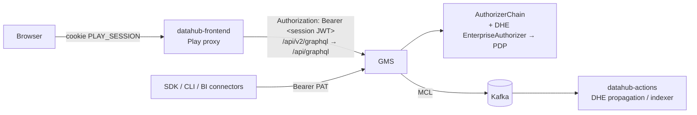
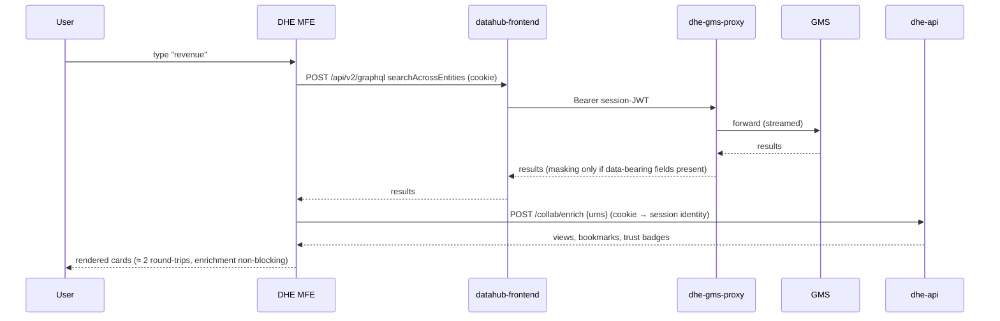
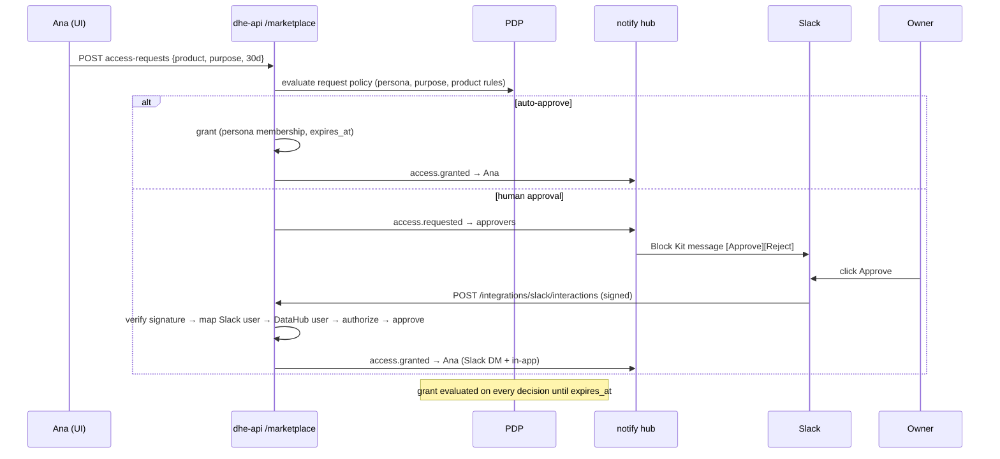

# Active Metadata & AI Context Layer: UX and Feature Architecture

> Status: v0.2 blueprint + reference implementation · Upstream analysed: `datahub-project/datahub` @ `f248d163`
> Builds on the DHE control plane described in [ARCHITECTURE_ENTERPRISE.md](ARCHITECTURE_ENTERPRISE.md).

The goal is to turn DataHub from an engineering metadata store into a **consumer-grade, collaboration-first
data platform** that analysts, product managers, compliance officers and executives use daily. This
covers the capabilities where DataHub trails Atlan, plus a few beyond it, and it **does not fork
DataHub**.

---

## Part 1: Analysis of the current frontend and GMS

### 1.1 `datahub-web-react` today

| Aspect | Finding | Consequence for this design |
|---|---|---|
| Stack | React 17, antd 4.24, styled-components 5, Apollo Client 3.13 (GraphQL codegen), Vite 6, `@visx/*`, `reactflow` 11, in-house design system `alchemy-components` | DHE UI uses the same React/antd/styled generation, so code can later be upstreamed or vendored |
| Shell | `AuthenticatedApp` → `ProtectedRoutes` → `SearchRoutes`; nav redesign behind `useShowNavBarRedesign`; home V2/V3 (`homeV2`, `homeV3` module templates) | DataHub keeps owning the shell, and our surfaces mount inside it |
| **Micro-frontends** | `app/mfeframework`: the host loads webpack Module-Federation remotes (`format: var`) listed in a YAML file (`MFE_CONFIG_FILE_PATH`). It calls `mount(el, {})`, adds nav entries and shares no dependencies. | **Primary integration point.** DHE ships its consumer UI as one federated remote (`dheConsumer/mount`) and needs no fork or rebuild of datahub-frontend |
| Embeds | `EmbedRoutes` (`/embed/<entity>/:urn`, `/embed/lookup/:url`) render entity pages without chrome, for an *authenticated session only* | Not usable inside BI tools whose viewers have no DataHub session, so DHE adds token-scoped embeds (§5) |
| Marketplace | `app/marketplace` = Data Product browse tree + search (`getRootDataProducts`, `childDataProducts`) | It covers discovery only. Request access, subscribe, SLA cards and request status are missing, and DHE adds them |
| Personalisation | `DataHubPersonaInfo` = *home-page persona* (technical / business user), not an access concept | DHE "Personas" are a separate, access-oriented concept (Atlan semantics). The UI labels them "Access Personas" to avoid confusion |
| Collaboration | No bookmarks, comments/discussions, follows, view tracking or trending. Only `favoritesCount` on dashboards (ingested from BI). `NotificationSettings`/`SlackNotificationSettings` PDLs exist, but OSS ships no sender | DHE provides collab storage, a notification hub, and Slack/Teams bots |

### 1.2 GMS request path and extension points



* `datahub-frontend` forwards every UI GraphQL/REST call to `DATAHUB_GMS_HOST:DATAHUB_GMS_PORT` with the
  user's **session JWT** (HS256, claim `actorId`, signed with `DATAHUB_TOKEN_SERVICE_SIGNING_KEY`).
* GMS has **no plugin hook for response transformation**. Authorizer plugins can only allow or deny.
  Field-level masking therefore needs a component *in the response path*.
* **Decision:** add **`dhe-gms-proxy`**, a streaming reverse proxy that sits in that path (frontend →
  proxy → GMS; SDK clients can also be pointed at it). It identifies the caller locally from the JWT,
  asks the PDP for masking obligations, and rewrites only the parts of responses that carry data
  values. Everything else streams through untouched. Writes are never modified, and GMS still enforces
  authentication and authorization on every request.
* Tag/term propagation stays **event-driven on MCL**, in the GMS processing pipeline, so that writes
  from ingestion, SDKs and the UI are all caught. That is more complete than intercepting UI writes.

### 1.3 Capability gap: DataHub OSS vs Atlan vs DHE v0.2

| Capability | DataHub OSS | Atlan | DHE v0.2 (this spec) |
|---|---|---|---|
| Consumer discovery home (trending, recents, bookmarks) | partial (recommendations) | ✅ | ✅ Discovery Portal |
| Inline discussions / @mentions on assets & columns | ❌ | ✅ | ✅ threads, reactions, mentions → notifications |
| Data marketplace with **ticket-free access requests** | browse only | ✅ | ✅ request → policy-driven auto/human approval → time-boxed grant → auto-expiry |
| Personas (role-scoped permissions) | roles/policies (engineer-oriented) | ✅ | ✅ business-language Persona builder compiled to ABAC |
| Purposes (tag-scoped compliance, deny wins) | ❌ | ✅ | ✅ purpose rules: deny/mask by tag; strict deny-overrides |
| Dynamic masking | ❌ | ✅ (via connectors) | ✅ metadata-plane masking in `dhe-gms-proxy` (samples, profiles, query text) |
| Tag propagation | ❌ (term propagation via actions in Cloud) | ✅ | ✅ rule-based tag + term propagation over column lineage |
| Context mining (queries/dbt/BI/runs) | ❌ | partial | ✅ Context Agents: term stitching, metric-definition drift, doc staleness, join graph, living ontology |
| Conversational AI over metadata | Ask DataHub (Cloud) | ✅ | ✅ tool-using assistant, markdown docs, plain-English lineage-anomaly explanations |
| Slack/Teams with in-chat actions | Cloud only | ✅ | ✅ Block Kit buttons (approve/reject/ack), Teams Adaptive Cards + signed one-click links |
| Embeds in BI tools for users without DataHub sessions | ❌ | ✅ (Chrome ext.) | ✅ token-scoped web components + iframe pages, BI URL → asset lookup |

---

## Part 2: UX principles and user personas

**Principles**

1. **Answer first, metadata second.** Every asset page opens with a business summary card: what the
   asset is, whether it can be trusted, who owns it and how to get access. Schema and lineage follow
   below.
2. **Zero-ticket workflows.** Every "ask someone" moment (access, certification, docs fix,
   deprecation) becomes an in-product request. It is routed to the right approver in their Slack or
   Teams and closed with one click.
3. **Trust is visible everywhere.** Certification, quality status and freshness appear as the same
   compact badges on every card, row, embed and chat answer.
4. **Progressive disclosure.** Business users see plain language ("Contains personal data, masked for
   you"). Engineers can expand to the exact policy, rule and lineage path.
5. **Fast by default.** Search results are p95 < 300 ms server time. Interactions use optimistic UI.
   Every page has a skeleton state, and nothing blocks on AI.
6. **Accessible.** WCAG 2.1 AA, full keyboard navigation (`/` focuses search, `j/k` moves through
   results, `b` bookmarks), visible focus, and colour never the only signal.

**User personas (design targets)**

| Persona | Primary jobs | Primary surfaces |
|---|---|---|
| Ana, business analyst | find trusted data, understand a metric, get access fast | Discovery Portal, Marketplace, Assistant |
| Priya, product manager | answer "where does this KPI come from", follow key products | Assistant, Lineage explain, Follow/Subscribe, Slack digests |
| Chen, compliance officer | verify PII is controlled, audit who can see what | Persona & Purpose Studio, Access Explorer, audit |
| Emeka, data engineer / steward | curate, certify, approve, act on drift | Context Inbox, Review Inbox, Slack actions |
| Eli, executive | glance at trust in dashboards they already use | BI embeds (quality badge, lineage) |

---

## Part 3: Information architecture

```
DataHub shell (left nav, owned by DataHub)
└── "Workspace" (MFE: dheConsumer/mount, route prefix /dhe)
    ├── /dhe/discover            Discovery Portal (home)        ← default landing for business users
    ├── /dhe/search?q=&f.*       Faceted search
    ├── /dhe/asset/:urn          Consumer asset view (summary · discussion · quality · lineage · access)
    ├── /dhe/marketplace         Data Product Marketplace
    │   └── /dhe/marketplace/:urn  Product detail + Request Access
    ├── /dhe/requests            My requests · Approvals inbox (access + certification + docs)
    ├── /dhe/assistant           Assistant (full page; also a global slide-over on every page)
    ├── /dhe/context             Context Inbox (findings) · Ontology explorer
    ├── /dhe/governance          Persona & Purpose Studio · Access Explorer
    └── /dhe/settings            Notifications (Slack/Teams/email) · Embeds (snippet builder)
Existing DHE admin pages (quality, policies, agents) stay under /enterprise/* (v0.1 modules).
```

---

## Part 4: Component hierarchy and wireframes

### 4.1 Discovery Portal (`/dhe/discover`)

```
┌──────────────────────────────────────────────────────────────────────────────────────┐
│  Good morning, Ana                                    [Persona: Finance Analysts ▾]   │
│  ┌────────────────────────────────────────────────────────────────────────────────┐  │
│  │ 🔍  Search datasets, dashboards, metrics… or ask a question          ⌘K  [Ask] │  │
│  └────────────────────────────────────────────────────────────────────────────────┘  │
│  Quick filters:  (Certified) (My domain: Finance) (Updated today) (Has PII)           │
│                                                                                      │
│  Trending in Finance ───────────────────────────────────────────── [See all →]       │
│  ┌──────────────┐ ┌──────────────┐ ┌──────────────┐ ┌──────────────┐                 │
│  │▲ orders      │ │★ revenue_kpi │ │ churn_scores │ │ NEW invoices │                 │
│  │ snowflake    │ │ looker dash  │ │ dbt model    │ │ postgres     │                 │
│  │ ✔Certified ● │ │ ✔ ● Healthy  │ │ ⚠ Warn       │ │ ○ Untested   │                 │
│  │ 128 views ·☆ │ │ 96 views · ★ │ │ 54 views · ☆ │ │ 12 views · ☆ │                 │
│  └──────────────┘ └──────────────┘ └──────────────┘ └──────────────┘                 │
│  Your bookmarks (5)          │  Recently viewed           │  Featured data products  │
│  • revenue_kpi   ✔ ●         │  • orders · 2h ago         │  [Customer 360]  ✔       │
│  • customers     ✔ ● PII     │  • payments · yesterday    │  [Finance Ledger] ✔      │
│  Activity you follow: "💬 Chen commented on customers.email" · "⚠ DQ incident: orders" │
└──────────────────────────────────────────────────────────────────────────────────────┘
```

Component tree:

```
DiscoverPage
├── GreetingHeader (persona switcher → ActivePersonaContext)
├── OmniSearchBar            (typeahead: entities + "Ask the assistant" row; ⌘K / "/")
├── QuickFilterChips         (→ navigates to /dhe/search with preset facets)
├── TrendingCarousel → AssetCard[]   (TrustBadges, BookmarkToggle, trend marker)
├── BookmarksPanel → AssetRow[]
├── RecentlyViewedPanel → AssetRow[]
├── FeaturedProducts → ProductCard[]
└── FollowFeed → ActivityItem[]
```

### 4.2 Faceted search (`/dhe/search`)

```
┌ Search: "revenue" ───────────────────────────────────────────── 42 results · 120 ms ┐
│ FACETS               │ ┌───────────────────────────────────────────────────────────┐ │
│ Type     ☑Dataset 31 │ │ ▸ revenue_daily  snowflake · Finance   ✔Certified ●Healthy│ │
│          ☐Dashboard 8│ │   "Daily recognised revenue by country…"   👁 230  💬 3  ☆ │ │
│ Platform ☐snowflake  │ ├───────────────────────────────────────────────────────────┤ │
│ Domain   ☑Finance    │ │ ▸ revenue_kpi   looker dashboard          ✔  ●             │ │
│ Trust    ☐Certified  │ │   "Exec revenue KPI board"                 👁 96   💬 0  ★ │ │
│ Quality  ☐Healthy    │ └───────────────────────────────────────────────────────────┘ │
│ Sensitivity ☐PII     │  Active: [Finance ×] [Dataset ×]   Sort: Relevance ▾          │
│ Owner    (search…)   │  j/k move · enter open · b bookmark                            │
└──────────────────────┴─────────────────────────────────────────────────────────────┘
```

* The query and facets live in the URL (`?q=revenue&f.domain=urn:li:domain:finance&f.type=DATASET`).
  The page is shareable and back/forward work.
* Search goes directly to DataHub GraphQL (`searchAcrossEntities` with `orFilters` and aggregations),
  same-origin with the session cookie. DHE enriches results with trust and engagement data in **one
  batch call**: `POST /collab/enrich {urns}` → views, bookmarks, quality, certification.

### 4.3 Consumer asset view (`/dhe/asset/:urn`)

```
┌ customers  postgres · Finance · Data product: Customer 360 ────────────────────────────┐
│ ✔ Certified by Emeka (valid to Mar 2027)  ● Quality: Healthy  ⏱ Fresh 12 min  🔒 PII   │
│ [☆ Bookmark] [🔔 Follow] [Request access] [Open in DataHub ↗] [Ask about this asset]   │
├──────────────────────────────────────────────────────────────────────────────────────┤
│ Summary  │ Columns │ Discussion (3) │ Quality │ Lineage │ Access                        │
│──────────                                                                            │
│ What it is: Customer master data, one row per customer…    (AI-assisted ✎ Suggest edit)│
│ Owners: Emeka (Technical), Finance Data (Business)                                    │
│ Business terms: Customer, Active Customer (mined from 42 queries, ✔ confirmed)        │
│ Used by: revenue_kpi (Looker), churn_model (dbt) …                                    │
│ Columns ─ email  VARCHAR  🔒PII.Email  "masked for you (Purpose: GDPR Personal Data)" │
└──────────────────────────────────────────────────────────────────────────────────────┘
```

`DiscussionTab → ThreadList → Thread → Comment (markdown, @mention autocomplete, reactions)`. A column
pill opens a thread scoped to that column (`field_path`).

### 4.4 Marketplace and ticket-free access

```
┌ Data Marketplace ───────────────────────────────────── [Search products…] ───────────┐
│ Domain ▾  Certified ☑  Access: (All) (Mine) (Requestable)       Sort: Most used ▾    │
│ ┌─────────────────────────┐ ┌─────────────────────────┐ ┌─────────────────────────┐ │
│ │ Customer 360        ✔   │ │ Finance Ledger      ✔   │ │ Web Analytics           │ │
│ │ Finance · 12 assets     │ │ Finance · 4 assets      │ │ Marketing · 7 assets    │ │
│ │ ● Healthy  SLA 99.5%    │ │ ● Healthy  fresh hourly │ │ ⚠ 1 incident            │ │
│ │ 38 consumers            │ │ 12 consumers            │ │ 51 consumers            │ │
│ │ [✓ Access granted]      │ │ [Request access]        │ │ [⏳ Pending · 2h]        │ │
│ └─────────────────────────┘ └─────────────────────────┘ └─────────────────────────┘ │
└──────────────────────────────────────────────────────────────────────────────────────┘

Request access (drawer, 3 steps, ≤ 30 seconds)
 ① Purpose      (•) Financial reporting  ( ) Fraud analytics  ( ) Other…
 ② Duration     ( ) 7 days  (•) 30 days  ( ) 90 days           max allowed: 90
 ③ Justification [ Quarterly close reconciliation for EMEA ……… ]
 Preview: "Auto-approved: you are in Finance Analysts and the purpose is pre-approved"  or
          "Routed to Finance Data owners (median approval 2h) · you'll be notified in Slack"
                                                       [Cancel]  [Submit request]
```

State machine: `PENDING → APPROVED (auto | human) → ACTIVE → EXPIRED | REVOKED`, and `PENDING →
REJECTED | CANCELLED`. A grant is a **time-boxed persona membership** (`grant_id`, `expires_at`)
evaluated by the PDP, so nobody has to edit a policy. Expiry is enforced by the PDP clock and also
swept by a background job that notifies the user.

### 4.5 Persona & Purpose Studio (`/dhe/governance`)

```
┌ Personas ────────────────────────────┬ Persona: Finance Analysts ────────────────────────┐
│ ● Finance Analysts     214 members   │ Who        groups: Finance, FP&A · rule: dept = "Finance" │
│ ● Marketing            98 members    │ What       domains: Finance · products: Customer 360       │
│ ● Data Stewards        12 members    │ Can        ☑ View  ☑ Request access  ☑ Comment             │
│ [+ New persona]                      │            ☐ Edit docs  ☐ Certify   ☐ View samples         │
│──────────────────────────────────────│ Preview    214 people · 1,240 assets in scope [See list]   │
│ Purposes                             │────────────────────────────────────────────────────────────│
│ 🔒 GDPR Personal Data  tags: PII.*   │ Purpose: GDPR Personal Data                                 │
│ 🔒 PCI Cardholder      tags: PCI     │ Applies to assets tagged  PII, PII.*                        │
│ [+ New purpose]                      │ Allowed for  persona Data Stewards, group DPO               │
│                                      │ Everyone else  ⛔ view samples & profiles · 🎭 mask (partial) │
│                                      │ Deny always wins over persona grants. [Simulate as user…]   │
└──────────────────────────────────────┴────────────────────────────────────────────────────┘
```

Personas and purposes compile into ABAC policies in the existing PDP (§6.2). Business users never
see the condition DSL, although an "Advanced: view generated policy" toggle shows it.

### 4.6 Assistant (global slide-over + `/dhe/assistant`)

```
┌ Assistant ─────────────────────────────────────────────────── [⤢] [×] ┐
│ You: why did revenue_kpi drop yesterday?                               │
│ ⚙ explained lineage for revenue_kpi · 3 upstream checks                │
│ Assistant: Most likely cause: **orders** volume fell 92% at 02:00      │
│ (DQ incident #12, still open). revenue_daily and revenue_kpi depend    │
│ on it within 2 hops. No schema changes upstream. [orders] [incident]   │
│ Suggested: [Follow orders] [Notify owners] [Open lineage]              │
│ ┌──────────────────────────────────────────────────────────────────┐   │
│ │ Ask about data, metrics, lineage…                         [Send] │   │
│ └──────────────────────────────────────────────────────────────────┘   │
└────────────────────────────────────────────────────────────────────────┘
```

### 4.7 Context Inbox (`/dhe/context`)

Finding cards are grouped by type. Each card carries a confidence meter, evidence snippets (SQL, dbt,
BI) and one-click **Accept** (emits the proposed metadata), **Dismiss** or **Open in review**. The
ontology explorer is a force-directed graph (`reactflow`) of terms ↔ columns ↔ metrics ↔ join keys,
filtered by domain.

### 4.8 Embeds (BI tools / portals)

```
<dhe-asset-card urn="…" token="…"></dhe-asset-card>     compact trust card (certification, quality, owners)
<dhe-quality-badge urn="…" token="…"></dhe-quality-badge> ● Healthy · 12 min fresh
<dhe-lineage urn="…" token="…" depth="2"></dhe-lineage>   upstream/downstream mini-graph
iframe: /dhe/api/embed/v1/frame/lineage?urn=…&token=…     for Tableau extensions / Power BI web content / Looker
```

---

## Part 5: State management and data flow

| State class | Owner | Mechanism |
|---|---|---|
| URL state (query, facets, tabs, selected asset) | router | `react-router` search params, the single source of truth for search |
| DataHub server state (search, entity) | DataHub GraphQL | `fetch` to `/api/v2/graphql` via a typed `gql()` helper. Separate from the host's Apollo cache, because MFEs share no dependencies. |
| DHE server state (collab, marketplace, context, governance) | DHE API | `DheClient` + `useDheQuery` (stale-while-revalidate cache keyed by path, dedupe, `invalidate(prefix)`) |
| Optimistic mutations | UI | bookmark/follow/reaction/comment are applied locally, reconciled on response, rolled back on error with a toast |
| Session context | `DheProvider` | current user (`/me`), active persona, feature flags (`/ui/config`) |
| Real-time hints | polling | 30 s polling of `/collab/inbox/count` and `/marketplace/access-requests?inbox` (SSE upgrade on the roadmap) |



**Access request flow**



---

## Part 6: Backend architecture

### 6.1 New services and modules

| Component | Entry point | Responsibility |
|---|---|---|
| `datahub_enterprise.collab` | `dhe api` (router `/collab`) | bookmarks, follows, views, trending, threads/comments/reactions/mentions, enrichment |
| `datahub_enterprise.marketplace` | `dhe api` (`/marketplace`) | product catalog view, request policies, access requests, grants, subscriptions, expiry sweeper |
| `datahub_enterprise.governance.personas` | `dhe api` / `dhe pdp` (`/governance/personas`, `/purposes`) | persona/purpose CRUD, compiler → ABAC, preview |
| `datahub_enterprise.gmsproxy` | **`dhe gms-proxy`** | identity from session JWT/PAT, masking obligations, response rewriting (GraphQL + OpenAPI), audit |
| `datahub_enterprise.governance.propagation_rules` | `dhe actions` | rule-based tag/term propagation over column lineage (generalises v0.1 PII propagation) |
| `datahub_enterprise.context` | **`dhe context-miner`** | Context Agents: mining queries, dbt, BI and runs → findings, drift, ontology |
| `datahub_enterprise.ai.assistant` / `lineage_explainer` | `dhe api` (`/ai/chat`, `/ai/explain/lineage`, `/ai/docs/markdown`) | tool-using conversational assistant, anomaly explanations, markdown docs |
| `datahub_enterprise.notify` | `dhe api` (`/notify`, `/integrations/*`) + **`dhe notifier`** | event bus → Slack/Teams/email/webhooks, Slack interactivity, signed action links, digests |
| `datahub_enterprise.embed` | `dhe api` (`/embed/v1`) | embed tokens, card/quality/lineage JSON, iframe pages, BI URL lookup, web-component SDK |

### 6.2 Personas and Purposes: compilation semantics

* **Persona** = *who* (users, groups, attribute rules such as `department = Finance`) × *where* (scope:
  domains, data products, platforms, tags, terms, explicit assets) × *can* (business permission
  bundles). It compiles into one `allow` policy per persona with `priority = 10`:
  * `actions` = union of the permission bundles. For example, `edit_docs` →
    `EDIT_ENTITY_DOCS, EDIT_DATASET_COL_DESCRIPTION`, and `view_samples` → `VIEW_DATASET_PROFILE`.
  * `condition` = all(member-of, in-scope).
  * Time-boxed **grants** from access requests add members with `expires_at`. They compile to
    `environment.now_ms < expires_at` conditions, so expiry needs no sweep to take effect.
* **Purpose** = *data tagged X* (tags/terms/classification labels, including prefix wildcards like
  `PII.*`) × *allowed for* (users, groups, personas) × *rules* for everyone else: `deny` (action
  groups) or `mask` (strategy). It compiles into:
  * a `deny` policy, `priority = 1000`, for the restricted actions where `subject ∉ allowed ∧
    resource has tag`. Deny-overrides makes it strictly stronger than any persona grant;
  * an `allow`+`obligation` policy that attaches `mask_columns {classification, strategy}` for
    non-allowed subjects viewing in-scope assets.
* Compiled personas and purposes form a **separate layer** in the PDP alongside the admin policy
  bundle, RBAC and native policies, and they recompile on every change. Every compiled policy is
  traceable to its source (`persona:<id>`, `purpose:<id>`) in explain traces.

### 6.3 `dhe-gms-proxy`: masking semantics

* **Identity:**
  * A session or PAT JWT is verified locally (HS256 with the DataHub signing key), and its `actorId`
    gives the caller.
  * If the key isn't configured, the identity comes from GMS `me` (cached for 60 s).
  * A request without a token is forwarded untouched; GMS rejects it if auth is required.
* **What is masked:** only *data values* that live in metadata:
  * `sampleValues`, `min`/`max`/`mean`/`median`/`stdev`, `distinctValueFrequencies`, `quantiles` and
    `histogram` inside field profiles;
  * literal values inside SQL in `statement.value` / `query` (literals become `?`);
  * for strategy `null`, column descriptions that contain PII patterns.

  Schema, names and lineage are never masked, because hiding them breaks discovery without
  protecting data.
* **Strategies:**
  * `redact` → `"••••"`;
  * `partial` → keep the first/last characters (`j•••@•••.com`);
  * `hash` → `sha256:` + 12 hex characters (stable and joinable);
  * `null` → `null`.
* **Scope:** a field is masked when its column (or the whole dataset) carries a classification
  matched by a purpose and the caller holds a `mask_columns` obligation for it. Field-to-dataset
  attribution comes from the enclosing JSON object that holds `urn` (GraphQL) or from the URL
  (OpenAPI).
* **Performance:** the proxy buffers and rewrites only JSON responses whose body contains a trigger
  key (`fieldProfiles`, `sampleValues`, `statement`, `datasetProfile`). Everything else streams.
  Decisions and resource attributes are cached through the PDP's own caches.
* **Response headers:** `X-DHE-Masked: <n>` and `X-DHE-Masking-Policies: purpose:gdpr` for UI
  affordances such as "masked for you".

### 6.4 Context Agents (`dhe context-miner`)

| Agent | Inputs | Output finding types |
|---|---|---|
| **Query miner** | `query` entities (`queryProperties.statement`, `querySubjects`), `datasetUsageStatistics.topSqlQueries` | `METRIC_DEFINITION` (alias ← expression, e.g. `revenue := SUM(amount_cents)/100`), `JOIN_RELATIONSHIP` (join keys between datasets with frequency), `TERM_LINK` (alias/term ↔ column) |
| **dbt miner** | dbt-platform datasets (`datasetProperties` description/customProperties, `upstreamLineage`, siblings) | `TERM_SUGGESTION` from model/column descriptions, `METRIC_DEFINITION` from model SQL |
| **BI miner** | `chartInfo`/`dashboardInfo`, `inputFields`, `semanticModel` / `metric` entities | `METRIC_DEFINITION` per BI metric, `TERM_LINK` for BI field labels |
| **Run miner** | `dataProcessInstanceRunEvent` (dbt/Airflow runs) | `RUN_ANOMALY` (failure streaks, duration regressions; feeds lineage explanations) |
| **Drift detector** | all `METRIC_DEFINITION` findings + glossary term definitions | `DEFINITION_DRIFT` (same business name, materially different normalised expressions across sources) |
| **Doc staleness** | `schemaMetadata` vs `editableSchemaMetadata` timestamps and field sets | `DOC_STALENESS` (columns documented before a breaking schema change, undocumented new columns) |
| **Ontology builder** | glossary + accepted findings + join graph | living ontology graph (`/context/ontology`), with accepted links emitted as `glossaryTerms` and `glossaryRelatedTerms` |

* SQL parsing uses `sqlglot` (the parser DataHub itself uses) with dialect detection from the platform.
* The miner is incremental: each source has a cursor (last `lastModified`), and findings are
  de-duplicated by a stable fingerprint, so re-mining never spams the inbox.
* Accepting a finding emits MCPs (e.g. glossary term association with `attribution.source =
  urn:li:dataHubAction:dhe-context-agent`) or creates a review workflow for higher-impact changes.

### 6.5 Notification hub and chat-ops

* Producers (marketplace, workflows, quality engine, discussions, context miner) call
  `notify.publish(Event{type, actor, entity_urn, recipients | audience, payload})`. Events are
  persisted (`dhe_notifications`) and fanned out by `dhe notifier` (or inline for small installs).
* **Event types:**
  * `access.requested|granted|rejected|expiring|revoked`
  * `certification.requested|decided`
  * `asset.deprecated`
  * `quality.incident.raised|resolved`
  * `discussion.mention|reply`
  * `context.drift`
* **Routing:**
  * per-user settings (Slack DM, Teams, email, in-app);
  * per-asset followers;
  * owners (from `ownership`);
  * channel routes per domain (e.g. `#finance-data`).
* **Slack:**
  * Messages use the Bot API (`chat.postMessage`) with Block Kit, and buttons carry the signed
    action id.
  * Interactions arrive at `/integrations/slack/interactions`. They are verified with the Slack
    signing secret (`v0=HMAC-SHA256(v0:ts:body)`, |skew| ≤ 300 s), the Slack user is mapped to a
    DataHub user via email, the action is authorized through the PDP, executed, and the message is
    updated in place.
  * The slash command `/datahub <search|ask> …` is also supported.
* **Teams:** Adaptive Cards via incoming webhooks (Workflows). Actions use **signed one-click
  links**: an HMAC token over (action, object, recipient, expiry), single-use, which opens a
  confirmation page in DHE and requires a DataHub login. Teams therefore needs no bot registration.
* **Email** is the same rendered digest via SMTP (optional).

### 6.6 Embeds

* `POST /embed/v1/tokens` is called by a logged-in user or service with
  `{urn | lookup_url, scopes, ttl ≤ 30 d, audience_origin}`. It returns a compact signed token
  (HMAC-SHA256, claims: `sub`, `urns`, `scopes`, `aud`, `exp`, `jti`).
* Embed endpoints are **read-only and minimal**: name, owners, certification, quality status,
  freshness, and lineage limited to depth ≤ 3 *restricted to the token's subject view*. The token
  records the minting user, and lineage nodes that user cannot view are collapsed into "N hidden".
* Pages are served with `Content-Security-Policy: frame-ancestors <allowlist>`. The allowlist is
  configured per deployment, e.g. `https://*.looker.com https://*.tableau.com https://app.powerbi.com`.
* Integrations:
  * **Looker**: a custom visualization or extension that loads the SDK.
  * **Tableau**: a dashboard extension (`.trex` manifest shipped in `embeds/tableau/`).
  * **Power BI**: a "Web content" tile with the iframe URL.
  * **Portals**: the web component. A BI URL resolves to an asset through
    `/embed/v1/lookup?url=` (matches `externalUrl`).

### 6.7 API contract (new endpoints)

All endpoints are under the DHE API base (`/dhe/api` via the edge). Identity comes from a session
cookie, a DataHub PAT or the service token. Every response that lists assets is filtered by
`VIEW_ENTITY_PAGE`.

```
# Collaboration
GET    /collab/bookmarks                         → [{urn, note, created_at}]
PUT    /collab/bookmarks/{urn}   {note?}         DELETE /collab/bookmarks/{urn}
GET    /collab/follows                           PUT/DELETE /collab/follows/{urn}
POST   /collab/views             {urn}           GET /collab/recent?limit=
GET    /collab/trending?entity_type=&domain=&limit=   → [TrendingItem]
POST   /collab/enrich            {urns:[...]}    → {urn: {views_7d, bookmarks, bookmarked, following, threads_open,
                                                         certification, quality_status}}
GET    /collab/threads?entity_urn=               → [Thread]
POST   /collab/threads           {entity_urn, field_path?, body_md}
POST   /collab/threads/{id}/comments {body_md}   POST /collab/threads/{id}/{resolve|reopen}
POST   /collab/comments/{id}/reactions {emoji}   DELETE same (toggle)
GET    /collab/activity?limit=                   → [ActivityItem]  (feed of followed assets, mentions)
# Marketplace
GET    /marketplace/products?q=&domain=&certified=&access=&sort=   → [ProductCard]
GET    /marketplace/products/{urn}               → ProductDetail
PUT    /marketplace/products/{urn}/policy        RequestPolicy (owners/admin)
POST   /marketplace/access-requests  {product_urn, purpose, justification, duration_days}
GET    /marketplace/access-requests?scope=mine|inbox&state=
POST   /marketplace/access-requests/{id}/{approve|reject|cancel|revoke} {comment?}
POST   /marketplace/products/{urn}/subscription  DELETE same
# Personas & purposes
GET/POST /governance/personas                    GET/PUT/DELETE /governance/personas/{id}
POST   /governance/personas/{id}/preview         → {members_count, sample_members, assets_in_scope, sample_assets}
GET/POST /governance/purposes                    GET/PUT/DELETE /governance/purposes/{id}
GET    /governance/personas/permission-bundles   → {bundle: [privileges]}
# Context
GET    /context/findings?type=&status=&entity_urn=   → [Finding]
POST   /context/findings/{id}/{accept|dismiss}   GET /context/ontology?domain=&limit=   GET /context/status
# AI
POST   /ai/chat              {conversation_id?, message}  → {conversation_id, reply_md, citations, tool_calls, suggested_actions}
POST   /ai/explain/lineage   {urn}                → {summary_md, likely_causes:[...], timeline:[...], used_llm}
POST   /ai/docs/markdown     {urn}                → {markdown, workflow_id}
# Notifications & integrations
GET/PUT /notify/settings                         GET /notify/inbox?unread=   POST /notify/inbox/read {ids}
GET/PUT /notify/routes (admin)                   POST /notify/test {channel}
POST   /integrations/slack/interactions          POST /integrations/slack/commands   (Slack-signed)
GET    /notify/actions/{token}  → confirm page;  POST /notify/actions/{token} → execute (requires login)
# Embeds
POST   /embed/v1/tokens  {urn|lookup_url, scopes, ttl_seconds, audience_origin}
GET    /embed/v1/assets/{urn}   /embed/v1/quality/{urn}   /embed/v1/lineage/{urn}?depth=   (token)
GET    /embed/v1/lookup?url=    /embed/v1/frame/{card|quality|lineage}?urn=&token=   /embed/v1/sdk.js
# UI bootstrap
GET    /ui/config   → {features, user, personas_active, slack_enabled, teams_enabled, embed_allowed_origins}
```

---

## Part 7: Data model (DHE Postgres)

| Table | Key columns |
|---|---|
| `dhe_bookmarks` | actor, urn, note, created_at (PK actor+urn) |
| `dhe_follows` | actor, urn, created_at |
| `dhe_views` | id, actor, urn, ts_ms (indexed urn+ts) → trending = Σ views·e^(−Δt/τ), τ = 3 d, + 3 × bookmarks + unique-viewer boost |
| `dhe_threads` / `dhe_comments` / `dhe_reactions` | thread(entity_urn, field_path, status), comment(body_md, mentions JSON), reaction(comment_id, actor, emoji) |
| `dhe_personas` / `dhe_purposes` | id, doc JSON, version, updated_by |
| `dhe_persona_grants` | id, persona_id, actor, source (access_request id), expires_at_ms, revoked |
| `dhe_product_policies` | product_urn, doc JSON (auto-approve rules, approvers, max_duration, purposes) |
| `dhe_access_requests` | id, product_urn, requester, purpose, justification, duration_days, state, decided_by, history JSON, grant_id |
| `dhe_subscriptions` | actor, product_urn, events JSON |
| `dhe_context_findings` | id, fingerprint (unique), type, status, confidence, doc JSON, entities JSON |
| `dhe_context_cursors` | source, cursor |
| `dhe_conversations` | id, actor, messages JSON (redacted), updated_at |
| `dhe_notifications` | id, type, recipient, channel, payload JSON, status, created_at, read_at |
| `dhe_notify_settings` / `dhe_notify_routes` | per-user settings; domain → channel routes |
| `dhe_action_tokens` | jti, used_at (single-use enforcement for signed links and embed revocation) |

Durable, user-visible results are still **projected into DataHub** where a native home exists: glossary
links, certification, docs and tags. DHE tables hold engagement, workflow and conversation state that
DataHub has no model for.

---

## Part 8: Deployment

* **New processes** (same `dhe/datahub-enterprise` image):
  * `dhe gms-proxy --port 8890`;
  * `dhe context-miner`;
  * `dhe notifier`.
* **UI artifacts:**
  * `dhe/consumer-ui` image (nginx, non-root) serving `remoteEntry.js` (Module Federation remote
    `dheConsumer`, exposed `./mount`), `embed/sdk.js` (web components) and the Tableau `.trex`
    manifest;
  * an `mfe.config.yaml` mounted into datahub-frontend via `MFE_CONFIG_FILE_PATH`.
* **Wiring changes:**
  * datahub-frontend gets `DATAHUB_GMS_HOST=dhe-gms-proxy`, `DATAHUB_GMS_PORT=8890` (masking
    middleware in path);
  * `dhe-gms-proxy` gets `DATAHUB_TOKEN_SERVICE_SIGNING_KEY` (read-only use) and upstream
    `datahub-gms:8080`.
  * The proxy is stateless and horizontally scalable. If it fails, the UI stops working, so it runs
    with ≥ 2 replicas, a PDB and readiness on the upstream health.
* **Secrets:** `DHE_SLACK_BOT_TOKEN`, `DHE_SLACK_SIGNING_SECRET`, `DHE_ACTION_LINK_SECRET`,
  `DHE_EMBED_SIGNING_SECRET`, `ANTHROPIC_API_KEY` (optional).
* **Helm:** new values blocks `dhe.gmsProxy`, `dhe.contextMiner`, `dhe.notifier`, `dhe.consumerUi`,
  `dhe.embeds.allowedOrigins`, `dhe.integrations.slack|teams`, plus frontend overrides for the GMS
  host and MFE config.

---

## Part 9: Quality bars

| Area | Bar |
|---|---|
| Performance | MFE initial JS ≤ 250 kB gz (lazy routes). Discover TTI ≤ 1.5 s on a warm cache. Proxy overhead p95 ≤ 5 ms for pass-through and ≤ 25 ms for masked responses |
| Accessibility | WCAG 2.1 AA, axe-clean core flows, all actions keyboard-reachable, `aria-live` for async results |
| Security | Proxy never logs bodies. Masking fails closed (if PDP is unreachable, mask everything classified). Slack signatures are verified. Signed links are single-use with ≤ 72 h expiry. Embed tokens are scoped, short-lived and revocable. |
| Privacy | Conversation history is stored redacted, per-user, with 30-day retention by default |
| Observability | Every request, decision and notification has a trace id. Metrics: `dhe_proxy_masked_total`, `dhe_access_requests_total{state}`, `dhe_notifications_total{channel,status}`, `dhe_findings_total{type}` |

---

## Part 10: Rollout milestones

| Milestone | Scope | Exit criteria |
|---|---|---|
| U1 Foundations | MFE shell + `/ui/config`, collab (bookmarks/views/trending/enrich), discovery + search | Analysts land on Discover. Search p95 < 300 ms |
| U2 Marketplace | product cards/detail, request policies, access requests, grants + expiry, Slack approvals | Median request→access < 1 h for auto-approvable products |
| U3 Personas & Purposes | studio, compiler, `dhe-gms-proxy` masking | Compliance sign-off: PII samples masked for non-purpose users in UI and API |
| U4 Context Agents | query/dbt/BI/run miners, drift, ontology, inbox | ≥ 60% acceptance rate on TERM_LINK findings in pilot domain |
| U5 Assistant & explanations | chat with tools, lineage explanations, markdown docs | Answer satisfaction ≥ 4/5 on golden set |
| U6 Embeds & Teams | web components, iframe pages, Tableau/Looker/Power BI packaging, Teams cards | Exec dashboards show trust badges in BI |
