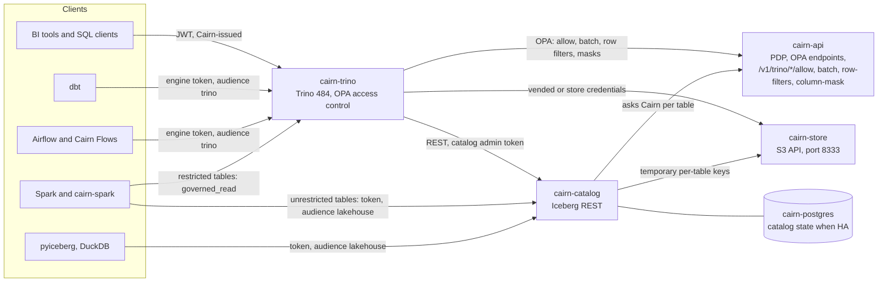

# Cairn Data Engine: storage, tables, query engines and read-path governance

| | |
|---|---|
| Document | Technical architecture, data engine (1 of 3: data engine, AI platform, system design) |
| Evidence date | 2026-11-14, repository commit `783865d7` (branch `claude/funny-meitner-qtz0ux`) |
| Scope | Cairn Store, Cairn Catalog, the query and transformation engines, open table formats, schema evolution, governance on the read path |
| Companion documents | [ai-platform.md](ai-platform.md), [system-design.md](system-design.md), [openapi.json](openapi.json) |
| Primary sources | `cairn/store/README.md`, `cairn/catalog/README.md`, `cairn/ARCHITECTURE.md`, `cairn/ROADMAP.md`, `cairn/doc/BRD.md` |

**How to read the status markers.** The roadmap's markers are used as written: ✅ shipped and tested end to end in CI, 🟡 shipped but partly validated, ⬜ planned. The L-numbers are the roadmap's queue items. Each claim in this document is tagged with its evidence: a source file (path relative to `cairn/` unless shown otherwise), a test file, or a roadmap row. Claims with no evidence are marked **[TARGET]**, **[ASSUMPTION]** or **[TO CONFIRM: …]**.

---

## 1. Summary

- The data engine separates **bytes**, **table metadata** and **query execution**. Cairn Store holds bytes. Cairn Catalog holds table metadata and commits. Trino, Spark, dbt and Airflow read and write through them. Cairn's policy decision point (PDP) decides for every engine that touches a table.
- Tables are Apache Iceberg. The catalog creates format versions 1, 2 (the default) and 3. Delta Lake tables are read through Trino's Delta connector and can be converted to Iceberg in place without copying data.
- Read-path governance has two layers. Trino asks Cairn before every action through its OPA access-control plugin, and Cairn applies masks and row filters to the result. Engines that read data files directly are refused tables that carry a mask or row filter for the caller. Those callers reach such tables through Trino.
- The design has three open points that a reviewer should weigh (section 7): the catalog's admin token is given to Trino, the binary's default vending mode is static, and the L19 roadmap text contradicts itself on Delta conversion.

---

## 2. Component responsibilities

| Concern | Owner | Evidence |
|---|---|---|
| Object bytes: immutable blob files, one transactional index, versioning, object lock, lifecycle, encryption at rest with customer keys | **Cairn Store** (Rust, S3-compatible) | `store/README.md`; `store/src/engine.rs`; `store/src/s3/`; L9 ✅, L22 ✅ |
| Table and view metadata, namespaces, commits as one compare-and-set transaction, branches and tags, clones, undrop, registration of existing files | **Cairn Catalog** (Rust, Iceberg REST, built on iceberg-rust 0.11) | `catalog/README.md`; `catalog/src/api.rs`; `catalog/src/db.rs` (redb) and `catalog/src/pg.rs` (PostgreSQL); L12 ✅, L75 ✅ |
| Per-table storage credentials for engines that read files | **Cairn Catalog**, vending temporary credentials from the store's STS | `catalog/src/main.rs:148-183`; `catalog/src/api.rs` (`Vend::Scoped`, `Vend::Static`, `Vend::Off`) |
| Authorization of engines that read files (Spark, pyiceberg, DuckDB) | **Cairn Catalog**, asking Cairn per table: view, read, write, manage and whether reading is restricted | `catalog/src/identity.rs:7-9`; `src/cairn/dataaccess/lakehouse.py` |
| SQL execution, DDL, DML, table procedures, the read-path masks and row filters | **Trino 484** (`trinodb/trino:484`), with `access-control.name=opa` calling Cairn | `helm/cairn/templates/trino.yaml:136-141`; `src/cairn/dataaccess/trino.py`; `deploy/versions/pins.json` |
| Spark jobs and notebooks | **cairn-spark** (Spark 4.0.1 with Iceberg 1.10.0). Restricted tables are read through Trino (`governed_read`), others through the catalog | `spark/src/cairn_spark/__init__.py:185`; L2 ✅, L3 ✅, L4 ✅ |
| SQL transformations (models, docs, tests) | **dbt-core 1.12.6** with dbt-trino 1.11.0, run as a pipeline user | `deploy/versions/pins.json`; ROADMAP "Transformation" row ✅ |
| Orchestration | **Cairn Flows** (engine driven under a database lease, so several replicas share runs) and **Apache Airflow 3.3.2** with `cairn-airflow-provider` | `src/cairn/flows/engine.py`; `airflow-provider/src/cairn_airflow/`; L122 ✅, L124 🟡 |
| Ingestion pipelines: streams, database mirrors, pipes, derived tables, maintenance, Delta conversion, vector indexes | Python services in `src/cairn/pipelines/` | section 5 and section 8 |
| Metadata graph, lineage and policy | Cairn Core and the Cairn PDP. Not in the data path; they decide and record | `cairn/ARCHITECTURE.md` section 1.0 |

Cairn Ontology (`ontology/`) is metadata, not data. It reads the catalog and the query history and returns proposals. It does not read table data files.

### 2.1 Data path

The diagram follows the compose and Helm wiring. Compose names the services `cairn-trino`, `cairn-catalog`, `cairn-store`, `cairn-api` and `cairn-postgres` (`docker-compose.cairn.yml`). The Helm chart uses the same roles as components named `trino`, `catalog`, `store` and `api` (`helm/cairn/templates/`). The token audiences `trino`, `lakehouse` and `airflow` are set in `src/cairn/dataaccess/trino_auth.py:33`, `src/cairn/dataaccess/lakehouse.py` and `src/cairn/dataaccess/trino_oauth.py`.

---

## 3. Cairn Store

- An S3-compatible object store in Rust (`store/src/s3/`), with a single node or a cluster that shares PostgreSQL metadata (`CAIRN_STORE_META`). It also serves WebDAV, SFTP, a file API, a Kafka protocol on message queues, and website hosting (`store/README.md`).
- Immutable blob files and a transactional index (redb). Design notes are at the top of `store/src/engine.rs`.
- Conditional writes: `s3.exclusive-create` is checked atomically by the store. The roadmap says this is what lets two Trino clusters write the same Delta log (L19 ✅).
- Encryption at rest: a keyring, or customer-managed keys in Vault or OpenBao Transit, AWS KMS, Azure Key Vault, Google Cloud KMS and KMIP (L22 ✅, `store/conformance/`).
- Versioning, object lock, lifecycle and tiering, quotas, replication, event notifications (webhook, Kafka, SQS, Pub/Sub, NATS), and backups to S3, Azure Blob and GCS (`store/README.md`).
- Disaster recovery: a standby store by bucket replication, a standby PostgreSQL by streaming, a failover runbook and `cairn dr reconcile` (L9 ✅).
- Conformance: suites in `store/conformance/` run the real binary, with boto3, pyarrow and pyiceberg (`store/README.md`).

Proto: the only protobuf file in the repository is `store/proto/csi.proto`, the Container Storage Interface specification used by the Kubernetes CSI driver (`store/src/csi/`). It is not a platform API (see `system-design.md`, section 6.2).

---

## 4. Cairn Catalog and the open table formats

### 4.1 Iceberg

| Item | Status | Evidence |
|---|---|---|
| REST API: config, OAuth token exchange, namespaces, tables, views, transactions/commit, rename, register, credentials, clone, undrop, dropped listing, metrics | ✅ | `catalog/src/api.rs` dispatch table (`(Method::…, [ "v1", …])` patterns); `catalog/conformance/test_rest_catalog.py` (pyiceberg) |
| Table creation as format version 1, 2 (default) or 3; anything else is refused with HTTP 400 | ✅ | `catalog/src/api.rs:1357-1361`; `catalog/README.md` |
| Iceberg v3 types and metadata (deletion vectors, row lineage, `VARIANT`, nanosecond timestamps) read and written by Spark 4 / Iceberg 1.10, Trino 484 and pyiceberg | ✅ | L86 ✅; `tests/test_iceberg_v3_writes.py`; `catalog/conformance/` (Iceberg v3 suite) |
| Table updates are applied by iceberg-rust's `TableUpdate` implementation, so the catalog "follows the table spec exactly" | ✅ | `catalog/src/api.rs:5` (module doc), `catalog/src/api.rs:399` (`updates: Vec<TableUpdate>`) |
| Clone (zero-copy), undrop, branches and tags | ✅ | L12 ✅ (`catalog/conformance/test_clones.py`); L75 ✅ (table branches, tags and data diff, write-audit-publish) |
| Maintenance: snapshot expiry, orphan removal, compaction and manifest rewrites, sort order and bloom filters, on a schedule and on demand | ✅ | L1 ✅ (`src/cairn/pipelines/maintenance.py`); L81 ✅ |
| Change data feed (inserts, deletes and updates by key since a snapshot) | ✅ | L25 ✅ (`GET /v1/lakehouse/tables/{schema}/{table}/changes`) |
| Tables on the customer's storage (ADLS Gen2, Blob, S3, GCS) inside registered external locations | 🟡 | L132 🟡; `catalog/src/external.rs` |
| Iceberg tables from another organisation's or a cloud Iceberg REST catalog, governed | ✅ | L105 ✅ (`src/cairn/dataaccess/external_catalogs.py`) |
| Snowflake and Databricks tables read in place through their Iceberg REST endpoints | 🟡 | L151 🟡 |

**Statement of what the catalog does not implement.** The catalog creates and commits Iceberg tables only. A search of `catalog/src/` finds no Delta Lake code. Delta is handled by Trino's Delta connector (`helm/cairn/templates/trino.yaml:171`, `connector.name=delta_lake`) and by the Python conversion service in section 4.2.

### 4.2 Delta Lake

| Item | Status | Evidence |
|---|---|---|
| Delta tables read through Trino's Delta connector, with the same OPA policy as Iceberg tables | ✅ | `helm/cairn/templates/trino.yaml:171`; the roadmap's "Tables and catalog" row |
| Concurrent writers to one Delta table, through conditional-write commits on Cairn Store | ✅ | L19 ✅, "proven with two Trino clusters" (`tests/test_trino_e2e.py`) |
| In-place conversion of a Delta table to Iceberg, with its data files left where they are | ✅ | `src/cairn/pipelines/delta_convert.py` (module docstring); L19 ✅ |
| Refused for conversion: column mapping (column names differing from the table's), and a log that moves during conversion | ✅ | `src/cairn/pipelines/delta_convert.py` (docstring: "refuses what Iceberg cannot read the same way") |
| Partitioned tables and deletion vectors converted in place | 🟡 **[TO CONFIRM: L19 text contradicts itself]** | L19 says both "converting partitioned tables and deletion vectors in place to do" and "partitioned tables … and deletion vectors … convert too, tested on tables Trino wrote". `delta_convert.py` documents both. Which of the two is current needs a test run. |
| Delta Sharing to external recipients, with the current snapshot's files as pre-signed store URLs | 🟡 | L8 🟡; `/v1/delta-sharing`; `tests/test_delta_sharing_e2e.py` |
| The Python `deltalake` package (1.6.6) is pinned for tests only, to write the table that a Delta Sharing provider shares | ✅ (test tooling) | `deploy/versions/pins.json` (`deltalake`) |

The conversion is one-way. The Delta table must be unregistered first, so nothing writes to it while its files belong to the Iceberg table (`delta_convert.py` docstring).

### 4.3 Query engines

- **Trino 484** is the SQL engine (`ROADMAP.md`, "The platform today", "SQL warehouse" row). It carries Iceberg 1.12 and reads and writes Iceberg v3 (L86 ✅). It has resource groups per team (L6 ✅), query history and tuning hints (L14 ✅), cost per query (L60 ✅), adaptive warehouses (L87 ✅) and serving tables for interactive access (L103 ✅).
- **Spark 4.0.1** with Iceberg 1.10.0 (`deploy/versions/pins.json`). Its governed read path is `cairn_spark.governed_read`, which reads through Trino as the signed-in user, applying masks and row filters (L2 ✅; `tests/test_spark_e2e.py`). Spark on Kubernetes is covered by L3 ✅ (`tests/test_spark_kind_e2e.py`). Spark Connect for users is not offered: "Spark Connect is unsupported on purpose today" (L183 ⬜).
- **dbt-core 1.12.6** with dbt-trino 1.11.0, and **Apache Airflow 3.3.2** (chart 1.20.0). Versions are pinned in `deploy/versions/pins.json`. The upgrade matrix tests the newest release of each engine weekly (`.github/workflows/cairn-upgrade-matrix.yml`; L11 ✅).

---

## 5. Schema evolution

The table below lists what the code and its tests support. Each entry is tied to a path that changes a schema.

| Path | Behaviour | Evidence |
|---|---|---|
| Iceberg schema change through the catalog | Clients commit schema updates through the REST API; iceberg-rust validates them. | `catalog/src/api.rs` (`TableUpdate`); `catalog/conformance/test_rest_catalog.py:70-71` (`update_schema().add_column`); `store/conformance/test_lakehouse.py:63-64` |
| `ALTER TABLE … ADD COLUMN` and `DROP COLUMN` through Trino | Supported. Both need the table's `MANAGE_DATASET` privilege. | `tests/test_trino_e2e.py:1043` (add), `:2866` (drop); `src/cairn/dataaccess/trino.py:65` (`AddColumn`, `DropColumn` mapped to `MANAGE`) |
| Streams (Kafka and Debezium into Iceberg) with `evolve` | With `evolve` set, new columns are added as the stream runs (`union_by_name`). Without it, a row that has columns the table lacks is set aside in `cairn_stream_rejects`. | `src/cairn/pipelines/streams.py:24, 75, 528-531`; `tests/test_streams_e2e.py:176` (`test_evolve_adds_new_columns`); L5 ✅ |
| Database mirrors (PostgreSQL, MySQL, SQL Server, Oracle, MongoDB sources) | Columns added, renamed and dropped; a type that widens (int to long, float to double) is changed in place; any other type change rebuilds the table and records that in the audit log. A table added or dropped at the source is handled. | `src/cairn/pipelines/mirror_db.py` (`_evolve`, `WIDENS`); `tests/test_database_mirror_e2e.py:274-330` |
| SaaS and connector syncs | Columns added as they appear at the source. | `src/cairn/pipelines/saas.py:826`; `src/cairn/pipelines/connectors.py:1118` |
| Table sort order and partition-related properties | Sort columns are chosen from query history and applied with `ALTER TABLE … SET PROPERTIES sorted_by`. | `src/cairn/pipelines/maintenance.py:254` |
| Delta conversion | Column mapping is refused, so a converted table never has names that differ from its files. | `src/cairn/pipelines/delta_convert.py` (docstring) |
| Control-plane database schema (Cairn's own PostgreSQL) | Alembic migrations, numbered `0001`–`0157`; 157 files in `src/cairn/migrations/versions/`, latest `0157_managed_airflow_leases.py`. | `src/cairn/migrations/`; `tests/test_migrations.py` (registration enforced) |

**Not verified in the sources reviewed.**

- Iceberg partition evolution (changing a table's partition spec on a live table through Trino or the catalog). The evidence above covers columns and sort order only. **[TO CONFIRM: partition-spec evolution through Cairn Catalog and Trino, with a test name]**
- Type widening rules for Iceberg tables written by Trino or Spark. The `WIDENS` set in `mirror_db.py` governs only the mirror path. **[TO CONFIRM: widening policy for direct writes]**

---

## 6. Governance on the read path

### 6.1 Trino and the Cairn PDP

Trino is configured with `access-control.name=opa`, with four endpoints on the API (`helm/cairn/templates/trino.yaml:136-141`):

| Endpoint (under `/v1/trino/<key>/`) | Purpose |
|---|---|
| `allow` | One decision per action (read, write, DDL, procedure, function call, and so on) |
| `batch` | Several decisions in one call (Trino's batched OPA) |
| `row-filters` | Row-filter expressions for a table, from the caller's obligations |
| `column-mask` | Mask expression for a column, from the caller's masking plan |

What Cairn decides (`src/cairn/dataaccess/trino.py` module docstring):

- **Identity.** The Trino user maps to a Cairn user URN. Trino groups become Cairn group memberships.
- **Privileges.** Seeing a table needs `VIEW_ENTITY_PAGE`. Reading rows needs `VIEW_DATASET_PROFILE`. Writing rows needs `WRITE_DATASET`. Changing tables or running table procedures needs `MANAGE_DATASET`. Calling AI functions needs `USE_AI_FUNCTIONS`. An action Cairn does not recognise is refused.
- **Masks.** Columns in the caller's masking plan get a Trino mask with one of four strategies: `partial`, `hash`, `redact` or `null` (`trino.py:171`, `mask_expression`).
- **Row filters.** A `row_filter` obligation becomes a Trino row filter. Its `{user}` placeholder becomes the quoted Trino user.
- **External catalogs** are read-only unless registered as writable. Every write, table change or schema change in one is refused.
- **Failure.** A decision that cannot be made is refused. The catalog's authorizer states "any error refuses (fail closed)" (`catalog/src/identity.rs:9`).

Workers are different. Trino worker nodes use a file-based access rule that allows only the drain user (`helm/cairn/templates/trino.yaml:131-134`). The coordinator asks Cairn, and the workers check nothing else. This is the designed behaviour, not a gap.

### 6.2 Engines that read files

A table that carries a mask or row filter for a caller is **restricted**. Its data files hold the values the mask or filter hides, so an engine that reads files directly would bypass the policy. The rule, stated in the catalog and in the roadmap:

- The catalog classifies each table decision with a `restricted` flag, set when a mask or row filter applies (`catalog/src/identity.rs:7-8`). **Restricted tables are refused** to any engine that reads files itself (Spark's direct path, pyiceberg, DuckDB).
- Those callers reach restricted tables through **Trino**, which applies the policy, or through a view. Spark does this through `governed_read` (L2 ✅; `tests/test_spark_e2e.py`: "the catalog still refuses the files").
- The design decision is recorded in `cairn/ROADMAP.md` ("Design decisions behind the lakehouse integration").

### 6.3 Credential vending

The catalog hands storage access to engines in one of three modes (`catalog/src/main.rs:148-183`):

| Mode (`CAIRN_CATALOG_VEND_CREDENTIALS`) | Behaviour | Where it is the default |
|---|---|---|
| `scoped` | Temporary keys for one table at a time, from the store's STS, assumed through `CAIRN_CATALOG_VEND_ROLE`. The lifetime is 900 to 43 200 s (`CAIRN_CATALOG_VEND_SECONDS`), and clients come back for renewal, where Cairn decides again (`CAIRN_CATALOG_VEND_REVALIDATE_SECONDS`). | Compose sets `CAIRN_CATALOG_VEND_ROLE` (`docker-compose.cairn.yml:658`) and the revalidation to 900 s. Helm sets the role when `cairn.catalog.vendRole` is set. |
| `static` | The catalog's own store key is returned to the engine. | The binary's default when no vending role is set (`main.rs:153`). |
| `off` | No credentials are vended. | Explicit only. |

Two protections apply in code:

- **Shares.** An external share's recipient is refused when the mode is `static`, with the message "External shares need scoped storage credentials" (`catalog/src/api.rs:498-505`). This is a per-request refusal.
- **Identity with static vending.** The Helm chart refuses to render a catalog with identity enabled and no vending role: `cairn.catalog.identity needs cairn.catalog.vendRole (per-table temporary credentials, never the store key)` (`helm/cairn/templates/catalog.yaml:89-90`). The binary does not refuse this combination at startup.

### 6.4 The catalog's admin token given to Trino

`CAIRN_CATALOG_TOKEN` creates a catalog principal named `admin` with no namespace restriction, and it is writable (`catalog/src/main.rs:84-96`). The catalog documents it as "an admin bearer token" (`catalog/src/main.rs:17`). Compose and Helm give the same token to Trino, for the catalog's REST client (`docker-compose.cairn.yml:728`; `helm/cairn/templates/trino.yaml:214`, `iceberg.rest-catalog.oauth2.token=${ENV:CAIRN_CATALOG_TOKEN}`).

Consequences, as the code shows them:

- For Trino's own reads and writes, table-level decisions come from Trino's OPA integration (section 6.1), not from the catalog's per-table check, because Trino authenticates to the catalog as `admin`.
- The roadmap's principle "No engine holds a database password or a store key" is kept at the store: Trino receives vended credentials for reads, not the store key. The catalog token is a separate credential, and it is not short-lived.

**[TO CONFIRM: whether the catalog's admin token should be replaced for Trino by a Cairn-issued, audience-bound token (the `lakehouse` audience already exists for Spark and pyiceberg), and what a reviewer should accept in the meantime.]** Dev defaults are in the compose file (`cairn-catalog-dev-token`). Production values are not in the repository.

### 6.5 Cairn Store secrets

Store keys reach the catalog through `CAIRN_STORE_*` variables and files (`store/src/main.rs`, `store/README.md`). The gateway's keys can be wrapped by Vault Transit or AWS KMS (L10 🟡, `CAIRN_GATEWAY_KEY_KMS`). These are secret-handling concerns for the system-design document.

---

## 7. Capability map

Status and L-number are as written in `ROADMAP.md`. "Evidence" is the test or source the roadmap cites.

| Capability | L-number | Status | Evidence |
|---|---|---|---|
| Object storage (Cairn Store) | Platform table row | ✅ | `store/README.md`; `store/conformance/` |
| Customer-managed keys for store encryption | L22 | ✅ | `store/conformance/test_kms_aws.py` and the L22 row |
| Storage credentials and external locations as governed objects | L133 | ✅ | ROADMAP queue |
| Tables on the customer's own cloud storage | L132 | 🟡 | `catalog/src/external.rs` |
| Table maintenance (expiry, orphans, compaction, clustering) | L1 | ✅ | `tests/test_trino_e2e.py`; `src/cairn/pipelines/maintenance.py` |
| Governed Spark on restricted tables | L2 | ✅ | `tests/test_spark_e2e.py` |
| Spark on Kubernetes | L3 | ✅ | `tests/test_spark_k8s_e2e.py`, `tests/test_spark_kind_e2e.py` |
| Streaming and CDC into Iceberg, with `evolve` | L5 | ✅ | `tests/test_streams_e2e.py` |
| HTTP streaming ingestion (`POST /v1/ingest/<name>/rows`) | L13 | ✅ | `tests/test_ingest_http_e2e.py` |
| Bad-row quarantine in pipes and streams | L72 | ✅ | ROADMAP queue |
| Files as data (pipes with document text and OCR) | L15 | ✅ | ROADMAP queue |
| Zero-copy clones, undrop, branches and tags | L12 | ✅ | `catalog/conformance/test_clones.py` |
| Table branches, tags and data diff | L75 | ✅ | ROADMAP queue |
| Zero-copy Parquet registered in place | L115 | ✅ | ROADMAP queue |
| Delta Lake concurrent writers and in-place conversion | L19 | ✅ **[TO CONFIRM: see section 4.2]** | `tests/test_trino_e2e.py`; `src/cairn/pipelines/delta_convert.py` |
| Iceberg v3 tables | L86 | ✅ | `tests/test_iceberg_v3_writes.py` |
| Change data feed | L25 | ✅ | ROADMAP queue |
| Materialized views | L24 | ✅ | ROADMAP queue |
| Serving tables (interactive and hybrid) | L103 | ✅ | ROADMAP queue |
| SCD type 2 and medallion layers | L110 | ✅ | ROADMAP queue |
| Streaming transformations on micro-batches | L104 | ✅ | ROADMAP queue |
| Vector indexes on lakehouse tables | L16 | ✅ (exact search); approximate search reported in the same row | `tests/test_vectors_e2e.py` |
| Grounded answers with citations from a vector index | L102 | ✅ | ROADMAP queue |
| Governed sharing through Iceberg REST, with recipient expiry and revocation | L8 | 🟡 | `tests/test_shares_e2e.py`; `tests/test_delta_sharing_e2e.py` |
| Clean rooms (aggregate templates, k-anonymity, differential privacy) | L8 (within the same row) | 🟡 | `tests/test_trino_e2e.py` (rooms); L169 ⬜ covers clean rooms across organisations |
| Sharing of governed views, volumes, models and functions | L169 | ⬜ | ROADMAP queue |
| Aggregation and projection policies | L85 | ✅ | ROADMAP queue |
| Data residency (namespaces pinned to a region) | L73 | ✅ | ROADMAP queue |
| Reversible tokenisation | L74 | ✅ | ROADMAP queue |
| Consent (withdrawn subjects excluded on Trino and on direct connections) | L66 | ✅ | ROADMAP queue |
| Retention and erasure | L50 | ✅ | ROADMAP queue |
| Cross-table transactions and schema-level clone | L180 | ⬜ | ROADMAP queue |
| Snowflake and Databricks tables in place | L151 | 🟡 | `src/cairn/dataaccess/external_catalogs.py` |
| Scale: decision latency and catalog decisions on large schemas | L10 | 🟡 | `tests/test_scale_decisions.py`; the L10 row (figures are as the roadmap reports them, from CI) |
| Upgrade matrix for Trino, Iceberg, Spark, dbt and Airflow | L11 | ✅ | `.github/workflows/cairn-upgrade-matrix.yml` |
| Workload management per team | L6 | ✅ | ROADMAP queue |
| Query insight | L14 | ✅ | `tests/test_trino_e2e.py` |

---

## 8. Ingestion into the lakehouse (summary)

The ingestion services write Iceberg tables through the catalog, as the service's own identity. Their roles are:

- **Streams** (`cairn-streams`, profile `streams`): Kafka JSON and Debezium CDC into Iceberg, with exactly-once offsets stored in the table snapshots (L5 ✅).
- **Database mirrors** (`src/cairn/pipelines/mirror_db.py`): change capture for PostgreSQL, MySQL (L92 ✅), SQL Server (L96 ✅), MongoDB (L97 ✅), and Oracle and Db2 (L167 🟡). Schema changes are handled as in section 5.
- **Pipes** (`src/cairn/pipelines/pipes.py`): files that land in the store, loaded once each.
- **Connectors** and **SaaS syncs**: L61 🟡 (SaaS loads into Iceberg), L182 ⬜ (SaaS and ERP sources on real accounts).

---

## 9. Open items

| # | Item | Status | Needed to close |
|---|---|---|---|
| 1 | Trino holds the catalog's admin token (section 6.4) | **[TO CONFIRM]** | Decision on a Cairn-issued, audience-bound token for Trino |
| 2 | Binary default of static vending when no vending role is set (section 6.3); no startup refusal with identity enabled | **[TO CONFIRM]** | Decision on refusing this combination in the binary, as the chart already does |
| 3 | L19 status text: partitioned and deletion-vector conversion is both "to do" and "converts" | **[TO CONFIRM]** | One test run on partitioned Delta tables with deletion vectors, and a corrected roadmap row |
| 4 | Iceberg partition-spec evolution through the catalog and Trino | **[TO CONFIRM]** | A test name, or a roadmap item |
| 5 | Approximate (IVF) vector search on very large tables: the L16 row says ANN is "to do" and then describes IVF with "recall@10 1.0" | **[TO CONFIRM]** | Corrected row, and a measurement on a stated table size |
| 6 | Delta concurrent writers beyond two clusters | **[TARGET]** | Load test on the target topology |
| 7 | Production-scale numbers for the store and catalog | **[TO CONFIRM: no production benchmark is in the repository]** | A published benchmark with hardware, data size and method. This document does not state any. |
| 8 | Cairn Catalog's behaviour on a Delta table, which it does not read | Fact, not an item | None |

---

## 10. Discrepancies with the existing documents

Reported here and not fixed in `cairn/` (per the brief).

1. **`cairn/ARCHITECTURE.md` section 1.5, "Guardrails" (3)** says prompts are kept only if `CAIRN_AI_AUDIT_PROMPTS=true`. The setting is parsed into `settings.ai.audit_prompts` (`src/cairn/common/config.py:94, 170`) and nothing reads it. This is in the AI document, reported here for completeness.
2. **`cairn/ROADMAP.md` L19** contradicts itself on partitioned and deletion-vector conversion (section 4.2).
3. **`cairn/ROADMAP.md` L16** describes IVF approximate search as done, and in the same row lists ANN as "to do" (section 9, item 5).
4. **`cairn/ARCHITECTURE.md` section 1.1, "Identity"** says the catalog's Cairn decision is per table. The Trino path is decided by OPA instead, because Trino authenticates as the catalog's admin principal (section 6.4). The document does not mention the admin principal.
5. **`cairn/ROADMAP.md`, "Fail closed" principle** says a deployment configured unsafely, such as "a catalog vending store keys alongside Cairn-issued tokens", is refused. The Helm chart refuses that combination. The binary does not refuse it at startup, and the static mode is its default (section 6.3).
