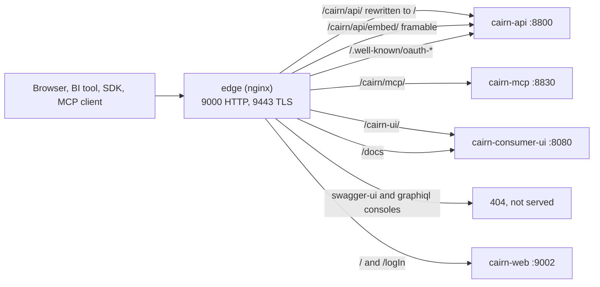
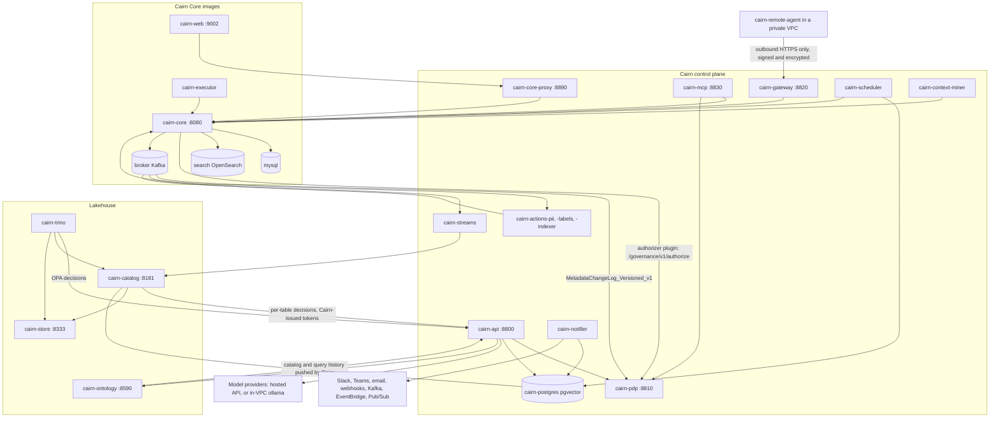
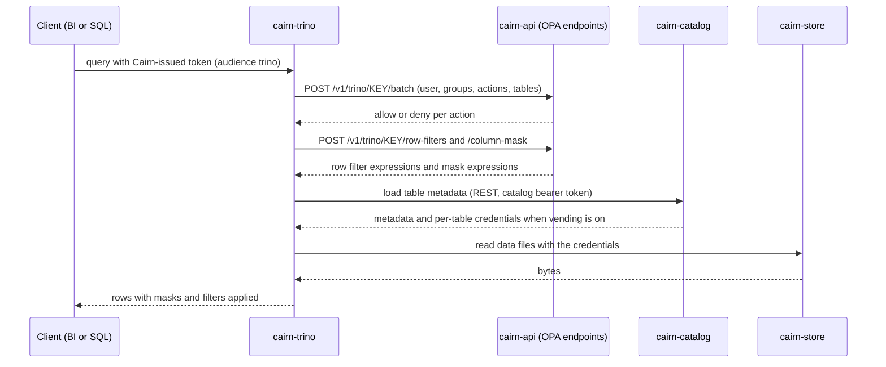
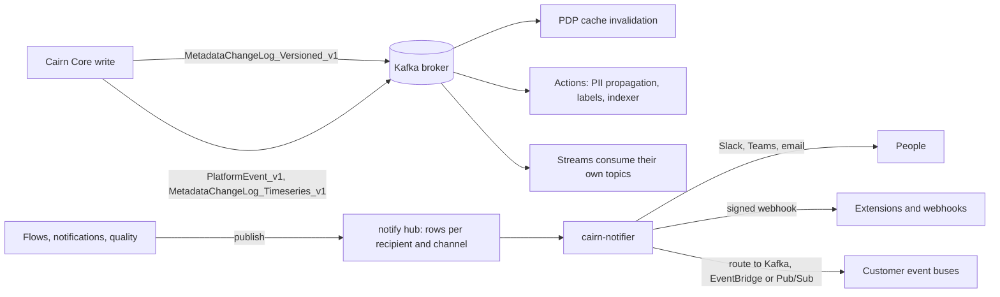

# Cairn System Design: topology, interfaces, API and events

| | |
|---|---|
| Document | Technical architecture, system design (3 of 3) |
| Evidence date | 2026-11-14, repository commit `783865d7` (branch `claude/funny-meitner-qtz0ux`) |
| Scope | Deployment units, process topology, network entry points, identity and tokens, the REST API (with the generated OpenAPI file), the absence of gRPC, asynchronous events |
| Companion documents | [data-engine.md](data-engine.md), [ai-platform.md](ai-platform.md), [openapi.json](openapi.json) |
| Primary sources | `cairn/docker-compose.cairn.yml`, `cairn/helm/cairn/` (`Chart.yaml`, `values.yaml`, `templates/`), `cairn/docker/nginx/`, `cairn/src/cairn/app.py`, `cairn/src/cairn/common/security.py`, `cairn/src/cairn/common/deprecation.py`, `cairn/core/UPSTREAM.md` |

**Status and evidence.** The roadmap's markers are used as written (✅, 🟡, ⬜), and L-numbers refer to `cairn/ROADMAP.md`. File paths are relative to `cairn/`, except paths that begin with `.github/` or `docs/`, which are relative to the repository root. Service and route names are taken from the compose file, the Helm templates and the route decorators. The OpenAPI document was generated from the application's own code (section 5.5). Anything not verified is marked **[TO CONFIRM: …]**.

---

## 1. Summary

- Cairn ships as **one Python package** (`cairn`) with several entry points, plus Rust services (Store, Catalog, Ontology), a Java authorizer plugin, the Cairn Core images, and the web applications. The compose file runs 40 services, of which several sit behind profiles. The Helm chart `helm/cairn` installs Cairn Core and the control plane. `helm/cairn-remote-agent` is installed inside each private network.
- All API traffic enters through one **edge** (nginx) in compose and the Helm ingress or Gateway API route. The edge routes `/cairn/api/` to `cairn-api`, `/cairn/mcp/` to `cairn-mcp`, `/cairn-ui/` and `/docs` to the consumer workspace, and the root paths to `cairn-web`.
- Authorization is decided by the **policy decision point** (PDP). `cairn/ARCHITECTURE.md` section 1.1 states that every Cairn endpoint calls the PDP itself. Cairn Core asks the PDP through its authorizer plugin (`POST /governance/v1/authorize`). Trino asks through its OPA integration. The catalog asks per table for Cairn-issued tokens. Section 5 records what the generated spec shows.
- The platform has **no gRPC API**. The only protobuf file is the vendored Container Storage Interface specification.
- Events are carried by **Kafka** (the Cairn Core change log, and streams), with an **outbox pattern** in three places. Outbound notifications go to webhooks, Slack, Teams, email, Kafka, EventBridge and Pub/Sub.
- The REST API has **780 paths** in the generated file (`openapi.json`), in about **90 family prefixes**, with a 180-day deprecation policy that is implemented but has no deprecated routes today.

---

## 2. Deployment units

### 2.1 Compose (`cairn/docker-compose.cairn.yml`)

The 40 services, grouped by role. "Profile" is the compose profile needed to start the service. "Default" means it starts with `docker compose up`.

| Group | Service | Profile | Role and evidence |
|---|---|---|---|
| Cairn Core | `cairn-core` | default | Metadata system of record (Cairn Core API) |
| | `cairn-web` | default | Cairn Core web application (`$frontend` upstream, port 9002) |
| | `cairn-setup` | default | One-shot setup job for Cairn Core |
| | `cairn-executor` | default | Cairn Core ingestion executor |
| | `cairn-bootstrap` | default | Bootstrap job for Cairn Core and the control plane (the README describes `cairn bootstrap`, which re-applies the structured properties, tags and terms) |
| | `cairn-token-keeper` | default | Rotates the service account's token (`CAIRN_TOKEN_ROTATE_DAYS`, default 7) |
| Core dependencies | `mysql` (8.2) | default | Cairn Core's relational store |
| | `search` (OpenSearch 2.19.3) | default | Cairn Core search and graph indexes |
| | `broker` (`apache/kafka:3.9.1`) | default | Kafka: Cairn Core change log and Cairn streams |
| | `cairn-postgres` (`pgvector/pgvector:pg16`) | default | Cairn's own database: monitors, audit, agents, tasks, embeddings |
| Control plane | `cairn-api` | default | FastAPI control plane, port 8800 (`cairn api`) |
| | `cairn-pdp` | default | Policy decision point, port 8810 (`cairn pdp`) |
| | `cairn-gateway` | default | Remote-agent gateway, port 8820 (`cairn gateway`) |
| | `cairn-scheduler` | default | Scheduled work, leader-elected (`cairn scheduler`) |
| | `cairn-actions-pii` | default | PII propagation action (over Kafka) |
| | `cairn-actions-labels` | default | Label action (over Kafka) |
| | `cairn-actions-indexer` | default | Vector indexer action (over Kafka) |
| | `cairn-mcp` | default | MCP server, streamable HTTP on port 8830 (`cairn mcp`) |
| | `cairn-core-proxy` | default | Masking proxy in the Cairn Core request path, port 8890 |
| | `cairn-context-miner` | default | Context agents: mines queries, dbt, BI and jobs for definitions |
| | `cairn-notifier` | default | Notification delivery worker (`cairn notifier --interval 10`) |
| | `cairn-consumer-ui` | default | Consumer workspace micro-frontend (served at `/cairn-ui/`) |
| | `cairn-streams` | `streams` | Kafka and CDC into Iceberg (`cairn streams`) |
| Lakehouse | `cairn-store` | default | Cairn Store, S3 API on port 8333 |
| | `cairn-catalog` | default | Cairn Catalog, Iceberg REST on port 8181 |
| | `cairn-ontology` | `ontology` | Cairn Ontology compiler, port 8590 |
| | `cairn-trino-tls` | `trino` | One-shot job that makes a self-signed certificate for Trino's HTTPS port, into a volume (`deploy/trino/make-tls.sh`); a deployment brings its own certificate by setting `CAIRN_TRINO_TLS_DIR` |
| | `cairn-trino` | `trino` | Trino 484, OPA access control |
| | `cairn-dbt` | `dbt` | dbt runner (dbt-core 1.12.6) |
| | `cairn-spark` | `spark` | Spark 4.0.1 with `cairn-spark` |
| | `cairn-spark-history` | `spark` | Spark history server |
| Orchestration | `airflow-init`, `airflow-api-server`, `airflow-scheduler`, `airflow-dag-processor`, `airflow-triggerer` | `airflow` (through the `x-airflow` anchor) | Apache Airflow 3.3.2 |
| Edge and demo | `edge` (nginx 1.27) | default | Single entry point, ports 9000 (HTTP) and 9443 (TLS) |
| | `finance-db` | default | Demo source database for the in-VPC agent |
| | `cairn-remote-agent` | default | Demo in-VPC ingestion agent |
| | `ollama` | `ai-local` | In-VPC model server (optional) |

Compose sets the store and catalog images from `${CAIRN_REGISTRY:-cairn}/store`, `/catalog`, `/ontology`, `/spark` and `/dbt`. Trino uses the upstream image `trinodb/trino:484`.

### 2.2 Helm (`cairn/helm/cairn`)

The chart's component names are built as `<fullname>-<component>` by the helper `cairn.componentName` (`templates/_helpers.tpl`). The component names below are the values found in the templates. The full name depends on the release name.

| Component | Template | Purpose |
|---|---|---|
| `core`, `web`, `setup`, `executor`, `core-token-bootstrap` | `core.yaml`, `core-setup-job.yaml`, `core-token.yaml` | Cairn Core and its setup |
| `api`, `pdp`, `gateway`, `mcp`, `scheduler`, `actions`, `core-proxy`, `context-miner`, `notifier`, `streams` | matching templates | Control plane (as in compose) |
| `store`, `store-csi`, `catalog`, `ontology` | `store.yaml`, `store-csi.yaml`, `catalog.yaml`, `ontology.yaml` | Lakehouse storage and catalog |
| `trino`, `trino-worker`, `trino-federation` | `trino.yaml`, `trino-federation.yaml` | Trino coordinator, workers and federation |
| `dbt`, `spark`, `spark-history`, `mlflow`, `models` | `dbt.yaml`, `spark.yaml`, `mlflow.yaml`, `ml-serving-kubernetes.yaml` | Engines and ML |
| `jobs`, `apps`, `agent-apps`, `egress-proxy` | `jobs-kubernetes.yaml`, `apps-kubernetes.yaml`, `agent-apps-kubernetes.yaml`, `egress-proxy.yaml` | User workloads (Kubernetes runtimes) and their egress |
| `airflow-deployments`, `nifi-deployments`, `warehouses` | matching templates | Managed Airflow, managed NiFi and per-team warehouses |
| `postgres` | `pg-kubernetes.yaml` | Managed PostgreSQL instances |
| `edge` | `ingress.yaml`, `gateway-api.yaml` | Ingress or Gateway API route (`core.gateway`) |
| `consumer-ui`, `metadata-export`, `updater`, `updates-store`, `token-keeper` | matching templates | Workspace, export, release updates |
| Observability | `observability.yaml`, `monitoring.yaml`, `servicemonitor.yaml` | Metrics, traces and dashboards |

Dependencies that the chart does not install are configured as values: `search` (OpenSearch 2.x) and `kafka` (`kafka.bootstrap`, default `kafka:9092`) in `helm/cairn/values.yaml`. Profiles for high availability, tenants and the active metadata layer are in `values-ha.yaml`, `values-tenant.yaml` and `values-active-metadata.yaml`.

### 2.3 Process entry points

| Command | Process | Default port | Source |
|---|---|---|---|
| `cairn api` | Control plane API | 8800 | `src/cairn/cli.py` (`cmd_api`); `src/cairn/app.py` (`create_api_app`) |
| `cairn pdp` | Policy decision point | 8810 | `src/cairn/app.py` (`create_pdp_app`) |
| `cairn gateway` | Remote-agent gateway | 8820 | `src/cairn/app.py` (`create_gateway_app`) |
| `cairn mcp` | MCP server | 8830 | `src/cairn/ai/mcp_server.py` |
| `cairn core-proxy` | Masking proxy | 8890 | `src/cairn/coreproxy/proxy.py` |
| `cairn scheduler`, `cairn actions`, `cairn streams`, `cairn notifier`, `cairn context-miner` | Background workers | none | `src/cairn/cli.py` |
| `cairn agent run` | In-VPC ingestion agent | none | `src/cairn/agent/` |
| Cairn Store | `cairn-store serve` | 8333 (`CAIRN_STORE_ADDR`) | `store/src/main.rs` |
| Cairn Catalog | `cairn-catalog serve` | 8181 (`CAIRN_CATALOG_ADDR`) | `catalog/src/main.rs` |
| Cairn Ontology | `cairn-ontology` | 8590 (`CAIRN_ONTOLOGY_ADDR`) | `ontology/src/main.rs` |

The CLI for people (`cairn login`, `cairn query`, `cairn search`, `cairn show`, `cairn ask`) is a separate package, `src/cairn_cli`, and does not import the server code (`cairn/README.md`).

---

## 3. Component interaction

### 3.1 Edge and request paths



Source: `docker/nginx/locations.conf`. `/docs` is served by `cairn-consumer-ui`. The developer consoles (`swagger-ui`, `graphiql`) return 404, while the documented APIs (`/api/v2/graphql`, `/openapi/v…`) stay reachable. The `/cairn/api/` block strips the prefix (`rewrite ^/cairn/api/(.*)$ /$1 break`) and sets `X-Forwarded-Prefix: /cairn/api`. The rate limit for the API zone is 50 requests per second per client address with a burst of 400 (`docker/nginx/nginx.conf:46`, `locations.conf:45-50`). Requests that call the API directly on port 8800 have no prefix, so the paths in `openapi.json` are the direct paths. Through the edge they are prefixed with `/cairn/api`.

### 3.2 Control plane and dependencies



Evidence for each relationship:

- Cairn Core to PDP, through the authorizer: `cairn/ARCHITECTURE.md` section 1.3.1 and `plugins/java/cairn-authorizer`; the plugin fails closed (section 6.2 of this document).
- `cairn-api` depends on `cairn-pdp` in compose (`docker-compose.cairn.yml:453`).
- Trino to API for OPA: `helm/cairn/templates/trino.yaml:136-141`.
- Catalog to API for Cairn-issued tokens: `docker-compose.cairn.yml:664-667` (`CAIRN_CATALOG_JWKS_URL`, `CAIRN_CATALOG_CAIRN_URL`).
- Ontology: `src/cairn/context/ontology_compiler.py` (module docstring).
- Remote agents: `cairn/ARCHITECTURE.md` section 1.4; the gateway's routes are listed in section 5.2.
- Kafka consumers: `src/cairn/governance/invalidation.py` (`MCL_TOPIC`); `cairn actions` runs the upstream `datahub actions` runner with Cairn's plugin (`src/cairn/cli.py:556-558`).

### 3.3 Trino authorization, sequence



The OPA paths are `allow`, `batch`, `row-filters` and `column-mask` (`helm/cairn/templates/trino.yaml:136-141`). The catalog's vended credentials are enabled by `iceberg.rest-catalog.vended-credentials-enabled=true` (`trino.yaml:224`). The access key `KEY` is `CAIRN_TRINO_ACCESS_KEY` and appears in the path. See section 6.4.

### 3.4 Engine token exchange, sequence

```mermaid
sequenceDiagram
  participant R as Runner (dbt, Airflow, Spark)
  participant A as cairn-api
  participant T as cairn-trino
  R->>A: POST /v1/trino/token with the pipeline user's token and ttl_seconds
  A->>A: resolve the caller's token (Cairn Core me, cached 60 s)
  A-->>R: signed token for audience trino
  R->>T: queries with the engine token
  Note over R,A: issuing a token is audited; lifetime 60 to 43200 s
```

Evidence: `src/cairn/dataaccess/trino.py:863-864` (`@router.post("/token")`); `src/cairn/dataaccess/trino_auth.py:33-34, 106-107` (`AUDIENCE = "trino"`, `MAX_TTL = 12 * 3600`); `src/cairn/pipelines/dbt_runner.py:29, 174` (`CAIRN_DBT_TOKEN_TTL`, default 14400 s); `cairn/ROADMAP.md` ("Short-lived tokens, never secrets in projects"). The Trino router is `include_in_schema=False`, so it is not in `openapi.json` (section 5.5).

### 3.5 Event flow



Topic names are from `core/UPSTREAM.md` (Cairn Core's topics, lines 95-105) and `src/cairn/governance/invalidation.py:26`. The notification fan-out is from `src/cairn/notify/hub.py` (module docstring) and `src/cairn/notify/streams.py`.

---

## 4. Identity and authentication

### 4.1 Credential types

The principal dependency reads the `Authorization` header and then the session cookies. The order and the types are taken from `src/cairn/common/security.py` (`_resolve`):

| Credential | How it is presented | Validated by | Principal |
|---|---|---|---|
| Service token | `Authorization: Bearer <service token>`, compared in constant time | Local compare | The service principal |
| Extension token | `Bearer cx_…` | Extension lookup | The extension's actor |
| Agent credential | `Bearer ca_…` or `Bearer cat_…` | Agent hub. Unknown, expired or revoked credentials are refused; paused agents are told so. | The agent, acting for its owner, with scopes, run and intent |
| CLI sign-in | `Bearer cla_…` (access). `clr_…` (refresh) is refused as a bearer. | CLI grant lookup | The signed-in person |
| Notebook token | Bearer, two dots (a signed token) | Notebook lookup | The notebook's user |
| Workload token | Bearer, two dots | Workload lookup (audience `cairn`, `src/cairn/identity/workload.py:45`) | The workload identity |
| Cairn Core personal access token, or a Core session | Any other bearer | Cairn Core GraphQL `me` (`_ME_QUERY`), cached for 60 s | The Core user |
| Session cookies (`PLAY_SESSION` or `actor`) | Cookie | Cairn Core frontend GraphQL `me` | The Core user |
| Development header | `X-Cairn-Actor`, only when `dev_trust_actor_header` is set | None | Dev only. Not for production. |

Unknown credentials are refused with HTTP 401 and `WWW-Authenticate: Bearer` (`src/cairn/app.py:33-45`). Agents may use only routes that declare a scope; others get HTTP 403 (`app.py:53-58`).

### 4.2 Engine audiences

Tokens are bound to one audience, so one engine's token is not accepted by another:

| Audience | Issued for | Evidence |
|---|---|---|
| `trino` | Trino sign-in and OPA-backed queries | `src/cairn/dataaccess/trino_auth.py:33` |
| `lakehouse` | Spark, pyiceberg and DuckDB against Cairn Catalog | `src/cairn/dataaccess/lakehouse.py` (module docstring and `AUDIENCE`) |
| `airflow` | Airflow's sign-in to Trino | `src/cairn/dataaccess/trino_oauth.py` (module docstring) |
| `cairn` | Workload identities and the notebook service | `src/cairn/identity/workload.py:45`; `src/cairn/identity/notebooks.py:33` |
| `jupyterhub` | JupyterHub's own sign-in | `src/cairn/identity/notebooks.py:32` |

Token lifetimes: the Trino issuer defaults to 3600 seconds (`CAIRN_TRINO_TOKEN_TTL`, `src/cairn/services.py:2386`); the maximum is 12 hours (`trino_auth.py:34`); the dbt runner defaults to 14400 seconds and may go up to 43200 (`dbt_runner.py:29, 174`).

### 4.3 Service-to-service identity

- The control plane runs as `urn:li:corpuser:cairn-service` in Cairn Core, created at bootstrap with two non-editable policies. It cannot manage policies, users, credentials or secrets (`cairn/README.md`, "Security notes"). Its token rotates every 7 days by default, with a 15-minute grace period (`cairn-token-keeper`).
- The catalog's shared bearer token is an `admin` principal with all namespaces and write access (`catalog/src/main.rs:84-96`). Trino holds it in both compose and Helm. See section 6.4.
- Remote agents hold no Cairn Core credential. Their gateway identity is an Ed25519 key, with an X25519 key for encryption (`cairn/ARCHITECTURE.md` section 1.4).

---

## 5. REST API

### 5.1 API families

The generated document (`openapi.json`) has **780 paths** and **1,052 operations** in **98 first-segment families** (version segments counted by the second segment). The table gives the largest families. Counts are paths, not operations.

| Family (path prefix) | Paths | What it covers |
|---|---|---|
| `/governance` | 86 | Policies, PDP authorize and simulate, PII classification, certification workflows, audit, tokens, access reviews, consent, residency, retention |
| `/sql` | 68 | Saved queries, dashboards, workbooks, input tables, metrics, reports, versions |
| `/v1/observability` | 45 | Observability: health, journeys, logs, SLOs, incidents, pipelines, exporters |
| `/ai` | 32 | Assistant, semantic search, documentation drafts, workspace, steward, CoWork outbox |
| `/v1/ontology` | 27 | Cairn Ontology: terms, relationships, metrics, runs, explorer, SQL validation |
| `/v1/flows` | 23 | Cairn Flows: definitions, runs, versions, publishing, backfills |
| `/catalog` | 18 | Glossary, data products, assets |
| `/marketplace` | 18 | Products, access requests, SLOs, listings |
| `/admin` | 17 | Administration: agents, extensions, devices |
| `/context` | 16 | Context agents: definitions, knowledge |
| `/v1/sre` | 15 | SRE agent: investigations, actions, postmortems |
| `/collab`, `/quality`, `/reports` | 13 each | Discussions, quality monitors and contracts, cost reports |
| `/notify` | 12 | Notification inbox and routes |
| `/v1/ai`, `/v1/iac`, `/v1/lakehouse` | 12 each | AI gateway, MCP registry; infrastructure as code; lakehouse tables and changes |
| `/v1/shares`, `/v1/clean-rooms` | 12, 11 | Shares (Iceberg REST) and clean rooms |
| `/embed`, `/v1/ml` | 10 each | Embedded dashboards; MLflow, models and fine-tuning |
| `/v1/people`, `/v1/me` | 10, 9 | People and roles; the caller's profile |
| `/agents`, `/integrations`, `/sources`, `/v1/delta-sharing` | 9 each | Remote agents; git integrations; ingestion sources; Delta Sharing |
| `/data`, `/scim`, `/v1/agent-projects`, `/v1/dataplanes`, `/v1/storage` | 7 to 8 | Data sheets; SCIM 2.0; agent projects; dataplanes; storage |
| `/v1/connector-syncs`, `/v1/custom-agents`, `/v1/database-mirrors`, `/v1/git-folders`, `/v1/passkeys`, `/v1/pipes`, `/v1/volumes` | 6 each | Connectors, custom agents, database mirrors, git folders, passkeys, pipes, volumes |

The remaining families are smaller. The full list is in `openapi.json` under `paths`.

**Versioning.** 386 paths begin with `/v1/`, and 394 do not. The `/v1/` prefix is used by most newer families, including lakehouse, pipelines, AI gateway, Ontology and flows. Older families (`/governance`, `/quality`, `/catalog`, `/ai`, `/agents`, `/sql`) are unversioned. The one versioned governance path, `POST /governance/v1/authorize`, is the PDP call used by Cairn Core. [TO CONFIRM: whether the unversioned families will move to `/v1/`. The roadmap's L65 policy applies to any route that is deprecated; it does not say when the families move.]

### 5.2 Other processes

| Process | Routes | Notes |
|---|---|---|
| PDP (`cairn pdp`) | 18 operations: `POST /governance/v1/authorize`, `POST /governance/simulate`, policy CRUD and validation, workflows, audit (`/governance/audit`, `…/export`, `…/verify`), PII classify and propagation plan, `GET /me` | Built by `create_pdp_app`. These routes are not in `openapi.json`, which covers the control plane API only. |
| Gateway (`cairn gateway`) | 13 operations: `POST /agents/enroll`, `…/heartbeat`, `…/tasks/poll`, `…/runs/{run_id}/batches`, `…/logs`, `…/complete`, `…/keys/rotate`; `POST /dataplanes/tunnel/enroll`, `…/poll`, `…/calls/{call_id}/answer`, `…/opa/{kind}`, `…/keys/rotate`; `GET /me` | The agent protocol. Requests are signed (section 6.5). |
| Cairn Catalog | Iceberg REST: `GET /v1/config`, `POST /v1/oauth/tokens`, namespaces (list, create, properties, dropped), tables (list, create, load, update, rename, register, clone, undrop, credentials, metrics), views, `POST /v1/transactions/commit`, `GET /v1/locations/credentials` | Per `catalog/src/api.rs`. Iceberg REST is an external standard; this is the set Cairn implements. |
| Cairn Store | S3 API (`GET`, `PUT`, multipart, versioning, object lock, lifecycle, replication, events); admin under `/-/admin/v1/` (`stats`, `buckets`, `buckets/{bucket}`) | `store/src/s3/admin.rs:1-8`; `store/README.md` |
| Cairn Ontology | `GET /v1/catalog`, `POST /v1/queries`, `POST /v1/runs`, `GET /v1/runs/{id}`, `POST /v1/runs/{id}/cancel`, `POST /v1/runs/{id}/resume`, `POST /v1/estimate`, `GET /v1/ontology`, `GET /v1/terms`, `GET /v1/terms/{id}`, `GET /v1/relationships`, `POST /v1/search`, `POST /v1/graph`, `POST /v1/validate-sql`, `GET /v1/provenance/{kind}/{id}`; health at `/-/live`, `/-/healthy`, `/-/ready`; `/metrics` | `ontology/src/api.rs:73-94`. The Cairn-side Ontology routes are under `/v1/ontology` in the control plane (section 5.1). |
| MCP (`cairn mcp`) | Streamable HTTP at `/mcp`; 46 tools registered; resources and prompts | `src/cairn/ai/mcp_server.py`; see `ai-platform.md`, section 2.2 |

### 5.3 Authentication on the API

- Bearer credentials, as in section 4.1. The principal is resolved once per request and cached for the credential's TTL (60 seconds for Cairn Core tokens, `src/cairn/common/security.py`).
- Cookies for the web applications. Cairn Core frontend sessions are checked through its GraphQL `me`.
- OAuth 2.0 for BI and Trino's web UI: `/v1/trino/oauth/authorize` and `/v1/trino/oauth/token` (`src/cairn/dataaccess/trino.py:811, 837`; hidden from the schema). Protected-resource and authorization-server metadata are served under `/.well-known/oauth-*`, which the edge routes to the API (`docker/nginx/locations.conf:64-69`; `src/cairn/identity/agents_api.py:98`). The OAuth client `jupyterhub` is registered for notebooks (L4 ✅).
- SCIM 2.0 at `/scim/v2` for provisioning (`src/cairn/identity/scim.py`; the roadmap principle "People sign in once (SSO, SCIM)"). SAML 2.0 is in L47 ✅.
- Device flow for the CLI (`cairn login`).
- Passkeys with step-up for the most sensitive actions (L83 ✅).

**The OpenAPI document declares only `HTTPBasic`** (`components.securitySchemes`). The API uses bearer and cookie credentials. The document therefore does not describe the authentication that the API requires. See section 9, item 1.

### 5.4 Versioning and deprecation (L65)

The deprecation policy is implemented in `src/cairn/common/deprecation.py`:

- A route is deprecated by adding a `Deprecated` entry to `DEPRECATIONS` (method, path template, deprecation day, sunset day, replacement). The sunset must be at least `MIN_NOTICE_DAYS = 180` after the deprecation day.
- From the deprecation day, every response from that route carries `Deprecation: @<unix time>` (RFC 9745), `Sunset: <HTTP date>` (RFC 8594), and `Link: <replacement>; rel="successor-version"` when there is one.
- From the sunset day, the route answers `410 Gone` with the same headers.
- `GET /deprecations` lists them. The OpenAPI document marks the operation `deprecated` and gives `x-sunset`. The Python, JavaScript and Java clients warn once per route. `cairn_api_deprecated_requests_total{route}` counts calls to deprecated routes.

**Current state.** `DEPRECATIONS` is an empty list (`src/cairn/common/deprecation.py:58`). The generated document has **zero** operations marked `deprecated`. The policy is in place, and nothing has been deprecated yet.

### 5.5 The generated OpenAPI file

`docs/architecture/openapi.json` was produced by importing the application and calling its `openapi()` method. It is the authoritative description of the control plane's routes as the code registers them.

**Procedure.** Run from a clean virtual environment, with Python 3.12 (the project's version), outside the repository. The environment used here was Python 3.13.18, so the generated output may differ slightly from a 3.12 run.

```bash
python3 -m venv /tmp/cairn-openapi && /tmp/cairn-openapi/bin/pip install -e ".[server,ai]"
# Dummy values that register the optional routers. None of them is a credential.
export CAIRN_DATABASE_URL=sqlite:////tmp/cairn-openapi/cairn.db
export CAIRN_TRINO_ACCESS_KEY=$(python3 -c "print('k'*32)")           # 24 characters or more
export CAIRN_PIPES_STORE='{"endpoint":"http://127.0.0.1:9","access_key":"a","secret_key":"b","bucket":"x"}'
export CAIRN_PIPES_CATALOG='{"url":"http://127.0.0.1:9"}'
export CAIRN_STREAMS_KAFKA='{"bootstrap":"127.0.0.1:9092"}'
export CAIRN_DERIVED_CONNECTION=trino CAIRN_MAINTENANCE_CONNECTION=trino
export CAIRN_ONTOLOGY_URL=http://127.0.0.1:9 CAIRN_ONTOLOGY_TOKEN=$(python3 -c "print('o'*24)")  # 16 characters or more
export CAIRN_AI_GATEWAY_OPENAI_URL=http://127.0.0.1:9 CAIRN_AI_GATEWAY_OPENAI_KEY=$(python3 -c "print('p'*24)")
export CAIRN_AI_GATEWAY_MODELS=placeholder
export CAIRN_FINETUNE_MODEL_DIR=/tmp/cairn-openapi/ft
cd /home/user/sca/cairn && /tmp/cairn-openapi/bin/python -I /tmp/cairn-openapi/gen_openapi.py   # the script below, saved outside the repository
```

The script (`gen_openapi.py`) builds the services as the CLI does (`build_services(get_settings())`), creates the API app with the default modules, and writes `app.openapi()`:

```python
import json
from cairn.common.config import get_settings
from cairn.services import build_services
from cairn.app import DEFAULT_MODULES, create_api_app

app = create_api_app(build_services(get_settings()), DEFAULT_MODULES)
doc = app.openapi()
json.dump(doc, open("/tmp/cairn-openapi/openapi.json", "w"), indent=2, sort_keys=True)
```

**What the file covers.** The routers in the default modules and the optional routers enabled by the variables above: Trino access, pipelines, streams, lakehouse, flows, ML and fine-tuning, Cairn Ontology, and the AI gateway. The `info.description` in the file records this.

**What the file does not cover.**

- **Configured-off families.** The application includes some routers only when a service is configured. These 16 router prefixes are absent because their service was not configured in the run: `/dataplanes/tunnel`, `/embed/v1/dashboards`, `/storage`, `/v1/agent-apps`, `/v1/audit/siem`, `/v1/databases`, `/v1/databases/instances`, `/v1/document-sources`, `/v1/ml/deployments`, `/v1/nifi`, `/v1/notebooks`, `/v1/serving`, `/v1/spark/history`, `/v1/sso`, `/v1/system-tables`, `/v1/warehouses`. To include them, configure the services they need.
- **Hidden routes.** The Trino router (`/v1/trino`, and `/v1/trino/functions` from `src/cairn/ai/sql_search.py`) is created with `include_in_schema=False` (`src/cairn/dataaccess/trino.py:755`; `src/cairn/ai/sql_search.py:116`). That includes the Trino token route `/v1/trino/token` and the OPA routes. They are not in the file by design.
- **Other processes.** The PDP, gateway, MCP and core-proxy processes build their own apps (`create_pdp_app`, `create_gateway_app`). Their routes are listed in section 5.2 and are not in this file.
- **Cairn Catalog, Store and Ontology.** These are Rust services with their own route tables (section 5.2).

**Verification.** The file has 780 paths and 1,052 operations. It contains no model names. Its route names include protocol names such as `/v1/ai/gateway/anthropic/v1/messages`, which are endpoints and not model identifiers. It contains no secret values or placeholders from the generation run (checked by search before writing).

**Changes to the generated content.** One field was changed after generation: `info.description`, which describes the run. The paths, schemas and operations are as the application produced them.

### 5.6 The MCP catalogue of the same API

The roadmap's L154 (🟡) generates MCP tools from the same OpenAPI description (`cairn.ai.mcp_api`). It reports 786 tools in 12 toolsets, with 43 exclusions and reasons, in the default build. That count is not reproduced here. See `ai-platform.md`, section 2.2.

---

## 6. Non-REST interfaces, security boundaries and secrets

### 6.1 gRPC

**There is no gRPC API for the platform.** A search of the repository for `.proto` files and gRPC definitions finds one protobuf file, `store/proto/csi.proto`. Its header says "Code generated by make; DO NOT EDIT", and it defines the `csi.v1` package for the Container Storage Interface, which the Kubernetes CSI driver in `store/src/csi/` implements. It is an external specification, not a Cairn API.

Two other uses of "gRPC" exist and are not APIs:

- OpenTelemetry. The exporter ships only `http/protobuf`. A `grpc` setting falls back to it with a warning (`src/cairn/observability/telemetry.py`).
- Other mentions of gRPC are in the observability configuration (for example the OpenTelemetry collector under `helm/cairn/files/observability/`) and in the CSI driver. None of them exposes a platform API.

### 6.2 Fail-closed behaviour

- The PDP fails closed. The Cairn Core authorizer plugin denies a request when the PDP cannot be reached, except for privileges listed in `failOpenPrivileges`, which is empty by default (`plugins/java/cairn-authorizer/src/main/java/io/cairn/authorization/CairnAuthorizer.java:40`).
- The catalog refuses any request whose decision it cannot make (`catalog/src/identity.rs:9`).
- Remote agents are refused tasks that contain inline credentials (`cairn/ARCHITECTURE.md` section 1.4).

### 6.3 Network and edge controls

- The edge limits the API zone to 50 requests per second per client address (`docker/nginx/nginx.conf:46`).
- Helm supports network policies (`helm/cairn/templates/networkpolicy.yaml`), pod disruption budgets and restricted pod security contexts (the roadmap's "Operations" row).
- The Helm chart's NetworkPolicy file and the restricted pod security context are present. [TO CONFIRM: that they are applied in the production profile; they were not run on a cluster in this review.]

### 6.4 Shared access keys in URLs and in the Trino configuration

Trino's OPA integration is configured with URLs that include the shared key `CAIRN_TRINO_ACCESS_KEY` as a path segment:

```
opa.policy.uri=${ENV:CAIRN_API_URL}/v1/trino/${ENV:CAIRN_TRINO_ACCESS_KEY}/allow
```

(`deploy/trino/access-control.properties`; the same form in `helm/cairn/templates/trino.yaml:139-141`.) The key must be at least 24 characters (`src/cairn/services.py:2330`). It is the only check that a request comes from Trino.

**Consequence.** Any system that logs request paths (the API's access log, a proxy, a tracing backend that records URLs) records the key. The OpenTelemetry instrumentation records HTTP request paths (FastAPI and httpx instrumentation, `telemetry.py`). **[TO CONFIRM: whether access logs and traces redact this path segment. If not, the key should move out of the URL, for example to a header or a file.]**

### 6.5 Agent protocol signing

Requests from remote agents carry an Ed25519 signature over `method ‖ path ‖ timestamp ‖ nonce ‖ sha256(body)`. The skew limit is 300 seconds, nonces are cached, and batch sequence numbers must increase (`cairn/ARCHITECTURE.md` section 1.4; `src/cairn/agent/crypto.py`, `signing_string`). Batch bodies are encrypted with AES-256-GCM under an ephemeral X25519 exchange, with AAD `agent_id ‖ run_id ‖ seq`.

### 6.6 Secrets and configuration

- Configuration is environment variables (`CAIRN_*`) and YAML policy and monitor bundles.
- Secrets can be read from files: `_FILE` variants exist for the store keys (`CAIRN_STORE_SECRET_KEY_FILE`, `store/src/main.rs`), the catalog token (`CAIRN_CATALOG_TOKEN_FILE`, `catalog/src/main.rs:17-18`), the AI gateway's provider keys (`CAIRN_AI_GATEWAY_*_KEY_FILE`, `src/cairn/ai/gateway.py`), and the settings listed in `src/cairn/common/config.py:25`.
- In Kubernetes, secrets are Kubernetes Secrets. The Helm chart references them with `secretKeyRef`.
- **Development defaults in compose.** The compose file supplies default values when the variables are unset. Among them: `CAIRN_CATALOG_TOKEN` defaults to `cairn-catalog-dev-token` and `CAIRN_STORE_SECRET_KEY` to `cairn-store-dev-secret`. `CAIRN_TRINO_KEYSTORE_PASSWORD` defaults to `cairn-trino-dev-keystore` (`docker-compose.cairn.yml`, service `cairn-trino-tls`). `CAIRN_SERVICE_TOKEN` is required (`docker-compose.cairn.yml:650-668`). The README instructs the operator to replace every `CHANGE_ME` value in `.env` before use. A search of `helm/cairn` finds no such development defaults. **[TO CONFIRM: that no production profile is started from the compose defaults.]**

---

## 7. Asynchronous events and streaming

### 7.1 Kafka

| Item | Value | Evidence |
|---|---|---|
| Broker in compose | `apache/kafka:3.9.1` (service `broker`) | `docker-compose.cairn.yml:196` |
| Broker in Helm | Configured as `kafka.bootstrap` (default `kafka:9092`) | `helm/cairn/values.yaml:72-73` |
| Cairn Core change log | `MetadataChangeLog_Versioned_v1` (aspect changes), `MetadataChangeLog_Timeseries_v1` (time series) | `core/UPSTREAM.md:100`; `src/cairn/governance/invalidation.py:26` |
| Cairn Core proposals | `MetadataChangeProposal_v1` (writes from ingestion) | `core/UPSTREAM.md:95` |
| Cairn Core platform events | `PlatformEvent_v1` | `core/UPSTREAM.md:105` |
| Cairn Core usage events | `DataHubUsageEvent_v1` | Found in `core/` and `plugins/` (name only) |
| PDP cache invalidation | Consumes the versioned change log in a daemon thread and invalidates decisions that depend on a changed aspect | `src/cairn/governance/invalidation.py` |
| PII propagation, labels, indexer | Run as Cairn actions under the upstream `datahub actions` runner, with Cairn's plugins discovered by entry point | `src/cairn/cli.py:556-558`; `src/cairn/governance/propagation_action.py` |
| Streams (Kafka and Debezium to Iceberg) | Each stream reads its configured topic. Offsets are kept in the table's snapshots, so delivery is exactly once (L5 ✅). Topic names are per stream. | `src/cairn/pipelines/streams.py` (`stream["topic"]`); `tests/test_streams_e2e.py` |
| Store message queues | The store's Kafka protocol on message queues (`CAIRN_STORE_KAFKA_ADDR`) | `store/src/s3/kafka.rs`; `store/src/main.rs:140-151` |
| Notification egress to Kafka | Each delivery is one JSON event, keyed by entity so one asset's events stay in order, with the type in a header | `src/cairn/notify/streams.py` (module docstring) |

The complete list of Cairn Core topics is in Cairn Core's own configuration in `core/`. This document lists the names that the repository states. **[TO CONFIRM: the complete Cairn Core topic list in a running deployment, from the broker.]**

### 7.2 Notifications and webhooks

- **Publishing.** Producers (marketplace, workflows, quality, discussions, context agents) publish events to the notification hub. The hub resolves recipients (explicit users, asset followers, asset owners, domain routes), applies each user's channel settings, and writes one row per recipient and channel (`src/cairn/notify/hub.py`).
- **Delivery.** `cairn notifier` delivers the rows with retries. It takes a Postgres advisory lock (`NOTIFIER_LOCK_KEY`) so one notifier delivers at a time (`src/cairn/cli.py:513`). In-app rows are delivered at once.
- **Actionable events.** An event may carry actions (approve, reject). Chat surfaces render them as buttons (Slack) or signed one-click links (Teams, email). Each action re-authorizes the acting user (`hub.py`, module docstring).
- **Webhook signature.** A delivery to an extension route is signed with `Cairn-Signature: t=<unix seconds>,v1=<HMAC-SHA256 hex of "<t>." followed by the body>`. The receiver checks that the timestamp is within 300 seconds (`src/cairn/extensions/service.py:120-130`; `src/cairn/notify/channels.py:378-380`).
- **Channels.** Slack (Block Kit), Teams (Adaptive Cards), email (SMTP), webhooks, and routes to Kafka, EventBridge and Pub/Sub (`src/cairn/notify/channels.py`; `src/cairn/notify/streams.py`).

### 7.3 Outbox pattern

The platform uses a durable-table outbox in three places. Each writes a row in the same database and a background loop drains it. None of them is a change-data-capture outbox.

| Outbox | Table | Drained by | Evidence |
|---|---|---|---|
| Flow definitions in the catalog | `cairn_flow_catalog_outbox` | The flow engine's tick, up to 100 rows per pass, ordered by next attempt | `src/cairn/flows/engine.py:121-122, 596-653`; migration `0155_flow_catalog_outbox.py` |
| Trino lineage events Cairn could not write to Core | `cairn_trino_lineage_outbox` | `LineageOutbox.drain` | `src/cairn/dataaccess/trino_lineage.py:2, 25, 44-120`; migration `0033_trino_lineage_outbox.py` |
| Notification rows | One row per recipient and channel, with retries | `cairn-notifier` | `src/cairn/notify/hub.py`; `src/cairn/cli.py:387` |

The CoWork outbox (`/ai/outbox`) is a human-approval queue for reports, not an event outbox (`src/cairn/ai/cowork.py`).

**Delivery semantics.**

- Streams: exactly once into Iceberg, with offsets in the snapshots (L5 ✅).
- SIEM export: at least once, ordered per sink, with a cursor, backoff, lease and rewind (L26 ✅).
- Notifications: rows are delivered with retries (`src/cairn/notify/hub.py`). The module does not state a delivery guarantee. [TO CONFIRM: the guarantee, and the duplicate handling expected of a webhook receiver.]
- Store events: webhook, Kafka, SQS, Pub/Sub and NATS (`store/README.md`). Delivery semantics are not stated in the README. [TO CONFIRM]

---

## 8. Availability, failure and coordination

| Mechanism | Used by | Evidence |
|---|---|---|
| Postgres advisory locks (leader election) | Notifier (`advisory_lock`, `src/cairn/cli.py:527`) and other singletons | `src/cairn/common/db.py:227-243`. Outside PostgreSQL the lock always reports as acquired (`db.py:228`), so every process is a leader on SQLite. That is acceptable for tests and development only. |
| Transactional advisory lock for policy writes | PDP policy changes | `src/cairn/governance/pdp.py:362, 384` |
| Database leases | Cairn Flows, so replicas share runs and the scheduler starts each run once | `cairn/ROADMAP.md`, L122 ✅; `src/cairn/flows/engine.py` |
| Hash-partitioned monitors | Quality scheduler replicas share work (CRC32 of the monitor id) | `cairn/ARCHITECTURE.md` section 1.2 |
| Catalog HA on PostgreSQL | Several catalog replicas serve one lakehouse (`CAIRN_CATALOG_DATABASE_URL`) | `catalog/src/pg.rs`; `catalog/README.md` |
| Store cluster | Nodes share PostgreSQL metadata (`CAIRN_STORE_META`), with cluster TLS | `store/README.md` |
| Disaster recovery | Standby store by bucket replication, standby PostgreSQL by streaming, `cairn dr reconcile` | L9 ✅ |
| Helm HA profile | `values-ha.yaml` | `helm/cairn/values-ha.yaml` |

**Failure behaviour** (from `cairn/ARCHITECTURE.md` section 1.9, not re-tested here):

| Failure | Behaviour as documented |
|---|---|
| PDP down | The plugin fails closed (section 6.2) |
| Cairn Core down | Quality results are buffered locally with `emitted=false` and re-emitted on recovery |
| Gateway down | Agents back off, capped at 60 seconds. In-flight batches are spooled to a bounded disk queue. |
| No model configured | Natural-language search falls back to its heuristic parser (`ai-platform.md`, section 5.4) |
| Kafka lag | Propagation and indexing are eventually consistent. Lag is exported as a metric. |

[TO CONFIRM: the failure behaviours above are documented, and the roadmap cites chaos tests for the catalog and the store (L10, `catalog/conformance/test_chaos.py`) and for the platform (L46 ✅). The rows for Cairn Core and the gateway were not traced to a test in this review.]

---

## 9. Open items and discrepancies

| # | Item | Status | Needed to close |
|---|---|---|---|
| 1 | The OpenAPI document declares only `HTTPBasic`, while the API accepts bearer, cookie and other credential types (section 4.1) | **Discrepancy in the generated document** | Add the bearer and cookie schemes to the application's OpenAPI configuration |
| 2 | Shared access key in the Trino OPA URL path (section 6.4) | **[TO CONFIRM]** | Confirm log and trace redaction, or move the key to a header |
| 3 | `cairn/ARCHITECTURE.md` section 1.7 lists `POST /agents/enroll` among the control plane's endpoints. In the code it is served by the gateway process (`create_gateway_app`), not by `cairn-api`. | **Discrepancy** | Correct the table in ARCHITECTURE.md to name the gateway process |
| 4 | Trino token and OPA routes are hidden from the schema by design, so `POST /v1/trino/token` is not in `openapi.json` (section 5.5) | Fact | Decide whether to document them separately |
| 5 | Version. `cairn/ARCHITECTURE.md` says "v0.2". The FastAPI app reports `version = 0.1.0` (`openapi.json` `info.version`, from `__version__`). The Helm chart is version `0.2.0` with `appVersion` `0.1.0`. | **Discrepancy** | One version source for the application and the chart |
| 6 | `cairn/README.md` "Verification status (v0.1)" is a snapshot. The README states that the figures were not re-run for this update. | Known, stated in the README | Re-run or remove the snapshot |
| 7 | Unversioned API families (394 paths) and versioned families (386 paths) | Design item | Decide the migration plan; use L65's deprecation policy |
| 9 | 18 router families are absent from the generated file because their services are not configured in the generation run | **[TO CONFIRM]** | Regenerate with each service configured, or document each family's configuration in the file |
| 10 | Python 3.13 was used for generation. The project targets Python 3.12. | **[TO CONFIRM]** | Regenerate under Python 3.12 and compare |
| 11 | Compose development defaults (section 6.6) | **[TO CONFIRM]** | Confirm the production profile |
| 12 | Notification and store-event delivery semantics beyond "at least once with retries" (section 7.3) | **[TO CONFIRM]** | Documented guarantees and tests |
| 13 | Edge rate limit and the Helm NetworkPolicy were not exercised on a cluster (section 6.3) | **[TO CONFIRM]** | Cluster run |
| 14 | Helm chart run on a real cluster (`cairn/README.md` "Not yet run live") | **[TO CONFIRM]** | Cluster run |

---

## 10. Discrepancies with the existing documents

Reported here and not fixed in `cairn/`, per the brief.

1. **`cairn/ARCHITECTURE.md` section 1.7** places `/agents/enroll` in the control plane. It is served by the gateway process (item 3 above).
2. **`cairn/ARCHITECTURE.md` section 1.1** says observability is "an OpenTelemetry trace header passed through to Cairn Core". The implementation exports traces, metrics and logs (L141 🟡, `src/cairn/observability/telemetry.py`). This is an understatement.
3. **`cairn/ARCHITECTURE.md` section 1.5** lists 11 MCP tools. The server registers 46 (`ai-platform.md`, section 2.2).
4. **`cairn/ARCHITECTURE.md` section 1.5, guardrail 3** says prompts are kept only with `CAIRN_AI_AUDIT_PROMPTS=true`. No code reads that setting (`ai-platform.md`, section 8).
5. **`cairn/ARCHITECTURE.md` section 1.9** lists failure behaviour that this review did not trace to tests (section 8).
6. **Version** (item 5 above).

---

## Appendix A. Ports used in the compose stack

| Port | Service | Notes |
|---|---|---|
| 8080 | `cairn-core` (inside the network) | Cairn Core API |
| 8800 | `cairn-api` | Control plane API (`CAIRN_MAPPED_API_PORT` on the host) |
| 8810 | `cairn-pdp` | Policy decision point |
| 8820 | `cairn-gateway` | Remote-agent gateway |
| 8830 | `cairn-mcp` | MCP server (`CAIRN_MAPPED_MCP_PORT`) |
| 8890 | `cairn-core-proxy` | Masking proxy |
| 8181 | `cairn-catalog` | Iceberg REST (`CAIRN_MAPPED_CATALOG_PORT`) |
| 8333 | `cairn-store` | S3 API |
| 8590 | `cairn-ontology` | Ontology compiler |
| 9000, 9443 | `edge` | Single entry point (HTTP and TLS) |
| 9002 | `cairn-web` | Cairn Core web application |
| 8090 | Airflow API server (mapped) | `CAIRN_MAPPED_AIRFLOW_PORT` |
