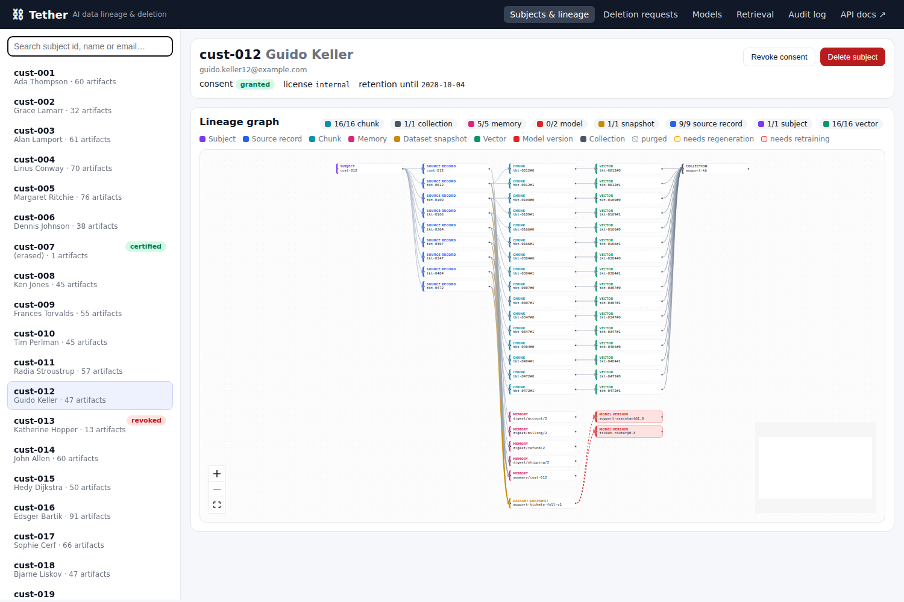
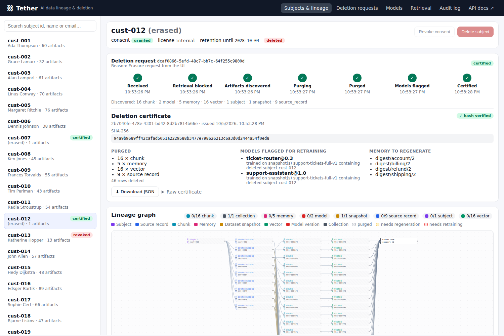
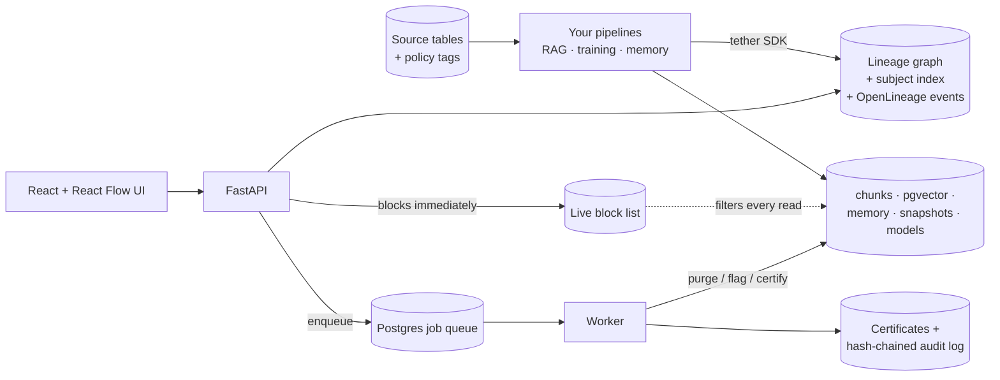

# Tether: AI data lineage & deletion tracker

> Where did this customer's data go inside our AI systems, and what do we have to purge
> or retrain to delete it?



## The problem

Companies can find a customer's rows in their databases. Once that data flows into AI
systems, though, the trail goes cold:

- It gets chunked and embedded into vector stores.
- It lands in fine-tuning datasets.
- It gets summarized into agent memory.

When a customer asks to be forgotten (GDPR Art. 17), revokes consent, or a data license
expires, nobody can say which vectors, memories and models carry that person's data.

## What Tether does

1. **Tags data at the source** with a subject id (e.g. customer id) and policy tags
   (consent, license, retention).
2. **Carries those tags through every AI transformation** with a small Python SDK.
   - A chunk inherits from its record, a vector from its chunk, and so on.
   - An artifact built from several sources gets the **union** of their subject ids and
     the **most restrictive** policy.
3. **Records every hop in a lineage graph.**
   - Node types: `Subject`, `SourceRecord`, `Chunk`, `VectorEntry`, `Collection`,
     `DatasetSnapshot`, `ModelVersion` and `MemoryEntry`.
   - Each hop is emitted as an [OpenLineage](https://openlineage.io) event with a
     custom `tether` facet.
4. **Executes deletion requests from start to finish:**
   1. Blocks retrieval immediately.
   2. Discovers every affected artifact.
   3. Purges chunks, vectors, memory and source rows.
   4. Marks multi-subject memory for regeneration.
   5. Flags exactly the models trained on affected snapshots.
   6. Issues a SHA-256-hashed **deletion certificate** and records it in an
      append-only, hash-chained audit log.



## Architecture



The full component diagram, graph model, deletion sequence diagram and guarantees are
in [`docs/architecture.md`](docs/architecture.md). Design decisions and deviations are
in [`PLAN.md`](PLAN.md).

**Stack:**

- Python 3.12, FastAPI, SQLAlchemy 2, Alembic, Pydantic v2
- PostgreSQL 16 with pgvector
- React, Vite, TypeScript and React Flow
- Docker Compose

## Run the demo

```bash
cd tether
docker compose up -d --build   # db (pgvector), api :8000, worker, ui :8080
make demo
```

`make demo` runs the whole scenario against the live stack and asserts every acceptance
criterion along the way:

1. **Seed:** 50 customers and 500 support tickets (with names, emails and phones), plus
   policy tags.
2. **Pipelines, all through the SDK:**
   - RAG: tickets → chunks → embeddings in pgvector
   - Training: two dataset snapshots and three model versions
   - Agent memory: per-customer summaries plus multi-customer digests
3. **RAG query** for customer X (`cust-007`): X's tickets come back.
4. **Deletion request:** retrieval is blocked before the API responds. A RAG query in
   the window *before the purge* already excludes X.
5. **Live status:**
   `received → retrieval_blocked → discovered → purging → purged → models_flagged → certified`
6. **Checks:**
   - Zero source rows, chunks, vectors or memory entries reference X.
   - The RAG query never returns X.
   - Exactly the models trained on snapshots containing X are flagged.
   - The shared digests are marked for regeneration.
7. **Certificate:** the SHA-256 hash verifies. The certificate is saved to
   `certificates/deletion-certificate-cust-007.json`. Check it again with
   `docker compose exec api tether verify-certificate certificates/deletion-certificate-cust-007.json`.
8. **Re-run:** the deletion request returns the same request and certificate.

Then open **http://localhost:8080**:

- Search for a subject and explore the lineage graph.
- Click **Delete subject** and watch the stepper update live.
- Download the certificate.
- Check the **Models** page for retraining flags.

API docs are at **http://localhost:8000/docs**.

### Without Docker

You need a Postgres 16 server with the `vector` extension available.

```bash
cd tether
python3.12 -m venv .venv && . .venv/bin/activate
pip install -e '.[dev]'
cp .env.example .env            # point TETHER_DATABASE_URL at your database
make local-demo                 # migrate + run the scenario in-process (no API/worker needed)

# or run the services yourself:
tether migrate && tether seed && tether pipelines
TETHER_RUN_WORKER_IN_API=true tether serve      # API + in-process worker on :8000
make ui-dev                                     # UI on :5173 (proxies /api to :8000)
```

## Integrating the SDK into an existing pipeline

Call the SDK next to your existing writes. Pass your SQLAlchemy session so lineage
commits atomically with your data. If you omit `session`, the SDK opens its own
transaction.

```python
import tether

# Optional: configure once (defaults come from TETHER_* env vars).
tether.configure(session_factory=my_sessionmaker)  # exporter=HttpExporter(marquez_url)

with my_sessionmaker.begin() as s:
    # 1. Tag the source record. With no tags, the subject's row in `policy_tags` is used.
    tether.record_source("support_tickets/tkt-0042", ["cust-007"],
                         {"consent_status": "granted", "license": "internal",
                          "retention_until": "2027-12-31"}, session=s)

    # 2. Chunk. Each ArtifactRef inherits subject ids and policy from the record.
    texts = my_chunker(ticket.body)
    chunks = tether.track_chunks("support_tickets/tkt-0042", texts, session=s)

    # 3. Embed and store. Put the subject ids next to each vector so retrieval can filter.
    vector_ids = my_vector_db.upsert(texts, metadata=[{"subject_ids": c.subject_ids} for c in chunks])
    tether.track_embeddings(chunks, "support-kb", vector_ids, session=s)

    # 4. Training: freeze a dataset, then register what you trained on it.
    snap = tether.snapshot_dataset("tickets-2026-q3", record_ids, session=s)
    tether.register_model("support-assistant", "1.2", [snap], session=s)

    # 5. Agent memory derived from records, chunks or other memories.
    tether.track_memory_write("summary/cust-007", ["support_tickets/tkt-0042", chunks[0]], session=s)
```

| SDK call | Creates | Inherits from | Edge |
|---|---|---|---|
| `record_source(record_id, subject_ids, tags)` | `SourceRecord` (+ `Subject` nodes) | the given tags or `policy_tags` (missing → `pending`) | `derived_from → Subject` |
| `track_chunks(source_record_id, chunks)` | one `Chunk` per text (deterministic ids) | source record(s) | `derived_from → SourceRecord` |
| `track_embeddings(chunk_ids, collection, vector_ids)` | `VectorEntry` per chunk + `Collection` | chunk | `derived_from → Chunk`, `stored_in → Collection` |
| `snapshot_dataset(name, record_ids)` | `DatasetSnapshot` + manifest | union of records; restricted subjects are excluded | `SourceRecord contained_in → Snapshot` |
| `register_model(name, version, snapshot_ids)` | `ModelVersion` | union of snapshots | `trained_on → Snapshot` |
| `track_memory_write(memory_id, derived_from_ids)` | `MemoryEntry` | union of any artifacts | `derived_from → *` |

**Your side of the contract:**

- **Retrieval.** Apply the live block list when you retrieve. With pgvector, use
  `tether.policy.enforcement.allowed_predicate(...)` in your similarity query (see
  `stores/vector.py`). With another vector database, add a `must_not` filter on the
  subject ids in `subject_restrictions`.
- **Deletion.** Register a purger for your store in `tether/deletion/purgers.py`
  (`PURGERS[node_type] = fn`) so deletion requests can reach it.
- **Source tables.** Register them in `tether/stores/source.py::SOURCE_TABLES` (an
  allow-list) so source rows can be purged.

## API

| Method & path | Purpose |
|---|---|
| `GET /subjects?q=` | Search subjects (id, name, email) |
| `GET /subjects/{id}/lineage` | Full graph of everything that touched the subject (tombstones included) |
| `GET /subjects/{id}/artifacts` | Flat list grouped by artifact type |
| `POST /subjects/{id}/consent` | Partial update of consent, license or retention. Revoking blocks retrieval immediately |
| `POST /subjects/{id}/deletion-requests` | Start a deletion (`202`); idempotent (`200` + existing request and certificate) |
| `GET /deletion-requests/{id}` | Status, history, inventory, purge results, flags, error |
| `POST /deletion-requests/{id}/retry` | Re-queue a failed request |
| `GET /deletion-requests/{id}/certificate[?download=true]` | Certificate, SHA-256 and `verified` flag (`409` until certified) |
| `GET /models` | Model versions with `needs_retraining` and reasons |
| `GET /audit-log` | Entries plus hash-chain verification |
| `POST /rag/query` | Policy-enforced similarity search |
| `GET /memory?subject_id=` / `POST /memory/regenerate` | Filtered memory reads; rebuild flagged digests |

## Development

```bash
make lint typecheck   # ruff + mypy --strict (clean)
make test             # pytest, needs Postgres+pgvector at TETHER_TEST_DATABASE_URL
make test-docker      # the same suite inside the api container
```

**What the tests cover:**

- `test_policy_tags.py`: the most-restrictive-policy rule
- `test_sdk_propagation.py`: propagation, the subject index, OpenLineage events and
  discovery
- `test_pipelines.py`: the demo pipelines
- `test_retrieval_filter.py`: the immediate retrieval and memory block, plus the
  retention and consent filters
- `test_deletion_e2e.py`: the full workflow (including the pre-purge window), exact
  model flags, multi-subject memory, certificate verification and tamper detection,
  idempotent re-runs, failure and retry resumption, worker backoff, and the
  append-only audit log
- `test_api.py`: the HTTP layer

**Configuration:**

- All settings are `TETHER_*` environment variables; see [`.env.example`](.env.example).
- Embedder:
  - `TETHER_EMBEDDER=fake` (default) is deterministic and offline.
  - `TETHER_EMBEDDER=sentence-transformers` needs
    `pip install '.[sentence-transformers]'`. Its default model,
    `all-MiniLM-L6-v2`, is 384-d, which matches the schema.

## Project layout

```
tether/
  src/tether/
    sdk/          public SDK (record_source, track_chunks, ...)
    lineage/      typed ids, graph store, queries, OpenLineage events/exporters
    policy/       PolicyTags + most-restrictive merge, consent, retrieval enforcement
    stores/       source-table registry, chunk / pgvector / memory stores
    embeddings/   Embedder protocol, FakeEmbedder, SentenceTransformerEmbedder
    pipelines/    seed, RAG, training snapshot, agent memory
    deletion/     state machine, purgers, certificate, job queue, worker, verifier
    api/          FastAPI app, schemas, thin routers
    audit.py      hash-chained audit log
    cli.py        tether migrate|seed|pipelines|serve|worker|demo|reset|verify-certificate
  migrations/     Alembic (includes the append-only trigger)
  tests/
  ui/             React + Vite + TS + @xyflow/react
```

## Non-goals and extension points

- **No real training or machine unlearning.** Models are flagged for retraining.
- **No authentication or multi-tenancy yet.** `api/deps.py::get_principal` is the hook.
- **One storage backend.** Postgres and pgvector only. Other backends plug in through
  the `VectorStore` protocol, the purger registry and `SOURCE_TABLES`.
- **Not production-scaled.** Vector search is exact, so filtering is always correct.
  For ANN at scale, use pgvector ≥ 0.8 iterative scans.

## License

Apache-2.0. See [LICENSE](LICENSE) and [CONTRIBUTING.md](CONTRIBUTING.md).
