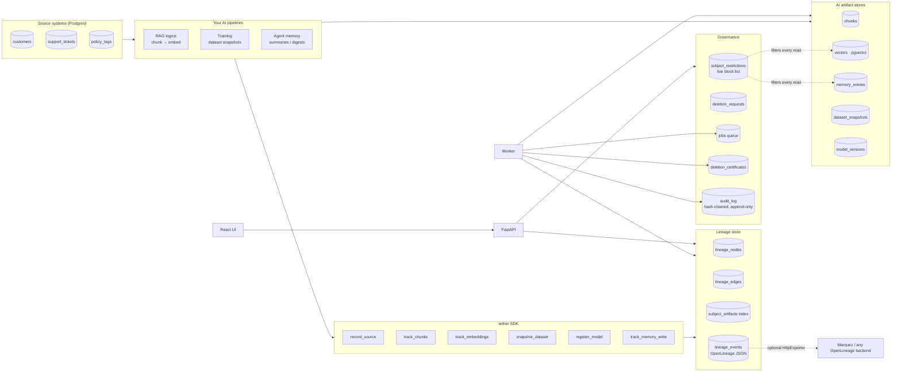
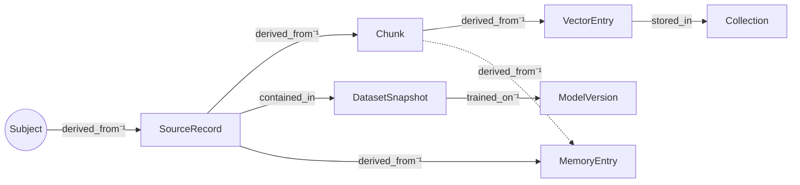
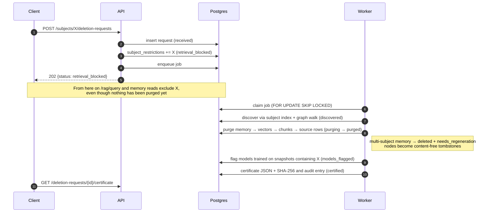

# Tether architecture

## Components

Everything lives in a single Postgres 16 database with pgvector in the MVP. The
`VectorStore` protocol and the purger registry are the seams where other backends
(Qdrant, Snowflake, S3, ...) plug in.

## Lineage graph model

Edges are stored child → parent for `derived_from` and `trained_on`, so the diagram
shows them inverted (⁻¹) to read downstream. `contained_in` is stored record →
snapshot and `stored_in` is stored vector → collection.

**Granularity:**

- Chunks, vectors and memory are tracked per record: every artifact is a node with
  its own subject ids.
- Training is tracked per snapshot. The snapshot manifest lists each member record and
  its subjects, but a model version links only to snapshots.

**Propagation:**

- Each node stores `subject_ids`, the union over its parents.
- Each node stores `policy`, the most restrictive combination of its parents' policies:
  - consent: `revoked > pending > granted`
  - license: `restricted > confidential > internal > public`, and an unknown license
    counts as `restricted`
  - retention: the earliest date wins
- Every write also updates the `subject_artifacts` index. "Everything for subject X" is
  one indexed lookup, plus a recursive CTE walk as a cross-check.

## Deletion workflow

**Guarantees:**

- **Immediate block.** The block list is applied inside the vector similarity query
  (before `LIMIT`) and inside memory reads, in the same SQL statement. It is written
  and committed before the API responds.
- **Idempotency.**
  - `deletion_requests.subject_id` is unique, so re-submitting returns the existing
    request and certificate.
  - Every step is safe to re-run: purges of missing rows delete 0 rows, and flags and
    restrictions are upserts.
  - The certificate is unique per request.
- **Failure handling.**
  - A failing step moves the request to `failed` with `error.failed_in_status`.
  - The job is retried with exponential backoff. Calling `POST` again or `/retry`
    re-queues it, and processing resumes at the failed step.
  - Retrieval stays blocked throughout.
- **Evidence.**
  - Every state change is logged and appended to the hash-chained audit log.
  - A database trigger rejects `UPDATE`, `DELETE` and `TRUNCATE` on that table.
  - The certificate hash is SHA-256 over canonical JSON (sorted keys, compact
    separators).

## What is (deliberately) not deleted

- **Dataset snapshot manifests.** They are immutable training history. The models
  trained on them are flagged `needs_retraining` instead.
- **Lineage tombstones.** They keep only the pseudonymous subject id and structural
  attributes; content hashes are stripped.
- **`subject_restrictions` row with reason `deleted`.** It acts as a suppression list,
  so pipelines never re-ingest the subject.
